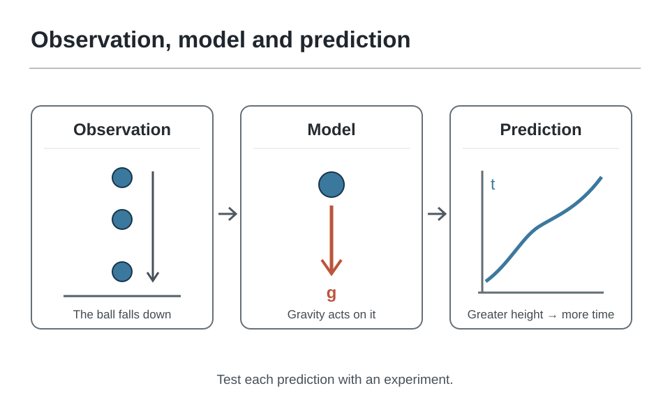

# M1-L1 – What is physics? Observation, explanation and models {#L1}

**Course area:** M1 – Understanding and investigating physics

**Level:** Lower secondary education – introduction

**Prior knowledge:** Everyday observations; no physics equations are required.

**Learning objective:** Distinguish observation, question, hypothesis, model and testable prediction in an example.

## Introduction {#S1}

A soft ball is released from a small height. It moves towards the ground. Why? The statement “The ball moves downwards” describes **what we observe**. “The Earth attracts the ball” attempts a **physical explanation**. The distinction matters: explanations must hold up against observations and experiments.

Physics investigates natural and technological processes. It combines careful observation, measurement, testable ideas and models. A model is not a complete copy of the real world; it is a simplified description designed to answer a specific question.

## Observing, explaining and predicting {#S2}

1. **Observation:** A released ball speeds up as it falls. This can be checked using a sequence of video frames.
2. **Question:** Does the falling time change when the release height increases?
3. **Hypothesis:** Under otherwise identical conditions, a ball takes longer to fall from a greater height.
4. **Model:** A simple model represents the ball as a point acted on by Earth's gravitational attraction. Air resistance is ignored at first.
5. **Prediction:** With all other conditions equal, the greater distance should lead to a longer falling time.
6. **Test:** Compare several drops from different heights using a suitable timing method. Measurements may support or contradict the hypothesis.

Important: One measurement does not conclusively prove a general statement. Measurement errors, uncontrolled influences and limitations of the model must be considered.

*Observation, model and prediction are different parts of a physics investigation.*

## Worked example: two release heights {#S3}

Keep the ball, surface and measurement method unchanged while comparing release heights of $0.4\,\mathrm{m}$ and $0.8\,\mathrm{m}$. First predict: “The fall from $0.8\,\mathrm{m}$ takes longer.” Next record several drops on video rather than attempting to time such short intervals manually with a stopwatch.

**What changes?** Release height. **What is measured?** Time until the first contact with the ground. **What stays the same?** Ball, release without a push and measurement method. Record the data in a table before deciding whether they support the prediction.

This experiment tests behaviour only in this setup. It does not automatically answer what happens with strong air resistance or on another celestial body.

## Check your understanding {#S4}

### Questions

1. Classify: A “The ball hits the ground”; B “The Earth exerts an attractive force”; C “A greater release height leads to a longer fall.” Label each as an **observation**, **explanation** or **testable prediction**.
2. A team changes both ball type and release height at the same time. Why does that make their investigation harder?
3. A model ignores air resistance. Give an example of an object for which that could be especially problematic.

### Answers

1. A is the observation, B the explanation, C the prediction. C must be tested.
2. Two factors change together; a change in fall time cannot clearly be attributed to either one.
3. A flat sheet of paper, for example, is strongly affected by air resistance.

## Assumptions and limits {#S5}

Representing a ball as a point neglects its shape and rotation. Neglecting air resistance is only justified within a simplified model. Limit drops to small, safe heights above a soft, clear surface; avoid heavy or fragile objects. Repeat measurements.

## Summary and next steps {#S6}

Physics develops knowledge by moving between observations, hypotheses, models and tests. Predictions must be formulated so they can be assessed through observation. The next lesson introduces quantities and units for reporting measurements unambiguously.

**Continue:** [Physical quantities, units and SI prefixes](M1-L2.md)

## Sources {#S7}

- [German Standing Conference of Education Ministers (KMK) – Updated educational standards for physics, intermediate school-leaving certificate (2024)](https://www.kmk.org/fileadmin/Dateien/veroeffentlichungen_beschluesse/2024/2024_06_13-WeBiS_Physik_MSA.pdf) – Scientific inquiry section, pp. 9–10, especially E1–E3; basis for hypotheses, model testing and experiments. **Last checked:** 2026-11-21.
