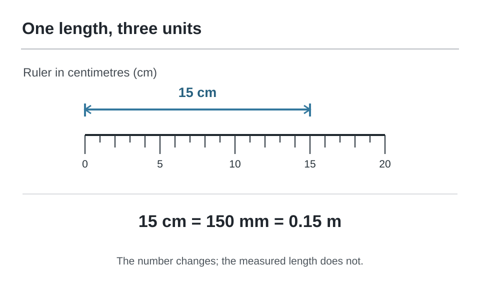

# M1-L2 – Physical quantities, units and SI prefixes {#L2}

**Course area:** M1 – Understanding and investigating physics

**Level:** Lower secondary education – introduction

**Prior knowledge:** Observations and measurement questions from [M1-L1](M1-L1.md).

**Learning objective:** Express measurement values using a number and an SI unit, use consistent units and convert kilo-, centi- and milli- correctly.

## Introduction {#S1}

“The table is 120 long” leaves out a crucial detail. Does 120 mean millimetres, centimetres or metres? A complete measurement consists of a **numerical value** and a **unit**: $l=120\,\mathrm{cm}=1.20\,\mathrm{m}$. Here $l$ represents length.

## Quantities and units {#S2}

A physical **quantity** is something measurable, such as length $l$, time $t$ or mass $m$. A quantity value includes both a number and a unit. Common SI base units include:

| Quantity | Symbol | SI unit | Symbol |
|---|---|---|---|
| Length | $l$ | metre | $\mathrm{m}$ |
| Time | $t$ | second | $\mathrm{s}$ |
| Mass | $m$ | kilogram | $\mathrm{kg}$ |
| Temperature | $T$ | kelvin | $\mathrm{K}$ |

**Note:** The SI base unit of mass is the *kilogram*, not the gram. The gram is a common submultiple: $1\,\mathrm{kg}=1000\,\mathrm{g}$. Speed is a derived quantity measured in $\mathrm{m/s}$.

Prefixes change the scale, not the type of quantity:

| Prefix | Symbol | Factor | Example |
|---|---|---|---|
| kilo | k | $10^{3}$ | $1\,\mathrm{km}=1000\,\mathrm{m}$ |
| centi | c | $10^{-2}$ | $1\,\mathrm{cm}=0.01\,\mathrm{m}$ |
| milli | m | $10^{-3}$ | $1\,\mathrm{mm}=0.001\,\mathrm{m}$ |

Prefix and unit symbols are joined without a space: `cm`, `mm`, `km`. Leave a space between the number and the unit: `15 cm`. Unit symbols are case-sensitive: `m` means metre, while uppercase `M` as a prefix means mega.

*A length of 15 cm can also be written as 150 mm or 0.15 m.*

## Worked example {#S3}

**Length:** A distance is $350\,\mathrm{mm}$. Since $1\,\mathrm{mm}=0.001\,\mathrm{m}$:

$$350\,\mathrm{mm}=350\cdot0.001\,\mathrm{m}=0.350\,\mathrm{m}.$$

**Time:** $1.5\,\mathrm{min}=1.5\cdot60\,\mathrm{s}=90\,\mathrm{s}$. The minute is not an SI base unit, but it is commonly used.

**Area:** When squaring a length, square its conversion factor too. Thus $1\,\mathrm{m^2}=(100\,\mathrm{cm})^2=10\,000\,\mathrm{cm^2}$. Do not convert areas using the linear factor alone.

## Check your understanding {#S4}

### Questions

1. Convert $2.5\,\mathrm{km}$ to metres and $24\,\mathrm{cm}$ to metres.
2. An experiment lasts $2\,\mathrm{min}\,30\,\mathrm{s}$. Express this time entirely in seconds.
3. Are $5\,\mathrm{m}$ and $500\,\mathrm{cm}$ equal? Show one conversion step.
4. Why is $1\,\mathrm{m^2}$ not equal to $100\,\mathrm{cm^2}$?

### Answers

1. $2.5\,\mathrm{km}=2500\,\mathrm{m}$; $24\,\mathrm{cm}=0.24\,\mathrm{m}$.
2. $2\cdot60\,\mathrm{s}+30\,\mathrm{s}=150\,\mathrm{s}$.
3. Yes. $500\,\mathrm{cm}=500\cdot0.01\,\mathrm{m}=5\,\mathrm{m}$.
4. Both dimensions are converted when a unit is squared: $100\cdot100=10\,000$.

## Assumptions and limits {#S5}

Correct units do not guarantee sufficient measurement accuracy. Writing $0.350\,\mathrm{m}$ implies a different stated precision from $0.35\,\mathrm{m}$; whether the extra digit is justified depends on the measuring instrument. Prefixes express powers of ten, not measurement uncertainty.

## Summary and next steps {#S6}

In physics, a measurement without a unit is usually incomplete. Check unit consistency before calculating. The next topic is evaluating repeated measurements and their uncertainty.

**Continue:** [M1-L3 – Measurements, repeated measurements and uncertainty](M1-L3.md)

## Sources {#S7}

- [German Standing Conference of Education Ministers (KMK) – Updated educational standards for physics, intermediate school-leaving certificate (2024)](https://www.kmk.org/fileadmin/Dateien/veroeffentlichungen_beschluesse/2024/2024_06_13-WeBiS_Physik_MSA.pdf) – Subject knowledge, communication and scientific inquiry sections (pp. 6–11); curriculum context for physical quantities, units, measurements and data presentation. **Last checked:** 2026-11-21.
