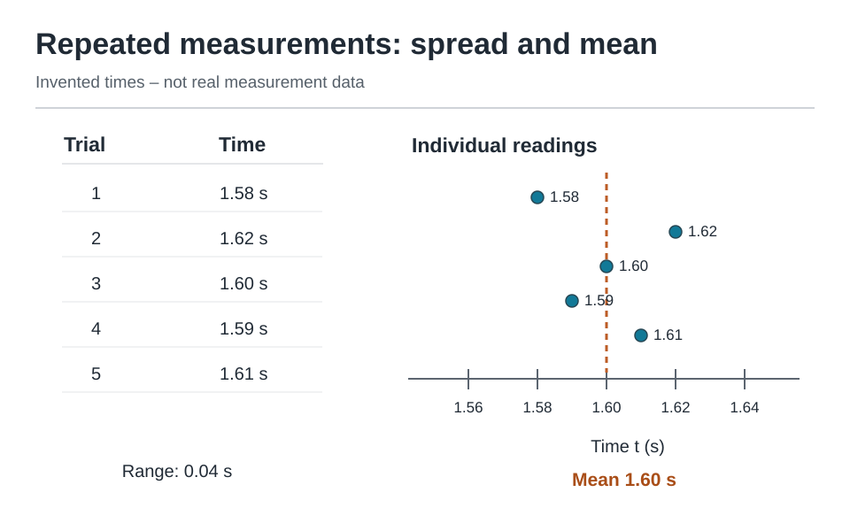

# M1-L3 – Measurements, repeated measurements and uncertainty {#L3}

**Course area:** M1 – Understanding and investigating physics. **Level:** Lower secondary education. **Prior knowledge:** [M1-L2](M1-L2.md). **Learning objective:** Calculate the mean and range of a measurement series and distinguish random variation from systematic influences.

## Introduction {#S1}

Repeating a short measurement five times often produces slightly different values. Differences may come from the operator, the instrument or changing conditions. A series makes the variation visible, but it cannot replace a description of the measurement procedure.

## Repeated measurements and analysis {#S2}

The following are **invented practice values**, not recorded experimental data.

| Trial | 1 | 2 | 3 | 4 | 5 |
|---|---:|---:|---:|---:|---:|
| Time $t$ in s | 1.58 | 1.62 | 1.60 | 1.59 | 1.61 |

The arithmetic mean is the sum of the readings divided by their number:

$$\bar t=\frac{1.58+1.62+1.60+1.59+1.61}{5}\,\mathrm{s}=1.60\,\mathrm{s}.$$

The **range** is $1.62\,\mathrm{s}-1.58\,\mathrm{s}=0.04\,\mathrm{s}$. It is the difference between the largest and smallest observed readings and **must not be confused with the complete measurement uncertainty**. An uncertainty assessment also needs the instrument resolution, calibration and other influences.

A random effect may move individual readings in either direction. A systematic influence, such as a stopwatch that always shows $0.10\,\mathrm{s}$ too much, shifts the whole series together. Taking an average does not remove that constant offset. The offset is a thought experiment, not a documented fault.

*Invented example data with mean 1.60 s and range 0.04 s.*

## Worked example {#S3}

A team records $2.0\,\mathrm{s}$, $2.2\,\mathrm{s}$ and $2.1\,\mathrm{s}$. Thus $\bar t=(2.0+2.2+2.1)\,\mathrm{s}/3=2.1\,\mathrm{s}$. The range is $0.2\,\mathrm{s}$. These figures describe the readings; they do not establish accuracy relative to a reference value.

A measurement report needs units, instrument, setup, individual readings, conditions and any irregularities. The final digit displayed by a device does not automatically indicate the accuracy of the entire experiment.

## Check your understanding {#S4}

### Questions

1. Find the mean of $3.1$, $3.2$ and $3.3\,\mathrm{s}$.
2. Find the range of the five times in S2.
3. A clock always runs 5% fast. Is this random or systematic?
4. Why is half the range not a complete uncertainty assessment?

### Answers

1. $(3.1+3.2+3.3)/3\,\mathrm{s}=3.2\,\mathrm{s}$.
2. $0.04\,\mathrm{s}$.
3. Systematic; simply repeating the test will not remove it.
4. The range does not separately address calibration, resolution or other sources of error.

## Assumptions and limits {#S5}

An average summarises readings taken under comparable conditions. It may be misleading if conditions change during the trials. Statistical standard uncertainty requires a more rigorous method and is a topic for later study.

## Summary and next steps {#S6}

Repeated readings reveal variation. Comparisons also require controlled conditions, which are the topic of [M1-L4](M1-L4.md).

## Sources {#S7}

- [KMK – Educational standards in physics for the intermediate school-leaving certificate (2024)](https://www.kmk.org/fileadmin/Dateien/veroeffentlichungen_beschluesse/2024/2024_06_13-WeBiS_Physik_MSA.pdf) · pp. 8–11, scientific methods and inquiry · Last accessed: 2026-11-21 · Content verified: 2026-11-21
- [JCGM – Guide to the Expression of Uncertainty in Measurement (2008)](https://www.bipm.org/documents/20126/2071204/JCGM_100_2008_E.pdf) · section 4.2, means and variation (advanced reference) · Last accessed: 2026-11-21 · Content verified: 2026-11-21
