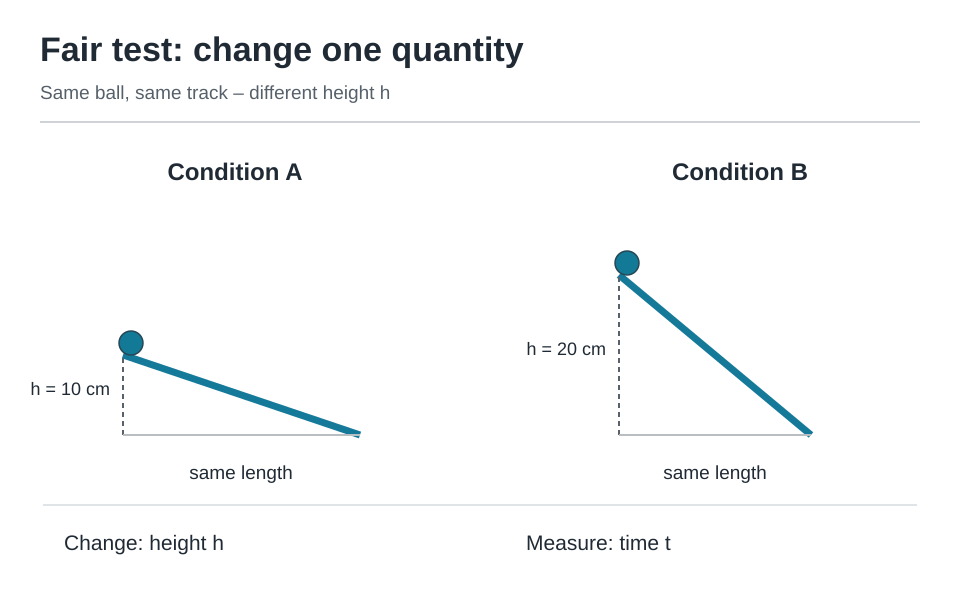

# M1-L4 – Hypotheses, variables and fair experiments {#L4}

**Course area:** M1 – Understanding and investigating physics. **Level:** Lower secondary education. **Prior knowledge:** [M1-L3](M1-L3.md). **Learning objective:** Formulate a testable hypothesis, identify independent, dependent and controlled variables, and plan a safe comparative experiment.

## Introduction {#S1}

A small ball rolls down a sloping track. Will it reach the end sooner if the track is steeper? We can test the idea, but only when the conditions can be compared meaningfully.

## Hypothesis and variables {#S2}

**Question:** How does the starting height $h$ affect the rolling time $t$?

**Hypothesis:** With the same track and ball, a greater starting height reduces the rolling time. This is testable, but not yet an observed result.

| Role | Quantity | Procedure |
|---|---|---|
| **Independent** | Starting height $h$ | deliberately change it, for example between 10 cm and 20 cm |
| **Dependent** | Rolling time $t$ | measure it on every run |
| **Controlled** | Ball, track length, release point, timing method | keep as constant as possible |

Both heights are example settings for a **planned** experiment, not documented results. Use one fixed track mounted securely at two different inclines using a low, stable support. Release the ball without pushing it, always from the same position along the track. Record several trials per setting.

**Original teaching graphic:** Two schematic tracks of equal length distinguish the varied height from controlled quantities. The drawing does not claim experimental results.

*Design: deliberately vary starting height and measure rolling time repeatedly.*

## Example: Improving an ambiguous experiment {#S3}

A team first uses a short wooden track and a metal ball, then a longer plastic track and a different ball. They attribute the observed times to height alone. This is **not a fair comparison**: length, track material and ball also changed.

**Better plan:** Deliberately change only the height. Keep the other named factors constant. Tabulate the times and consider the variation described in [M1-L3](M1-L3.md). The lower starting height can serve as a **reference condition**.

## Check your understanding {#S4}

### Questions

1. The slope of a toy ramp is changed, and the time to reach the bottom is measured. Name the independent and dependent quantities.
2. Name three conditions to keep constant.
3. A team pushes the ball at the start of its second trial. What is wrong with the comparison?
4. Write a testable prediction for the two starting heights.

### Answers

1. Independent: slope or starting height; dependent: rolling time.
2. For example the ball, track length, release point and timing method.
3. Initial velocity changed as well as height, so the cause of any difference is ambiguous.
4. For example: “At the greater starting height the average rolling time is shorter, with other conditions held constant.”

## Assumptions and limits {#S5}

A comparison cannot remove every possible disturbing influence. The track must be set up so that its length and the release point along it remain identical in both configurations. Safety comes first: use a lightweight ball, a low height, stable supports, a clear catching area and teacher instruction. Never build an unsecured structure above people or on unstable furniture.

## Summary and next steps {#S6}

A fair comparison changes as few relevant factors as possible, ideally only the one being tested. [M1-L5](M1-L5.md) shows how to summarise results in tables and graphs.

## Sources {#S7}

- [KMK – Educational standards in physics for the intermediate school-leaving certificate (2024)](https://www.kmk.org/fileadmin/Dateien/veroeffentlichungen_beschluesse/2024/2024_06_13-WeBiS_Physik_MSA.pdf) · pp. 8–11, scientific methods and inquiry · Last accessed: 2026-11-21 · Content verified: 2026-11-21
- [IQB – Physics proficiency-level models](https://www.iqb.hu-berlin.de/media/documents/KSM_Physik.pdf) · pp. 44–48, variable control, graphs and model limitations · Last accessed: 2026-11-21 · Content verified: 2026-11-21
- [DGUV – Safe practical work in physics](https://www.sichere-schule.de/physik/praktisches-arbeiten/anforderungen-intro) · safety, experiment instructions and apparatus · Last accessed: 2026-11-21 · Content verified: 2026-11-21
