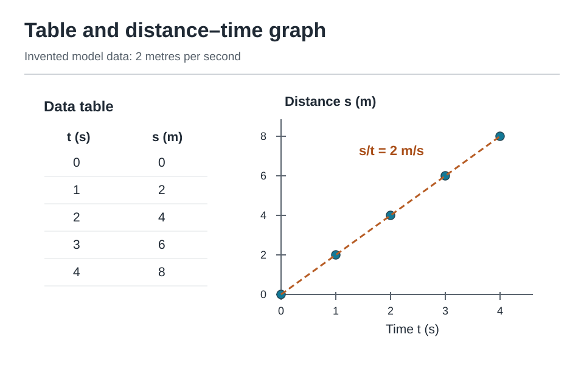

# M1-L5 – Tables, graphs and proportionality {#L5}

**Course area:** M1 – Understanding and investigating physics. **Level:** Lower secondary education. **Prior knowledge:** [M1-L4](M1-L4.md). **Learning objective:** Plot data on labelled axes and identify direct proportionality from a constant ratio and a straight line through the origin.

## Introduction {#S1}

A table contains individual pairs of values. A graph helps us see how one quantity changes with another. We need sensible scales and clear axis labels containing both **quantity and unit**.

## Data tables and proportionality {#S2}

These are **invented, ideally proportional model values**, not experimental measurements. In the model, an object travels two metres every second.

| Time $t$ in s | 0 | 1 | 2 | 3 | 4 |
|---|---:|---:|---:|---:|---:|
| Distance $s$ in m | 0 | 2 | 4 | 6 | 8 |

The independent quantity $t$ belongs on the horizontal x-axis and distance $s$ on the vertical y-axis. Each point gives a pair $(t,s)$. For these values, the points lie on a straight line through the origin.

Two quantities are **directly proportional** if $s=k\,t$ for a constant factor $k$. For $t>0$ we obtain:

$$k=\frac{s}{t}=\frac{6\,\mathrm{m}}{3\,\mathrm{s}}=2\,\mathrm{m/s}.$$

This is the **gradient** of the model line. At the origin the ratio $s/t=0/0$ is undefined. That does not invalidate the proportional relationship; we evaluate the ratio at positive times.

**Original teaching graphic:** The bilingual SVG draft combines a data table, labelled axes, plotted points and a model line.

*Idealised model: s = (2 m/s) · t, values are not real measurements.*

## Worked example {#S3}

At $t=2.5\,\mathrm{s}$, the model gives $s=2\,\mathrm{m/s}\cdot2.5\,\mathrm{s}=5\,\mathrm{m}$. As this is between known values, it is an **interpolation**. A prediction of $s=16\,\mathrm{m}$ at $t=8\,\mathrm{s}$ would be an **extrapolation** beyond the range considered. Constant speed would have to be checked there.

An upward straight line is not necessarily directly proportional: it must pass through $(0,0)$. Real measurements may vary around a line. A graph alone does not prove cause and effect.

## Check your understanding {#S4}

### Questions

1. Find $s$ at $t=3.5\,\mathrm{s}$ in the model.
2. Calculate $k$ from $t=4\,\mathrm{s}$ and $s=8\,\mathrm{m}$, with a unit.
3. Points $(1,3)$, $(2,5)$ and $(3,7)$ lie on a line that misses the origin. Are the quantities directly proportional?
4. Distinguish interpolation from extrapolation.

### Answers

1. $s=7\,\mathrm{m}$.
2. $k=8\,\mathrm{m}/4\,\mathrm{s}=2\,\mathrm{m/s}$.
3. No; the ratio is not constant and the line misses the origin.
4. Interpolation is inside, extrapolation is outside the data range under consideration.

## Assumptions and limits {#S5}

The example assumes constant speed and suitably chosen zero points for distance and time. This simple model is insufficient when the body accelerates or changes direction. Real measurements additionally require sensible scales and discussion of variation.

## Summary and next steps {#S6}

A useful graph gives axes, units and the relevant data range. [M1-L6](M1-L6.md) examines the assumptions and limits of physical models.

## Sources {#S7}

- [KMK – Educational standards in physics for the intermediate school-leaving certificate (2024)](https://www.kmk.org/fileadmin/Dateien/veroeffentlichungen_beschluesse/2024/2024_06_13-WeBiS_Physik_MSA.pdf) · pp. 8–11, scientific methods and inquiry · Last accessed: 2026-11-21 · Content verified: 2026-11-21
- [IQB – Physics proficiency-level models](https://www.iqb.hu-berlin.de/media/documents/KSM_Physik.pdf) · pp. 44–48, variable control, graphs and model limitations · Last accessed: 2026-11-21 · Content verified: 2026-11-21
