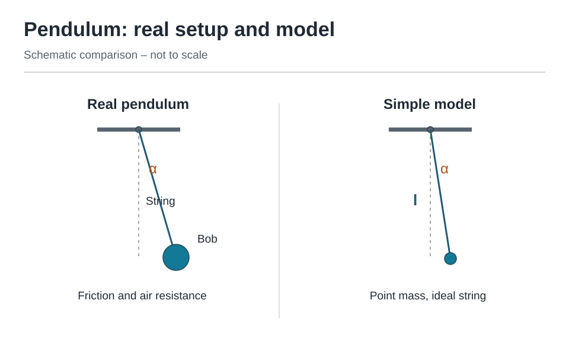

# M1-L6 – Models, ranges of validity and safe experiments {#L6}

**Course area:** M1 – Understanding and investigating physics. **Level:** Lower secondary education. **Prior knowledge:** [M1-L4](M1-L4.md) and [M1-L5](M1-L5.md). **Learning objective:** Identify the assumptions of a simple pendulum model, explain its limits and plan a safe experiment to test it.

## Introduction {#S1}

A small object suspended from a string swings back and forth after being displaced. To describe the motion, we often draw a point on an ideal string. This is not an exact copy of the equipment but a deliberately simplified **model**.

## From experiment to model {#S2}

A real pendulum has a bob with physical size, a string with mass and a pivot with friction. The **simple pendulum model** treats the bob as a point mass and the string as massless and inextensible. Friction and air resistance are initially ignored.

| Feature | Real system | Simple model |
|---|---|---|
| Bob | has size and shape | point mass |
| String | has mass and may stretch | massless and of fixed length |
| Losses | friction and air drag | initially neglected |
| Validity | check for each apparatus | especially useful for small angles and low losses |

Length $l$ is measured from the pivot to the centre of mass of the bob. The **period** $T$ is the time for a complete back-and-forth oscillation, returning to the same state of motion.

**Original teaching graphic:** An SVG drawing compares the real setup with an idealised model; it is not to scale. Both language versions are included.

*Real setup and simplified pendulum model have different assumptions; not to scale.*

## Worked example {#S3}

Suppose **invented exercise readings** give $20.4\,\mathrm{s}$ for ten full oscillations. Then:

$$T=\frac{t_{10}}{10}=\frac{20.4\,\mathrm{s}}{10}=2.04\,\mathrm{s}.$$

**Optional extension:** For small displacement angles, the idealised approximation is $T\approx 2\pi\sqrt{l/g}$. It shows the influence of string length $l$ and gravitational acceleration $g$ in the model. The approximation becomes less accurate for large angles. Air drag, pivot friction and real string properties may also cause discrepancies. A derivation of the formula is not required at this introductory stage.

For a safe comparison, use a low, stable arrangement, a light bob, a clear swing path and a small angle. Release without pushing. A teacher should check the apparatus and its risks beforehand; nobody should stand in the swing path.

## Check your understanding {#S4}

### Questions

1. Name two differences between a real pendulum and the simplified model.
2. Twelve full oscillations take $24.0\,\mathrm{s}$. Find $T$.
3. Why is the small-angle approximation not valid for arbitrarily large displacements?
4. Give two safety precautions for a pendulum experiment.

### Answers

1. For example, a real bob has size and the string has mass; the model uses a point mass and massless string.
2. $T=24.0\,\mathrm{s}/12=2.0\,\mathrm{s}$.
3. The formula relies on a small-angle approximation whose discrepancy grows at larger angles.
4. Use a low stable support, light bob, unobstructed swing path and teacher supervision.

## Assumptions and limits {#S5}

A model is useful only when it fits the question. It can predict small-angle behaviour well but must be reassessed under other conditions. The drawing is not independent construction guidance; school experiments must follow local safety rules and the teacher's risk assessment.

## Summary and next steps {#S6}

Models reduce complexity, make testable predictions and have limits. This completes the methods module. The next module starts with [M2-L1 – Light sources, propagation and shadows](M2-L1.md).

## Sources {#S7}

- [KMK – Educational standards in physics for the intermediate school-leaving certificate (2024)](https://www.kmk.org/fileadmin/Dateien/veroeffentlichungen_beschluesse/2024/2024_06_13-WeBiS_Physik_MSA.pdf) · pp. 8–11, scientific methods and inquiry · Last accessed: 2026-11-21 · Content verified: 2026-11-21
- [IQB – Physics proficiency-level models](https://www.iqb.hu-berlin.de/media/documents/KSM_Physik.pdf) · pp. 44–48, variable control, graphs and model limitations · Last accessed: 2026-11-21 · Content verified: 2026-11-21
- [DGUV – Safe practical work in physics](https://www.sichere-schule.de/physik/praktisches-arbeiten/anforderungen-intro) · safety, experiment instructions and apparatus · Last accessed: 2026-11-21 · Content verified: 2026-11-21
- [DGUV – Risk assessments in physics](https://www.sichere-schule.de/physik/organisation-und-verantwortung/gefaehrdungsbeurteilung) · teacher responsibility and protective measures · Last accessed: 2026-11-21 · Content verified: 2026-11-21
