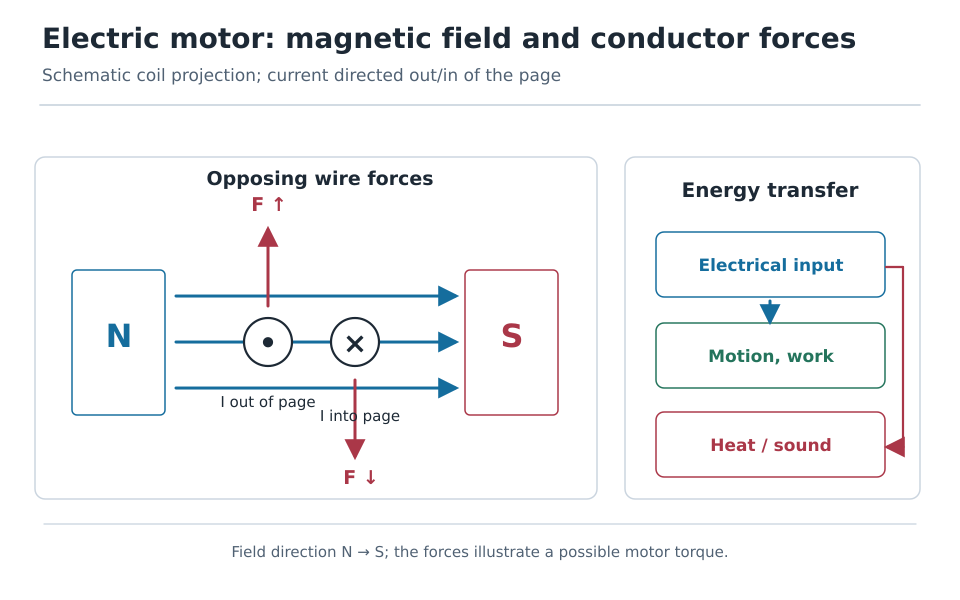

# M10-L1 – Electromagnets and electric motors {#L1}

**Course area:** M10 – Electromagnetism and electricity supply. **Level:** Lower secondary education. **Prior knowledge:** [M9-L7](M9-L7.md). **Learning objective:** Explain how a magnetic field acts on a current-carrying wire and trace energy transfer in a basic electric motor.

## Starting question {#S1}

Why does a battery-powered model motor spin, whereas a coil with no current does not keep speeding up?

## Physical concepts and model {#S2}

An **electromagnet** is produced when current flows through a coil. Its magnetic field depends on the direction of current. A soft-iron core can strengthen its magnetic effect. Switching off the current largely removes the field generated by the coil, although some materials can retain magnetisation.

A **current-carrying conductor in an external magnetic field** may experience a force. In a suitable arrangement, the force is perpendicular to the current direction and the magnetic field. On opposite sides of a rotating coil, forces may act in opposite directions and together produce a **turning effect (torque)**. As an extension, for a straight wire perpendicular to a uniform field the force magnitude is $F=B\,I\,l$, where $B$ is magnetic flux density in tesla, $I$ is current, and $l$ the effective wire length.

A simple DC motor uses a **commutator** to reverse current in the rotor coil after each half-turn, allowing the driving torque to keep approximately the same direction through most of the cycle. Other motor designs use electronic commutation or alternating current. Input electrical energy becomes useful mechanical energy, with some transfer into internal energy and sound.

**Original teaching graphic:** Two opposing forces acting on wire segments in a magnetic field, together with an electrical-input-to-rotation-and-losses energy chain. This is not a buildable wiring diagram.

*Forces on opposite coil segments can cause rotation; electric motors convert electrical energy to mechanical motion.*

## Worked example or application {#S3}

Consider a constructed example: $B=0.20\,\mathrm T$, $I=0.50\,\mathrm A$ and $l=0.10\,\mathrm m$ for a straight wire perpendicular to the field. The magnitude is

$$F=BIl=0.20\cdot0.50\cdot0.10\,\mathrm N=0.010\,\mathrm N.$$

This force alone does not specify the torque of a real motor. The lever arm, number of active wire segments, rotor orientation and field distribution would also matter.

## Safe observation and experiment {#S4}

**Safe demonstration:** Under teacher supervision, use a ready-made classroom extra-low-voltage motor to observe the direction of rotation with permitted supply polarity. Disconnect the supply before changing connections, avoid stalling the motor, use current limiting, and follow the equipment ratings. Alternatively, predict the motion of the model loop from the diagram.

## Check your learning {#S5}

### Questions

1. Why can a current-carrying coil behave as an electromagnet?
2. What useful energy output does an electric motor mainly provide?
3. Find F for B = 0.30 T, I = 0.40 A and l = 0.20 m at right angles.
4. Why does a basic DC motor need appropriate current reversal?

### Answers

1. Electric current creates a magnetic field; a coil concentrates the magnetic effect.
2. Mechanical motion or useful mechanical work.
3. F = 0.30 × 0.40 × 0.20 N = 0.024 N.
4. To prevent the driving torque from reversing its sustained direction after the next half-turn.

## Limits and transition {#S6}

The stated F = BIl formula assumes a perpendicular wire in a nearly uniform field. Real motors have feedback and counter-voltage. Motors and generators use related magnetic interactions but opposite useful directions of energy conversion.

**Next lesson:** [M10-L2](M10-L2.md)

## Sources {#S7}

- [Berlin-Brandenburg Education Server – Physics: topics and content](https://bildungsserver.berlin-brandenburg.de/rlp-online/c-faecher/physik/themen-und-inhalte) · Curriculum content on electromagnetism, induction, and technological energy transfer · Last accessed: 2026-11-21 · Content verified: 2026-11-21
- [LEIFIphysik – Electric motor](https://www.leifiphysik.de/elektrizitaetslehre/kraft-auf-stromleiter-e-motor/grundwissen/elektromotor) · Magnetic action on the rotor and the function of commutation · Last accessed: 2026-11-21 · Content verified: 2026-11-21
- [LEIFIphysik – Generator and motor principles](https://www.leifiphysik.de/elektrizitaetslehre/induktion-und-transformator/grundwissen/generator-und-motorprinzip) · Comparison of motor and generator energy conversion · Last accessed: 2026-11-21 · Content verified: 2026-11-21
- [DGUV Safe School – Electricity experiments](https://www.sichere-schule.de/physik/praktisches-arbeiten/elektrik) · Rules for isolated classroom low-voltage equipment and de-energised rearrangements · Last accessed: 2026-11-21 · Content verified: 2026-11-21
