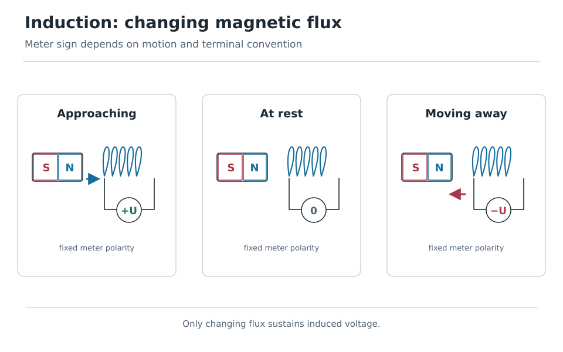

# M10-L2 – Changing magnetic flux and induction {#L2}

**Course area:** M10 – Electromagnetism and electricity supply. **Level:** Lower secondary education. **Prior knowledge:** [M10-L1](M10-L1.md). **Learning objective:** State when a coil develops induced voltage and explain why the rate of magnetic-flux change matters.

## Starting question {#S1}

A coil is connected to a sensitive voltmeter. A bar magnet rests inside it and the pointer is at zero. Why does the pointer move when the magnet moves?

## Physical concepts and model {#S2}

An **induced voltage** can arise whenever **magnetic flux** through a conducting loop changes with time. This can happen when magnet or coil moves, the magnetic field strength changes, or the loop's effective area or orientation changes. For a flat surface in a uniform field, $\Phi=B A\cos\alpha$, where $\alpha$ is the angle between the field and the surface normal.

For a coil with $N$ similar turns, an extension formula for the average induced voltage is

$$U_{\mathrm{ind}}=-N\frac{\Delta\Phi}{\Delta t}\quad\text{(average voltage over the interval).}$$

The minus sign expresses **Lenz's law**: when a circuit is closed, the induced current produces a magnetic effect opposing the *change* that caused it. An open circuit can have a measurable voltage without a sustained conduction current. A strong but **unchanging** flux is not enough.

**Original teaching graphic:** A magnet moves towards or away from a coil, with opposite deflections of a simplified voltage pointer. With the magnet stationary, the pointer returns to zero. Directions refer to the marked orientation.

*What matters is the change in magnetic flux; polarity is defined by the fixed meter terminals.*

## Worked example or application {#S3}

Suppose flux per turn changes from $0.010\,\mathrm{Wb}$ to $0.004\,\mathrm{Wb}$ in $0.20\,\mathrm s$, in a model coil with $N=100$. The **magnitude** of mean induced voltage is

$$|\overline{U}_{\mathrm{ind}}|=N\frac{|\Delta\Phi|}{\Delta t}=100\cdot\frac{0.006\,\mathrm{Wb}}{0.20\,\mathrm s}=3.0\,\mathrm V.$$

Assigning its sign requires specifying loop direction and meter terminals. These are constructed example values.

## Safe observation and experiment {#S4}

**Safe classroom experiment:** Connect a small coil to an approved high-impedance meter and move a suitable bar magnet in and out. Compare the pointer at rest, on approach, on withdrawal, and at different speeds. Avoid uncontrolled strong neodymium magnets; consider pinch risks, implanted devices and nearby electronics.

## Check your learning {#S5}

### Questions

1. Does constant magnetic flux through a stationary loop induce a sustained voltage?
2. Give two ways of changing flux through a loop.
3. Find |Uind| for N = 50, |ΔΦ| = 0.004 Wb and Δt = 0.10 s.
4. What does Lenz’s law tell us?

### Answers

1. No in the stationary model; without a changing flux the induced voltage is zero.
2. For example, move a magnet or rotate the coil; changing field strength also works.
3. 50 × 0.004 / 0.10 V = 2.0 V.
4. The induced current acts to oppose the magnetic-flux change that causes it.

## Limits and transition {#S6}

A finite-difference expression gives the average induced voltage. Instantaneous voltage depends on the instantaneous rate of change. The pointer sketch does not specify every sign convention.

**Next lesson:** [M10-L3](M10-L3.md)

## Sources {#S7}

- [Berlin-Brandenburg Education Server – Physics: topics and content](https://bildungsserver.berlin-brandenburg.de/rlp-online/c-faecher/physik/themen-und-inhalte) · Curriculum content on electromagnetism, induction, and technological energy transfer · Last accessed: 2026-11-21 · Content verified: 2026-11-21
- [LEIFIphysik – Occurrence of induction](https://www.leifiphysik.de/elektrizitaetslehre/induktion-generator-und-transformator/grundwissen/auftreten-von-induktion) · Coil, magnet, meter response and dependence on magnetic-flux change · Last accessed: 2026-11-21 · Content verified: 2026-11-21
- [DGUV Safe School – Electricity experiments](https://www.sichere-schule.de/physik/praktisches-arbeiten/elektrik) · Rules for isolated classroom low-voltage equipment and de-energised rearrangements · Last accessed: 2026-11-21 · Content verified: 2026-11-21
