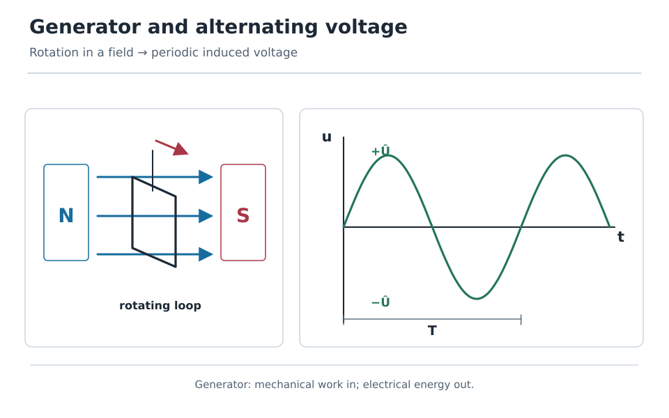

# M10-L3 – Generator principle and alternating voltage {#L3}

**Course area:** M10 – Electromagnetism and electricity supply. **Level:** Lower secondary education. **Prior knowledge:** [M10-L2](M10-L2.md). **Learning objective:** Explain mechanical-to-electrical energy conversion in a generator and calculate the period and frequency of a model alternating voltage.

## Starting question {#S1}

Why does a hand-driven bicycle generator produce voltage readings that change, and why does the electrical effect often grow at faster rotation?

## Physical concepts and model {#S2}

A **generator** receives mechanical work through rotation. As a conducting loop turns relative to a magnetic field, the magnetic flux through it changes and an induced voltage appears across its terminals. For a uniformly rotating ideal loop in a constant field, voltage can be **sinusoidal**:

$$u(t)=\hat U\sin(2\pi f t+\varphi_0),\qquad f=\frac1T.$$

$\hat U$ is peak voltage, $f$ frequency and $T$ period. An **alternating voltage** takes both positive and negative values relative to fixed terminal labels. Real generator waveforms and peak values depend on construction and load. Electrical output does not come free: when a generator supplies more power, additional mechanical work is required, often felt as greater resistance to turning.

A generator does not create energy from nothing: **mechanical input → useful electrical output + unavoidable losses**. Bicycle generators, wind turbines and larger turbine-driven generators share this general conversion idea, although their designs differ.

**Original teaching graphic:** A rotating loop in a simplified magnetic field and an alternating-voltage trace below it, showing positive and negative half-cycles.

*With uniform rotation under the model assumptions, induced voltage changes sign periodically.*

## Worked example or application {#S3}

An idealised trace repeats after $T=0.040\,\mathrm s$. Its frequency is

$$f=\frac1T=\frac1{0.040\,\mathrm s}=25\,\mathrm{Hz}.$$

If $\hat U=4.0\,\mathrm V$, the ideal extreme instantaneous values are $+4.0$ and $-4.0\,\mathrm V$. These values are **not** the RMS voltage. For a pure sine wave, the extension relation is $U_\mathrm{rms}=\hat U/\sqrt2$.

## Safe observation and experiment {#S4}

**Safe demonstration:** Use a ready-made protected hand generator and a suitable extra-low-voltage measuring device, turning the handle slowly. Where the instrument is approved, display voltage against time. Never connect a classroom hand generator to mains or unapproved electronics.

## Check your learning {#S5}

### Questions

1. What useful input form of energy drives a generator?
2. What does a negative alternating-voltage value mean?
3. Find f when T = 0.020 s.
4. Why does a loaded generator usually become harder to turn?

### Answers

1. Mechanical energy or mechanical work.
2. The instantaneous polarity has reversed relative to the chosen reference terminals.
3. f = 1/0.020 s = 50 Hz.
4. Energy conservation requires additional mechanical work to provide electrical output.

## Limits and transition {#S6}

The sine curve assumes uniform rotation and an appropriate idealised field. A simple commutator can produce pulsating DC instead of a signed alternating voltage. Neither frequency nor peak voltage alone describes the capability of a real generator.

**Next lesson:** [M10-L4](M10-L4.md)

## Sources {#S7}

- [Berlin-Brandenburg Education Server – Physics: topics and content](https://bildungsserver.berlin-brandenburg.de/rlp-online/c-faecher/physik/themen-und-inhalte) · Curriculum content on electromagnetism, induction, and technological energy transfer · Last accessed: 2026-11-21 · Content verified: 2026-11-21
- [LEIFIphysik – Generator experiment](https://www.leifiphysik.de/elektrizitaetslehre/induktion-und-transformator/versuche/generator) · Rotating coil, alternating-voltage trace and commutator behaviour · Last accessed: 2026-11-21 · Content verified: 2026-11-21
- [LEIFIphysik – Generator and motor principles](https://www.leifiphysik.de/elektrizitaetslehre/induktion-und-transformator/grundwissen/generator-und-motorprinzip) · Comparison of motor and generator energy conversion · Last accessed: 2026-11-21 · Content verified: 2026-11-21
- [DGUV Safe School – Electricity experiments](https://www.sichere-schule.de/physik/praktisches-arbeiten/elektrik) · Rules for isolated classroom low-voltage equipment and de-energised rearrangements · Last accessed: 2026-11-21 · Content verified: 2026-11-21
