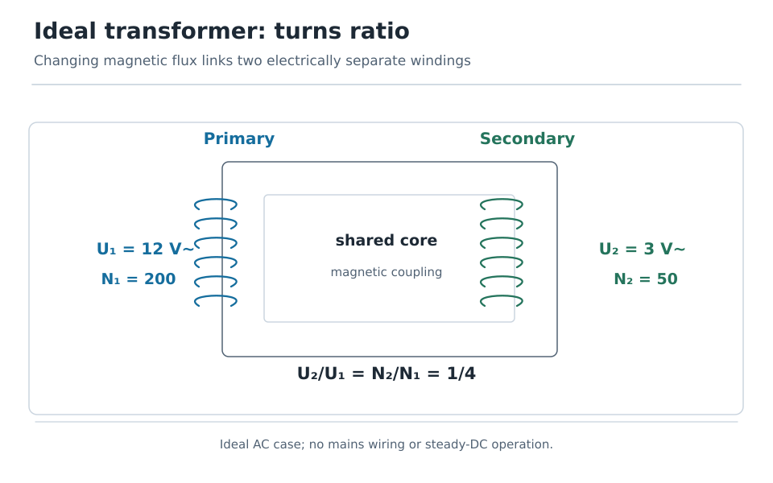

# M10-L4 – Transformers and energy transfer {#L4}

**Course area:** M10 – Electromagnetism and electricity supply. **Level:** Lower secondary education. **Prior knowledge:** [M10-L3](M10-L3.md). **Learning objective:** Explain why transformer action needs changing magnetic flux and apply the ideal voltage-to-turns ratio.

## Starting question {#S1}

A classroom transformer has 200 turns on its primary coil and 50 on its secondary. How does an approved AC supply affect the secondary voltage?

## Physical concepts and model {#S2}

A **transformer** has two electrically separated windings sharing a magnetic core. Changing current in the primary creates changing magnetic flux, which induces voltage in the secondary. An ordinary fixed-core transformer therefore does **not** operate continuously from steady DC; after switch-on a constant primary current creates no continuing flux change.

For an **ideal transformer**,

$$\frac{U_2}{U_1}=\frac{N_2}{N_1},\qquad U_1 I_1=U_2 I_2.$$

$N_1,N_2$ are turns counts. Voltages are RMS values for sinusoidal operation, or corresponding consistent AC quantities. Ideal conservation of transferred power produces an inverse current ratio. **Stepping up voltage does not create additional energy**: for equal power, current falls. Ohmic line losses may be approximated by $P_\mathrm{loss}=I^2R$. This is one reason appropriately designed transmission systems use high voltages, always with strict engineering safeguards.

**Original teaching graphic:** Two separate windings with $N_1=200$ and $N_2=50$, a simple shared core, and voltage labels. It is not a mains installation guide.

*In the ideal transformer voltage scales with turns count; primary and secondary are electrically separated.*

## Worked example or application {#S3}

Consider an **ideal** educational transformer with $N_1=200$, $N_2=50$ and an approved isolated AC input of $U_1=12.0\,\mathrm V$:

$$U_2=U_1\frac{N_2}{N_1}=12.0\,\mathrm V\cdot\frac{50}{200}=3.0\,\mathrm V.$$

If the secondary provides $I_2=0.80\,\mathrm A$, then $P_2=2.4\,\mathrm W$ and ideal $I_1=P_1/U_1=0.20\,\mathrm A$. Real losses require slightly more input power.

## Safe observation and experiment {#S4}

**Approved classroom transformer only:** A teacher may demonstrate a suitable unit using properly isolated extra-low-voltage AC and rated meters. Pupils must never wire transformers to wall outlets or perform short-circuit tests without a formal safety assessment. A paper-only comparison of turns ratios is a safer alternative.

## Check your learning {#S5}

### Questions

1. Why must linked magnetic flux change in an ordinary transformer?
2. Find U2 for U1 = 8 V, N1 = 100 and N2 = 300 (ideal).
3. At equal power, what happens to current if secondary voltage increases?
4. Why can high transmission voltage reduce line losses?

### Answers

1. Changing flux is needed to sustain induced secondary voltage.
2. U2 = 8 V × 300/100 = 24 V.
3. Current decreases because P = UI stays equal in the ideal model.
4. For equal power, the current is lower and resistive losses fall with I².

## Limits and transition {#S6}

The ratios assume ideal magnetic coupling. Core losses, winding resistance and loading affect real values. This explanation is not sufficient to design or verify a mains-connected transformer.

**Next lesson:** [M10-L5](M10-L5.md)

## Sources {#S7}

- [Berlin-Brandenburg Education Server – Physics: topics and content](https://bildungsserver.berlin-brandenburg.de/rlp-online/c-faecher/physik/themen-und-inhalte) · Curriculum content on electromagnetism, induction, and technological energy transfer · Last accessed: 2026-11-21 · Content verified: 2026-11-21
- [LEIFIphysik – Transformer](https://www.leifiphysik.de/elektrizitaetslehre/induktion-generator-und-transformator/grundwissen/transformator) · Changing magnetic field, secondary induction and absence of steady-DC operation · Last accessed: 2026-11-21 · Content verified: 2026-11-21
- [DGUV Safe School – Electricity experiments](https://www.sichere-schule.de/physik/praktisches-arbeiten/elektrik) · Rules for isolated classroom low-voltage equipment and de-energised rearrangements · Last accessed: 2026-11-21 · Content verified: 2026-11-21
