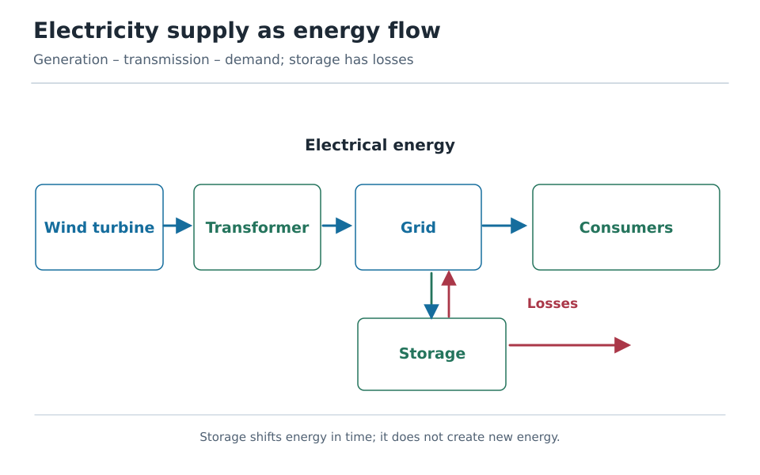

# M10-L5 – Electricity grids, supply and storage {#L5}

**Course area:** M10 – Electromagnetism and electricity supply. **Level:** Lower secondary education. **Prior knowledge:** [M10-L4](M10-L4.md). **Learning objective:** Describe generation, transmission, storage and electricity use as a system and calculate a basic energy balance.

## Starting question {#S1}

Where can energy from a wind turbine go when immediate electricity demand is lower than the turbine could supply?

## Physical concepts and model {#S2}

Electricity supply is a time-dependent chain of **conversion – transmission – distribution – use**. Wind and hydropower convert motion; photovoltaics convert radiation directly into electrical energy. Many large generating stations drive generators with turbines. Grids transmit electrical energy through AC systems; different voltage levels and transformers allow practical, efficient transmission.

**Storage** absorbs energy in one form and releases some later. Examples include pumped hydro (gravitational potential energy) and batteries (chemical energy). Storage **does not create** energy and causes charging, discharging and standby losses. Flexible demand, interconnections, controllable generation and storage all help balance power production and consumption in real time.

For a simple storage model, round-trip efficiency is $\eta=E_\mathrm{out}/E_\mathrm{in}$ where $0\le\eta\le1$. Energy can be expressed in joules or kilowatt-hours: $1\,\mathrm{kWh}=3.6\,\mathrm{MJ}$. **Power** in kW describes a rate; storage capacity in kWh describes an amount of energy.

**Original teaching graphic:** Energy flow from a wind generator through a transformer and grid to consumers, with a branch to a battery icon and an explicitly marked loss arrow.

*Electricity supply connects conversion, transmission, use and time-shifted storage, including losses.*

## Worked example or application {#S3}

A model store receives $E_\mathrm{in}=10\,\mathrm{kWh}$ and later delivers $E_\mathrm{out}=8\,\mathrm{kWh}$:

$$\eta=\frac{8}{10}=0.80=80\,\%.$$

The difference is $2\,\mathrm{kWh}$ or $7.2\,\mathrm{MJ}$; in real conversions some is transferred as internal energy. A steady $2\,\mathrm{kW}$ load could use the available $8\,\mathrm{kWh}$ for four hours in a simplified constant-power model.

## Safe observation and experiment {#S4}

**Paper exercise:** Put hourly demand data alongside a constructed wind-power profile and mark when a model store charges or discharges. Never connect a classroom demonstration to household electrical installations. Approved school extra-low-voltage equipment only for physical models.

## Check your learning {#S5}

### Questions

1. Name two physically different forms of energy storage.
2. Why does a large installed generator capacity not guarantee supply at every moment?
3. Find efficiency for 12 kWh stored and 9 kWh returned.
4. What is the difference between kW and kWh?

### Answers

1. Pumped storage (gravitational potential energy) and a battery (chemical energy), for example.
2. Weather, availability and demand vary; generation and consumption must be balanced.
3. η = 9/12 = 0.75 = 75 %.
4. kW is power (energy per unit time); kWh is energy.

## Limits and transition {#S6}

The graphic is an energy-path model, not a description of real-time grid frequency control, reactive power, multiple storage cycles or electricity markets. Numerical storage values are invented exercises, not product claims.

**Next lesson:** [M10-L6](M10-L6.md)

## Sources {#S7}

- [Berlin-Brandenburg Education Server – Physics: topics and content](https://bildungsserver.berlin-brandenburg.de/rlp-online/c-faecher/physik/themen-und-inhalte) · Curriculum content on electromagnetism, induction, and technological energy transfer · Last accessed: 2026-11-21 · Content verified: 2026-11-21
- [German federal energy data portal SMARD – Balancing reserves](https://www.smard.de/page/home/wiki-article/446/396) · Requirement to balance physical electricity generation and demand · Last accessed: 2026-11-21 · Content verified: 2026-11-21
- [German Environment Agency – Renewable and conventional electricity generation](https://www.umweltbundesamt.de/daten/umweltzustand-trends/energie/erneuerbare-konventionelle-stromerzeugung) · Electricity generation types and evolution of the generation mix · Last accessed: 2026-11-21 · Content verified: 2026-11-21
- [DGUV Safe School – Electricity experiments](https://www.sichere-schule.de/physik/praktisches-arbeiten/elektrik) · Rules for isolated classroom low-voltage equipment and de-energised rearrangements · Last accessed: 2026-11-21 · Content verified: 2026-11-21
