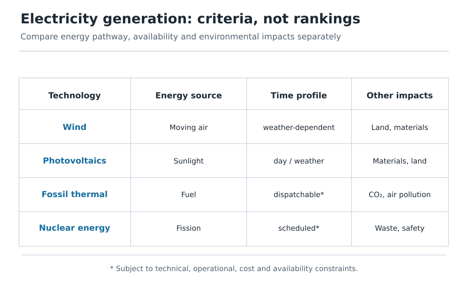

# M10-L6 – Evaluating electricity sources {#L6}

**Course area:** M10 – Electromagnetism and electricity supply. **Level:** Lower secondary education. **Prior knowledge:** [M10-L5](M10-L5.md). **Learning objective:** Compare generation technologies by conversion pathway, availability, greenhouse gases and broader environmental effects.

## Starting question {#S1}

Two power stations can deliver the same electrical power. Do they necessarily have identical effects on climate, nature and supply security?

## Physical concepts and model {#S2}

Comparing **electricity sources** requires multiple criteria. **Wind** exploits the motion of air, **hydropower** gravitational and kinetic energy of water, and **photovoltaics** solar radiation. **Coal and natural gas** convert chemical energy to heat and often via a turbine and generator into electricity. **Nuclear plants** obtain heat from fission and commonly drive a turbine-generator system as well.

**Power is not energy:** A plant rated at $P_\mathrm{rated}$ does not produce at that level continuously. Over a period, $E=\int P(t)\,dt$; for a model with a constant average power, $E=P_\mathrm{avg}t$. A **capacity factor** over a stated period is actual energy divided by the energy that continuous rated output would have produced. Values depend on location, technology and the period considered.

Environmental assessment has **several dimensions**: greenhouse gases in operation and across the life cycle, material needs, land use, ecosystems, waste, water use and safety and reliability criteria. Fossil-fuel combustion releases CO₂ and other air pollutants. Wind and photovoltaics have no combustion emissions while operating, but infrastructure and manufacturing have impacts. Nuclear generation has low direct operational CO₂ emissions yet specific waste and risk issues. The importance attached to different criteria is a societal judgement, not settled by one physics calculation.

**Original teaching graphic:** A neutral comparison grid for four technology groups showing physical input, dispatchability and environmental considerations, deliberately avoiding an overall ranking.

*Neutral comparison distinguishes physical conversion, availability and different environmental effects.*

## Worked example or application {#S3}

A **fictional** wind turbine rated at $2.0\,\mathrm{MW}$ generates $12\,\mathrm{MWh}$ over a 24-hour interval. Continuous rated operation would produce $48\,\mathrm{MWh}$. The capacity factor for this particular modeled day is

$$c=\frac{12\,\mathrm{MWh}}{2.0\,\mathrm{MW}\cdot24\,\mathrm h}=\frac{12}{48}=25\,\%.$$

This is a **single-day model value**, not a real plant's annual statistic or a climate-impact figure.

## Safe observation and experiment {#S4}

**Source comparison on paper:** Choose three criteria for wind, photovoltaic and fossil combustion. Identify which quantities can be measured, which need studies and which involve values or policy choices. State the assessment method. No hazardous power, combustion or nuclear-material experiment.

## Check your learning {#S5}

### Questions

1. Why is rated power not the same thing as generated daily energy?
2. Name two environmental effects other than greenhouse gases.
3. A 1 MW generator delivers 6 MWh in 12 h. Find the model capacity factor.
4. Why does physics alone not determine a complete policy ranking of all energy technologies?

### Answers

1. Power is an instantaneous or reference rate; energy depends on the entire time profile of power.
2. For example, land use, raw materials, waste or effects on waterways.
3. c = 6 MWh/(1 MW × 12 h) = 0.50 = 50 %.
4. Physics supplies testable evidence, but weighting environment, safety, cost and security requires additional explicit value judgements.

## Limits and transition {#S6}

This lesson does not assert present-day prices, actual plant capacity factors or site-specific emissions. Real decisions require current data with a clear publication date, method, reference year and system boundary. Renewable does not mean impact-free; dispatchable does not mean climate-neutral.

**Looking ahead:** The next module begins with [M11-L1 – The electromagnetic spectrum and wavelength](M11-L1.md).

## Sources {#S7}

- [Berlin-Brandenburg Education Server – Physics: topics and content](https://bildungsserver.berlin-brandenburg.de/rlp-online/c-faecher/physik/themen-und-inhalte) · Curriculum content on electromagnetism, induction, and technological energy transfer · Last accessed: 2026-11-21 · Content verified: 2026-11-21
- [German Environment Agency – Renewable and conventional electricity generation](https://www.umweltbundesamt.de/daten/umweltzustand-trends/energie/erneuerbare-konventionelle-stromerzeugung) · Electricity generation types and evolution of the generation mix · Last accessed: 2026-11-21 · Content verified: 2026-11-21
- [German Environment Agency – Energy-related emissions](https://www.umweltbundesamt.de/daten/umweltzustand-trends/energie/energiebedingte-emissionen-von-klimagasen) · Greenhouse gases and air pollution caused by fossil combustion · Last accessed: 2026-11-21 · Content verified: 2026-11-21
- [German Environment Agency – Environmental costs of energy](https://www.umweltbundesamt.de/indikator-umweltkosten-von-energie-strassenverkehr) · Environmental effects and assessment limits of electricity production · Last accessed: 2026-11-21 · Content verified: 2026-11-21
