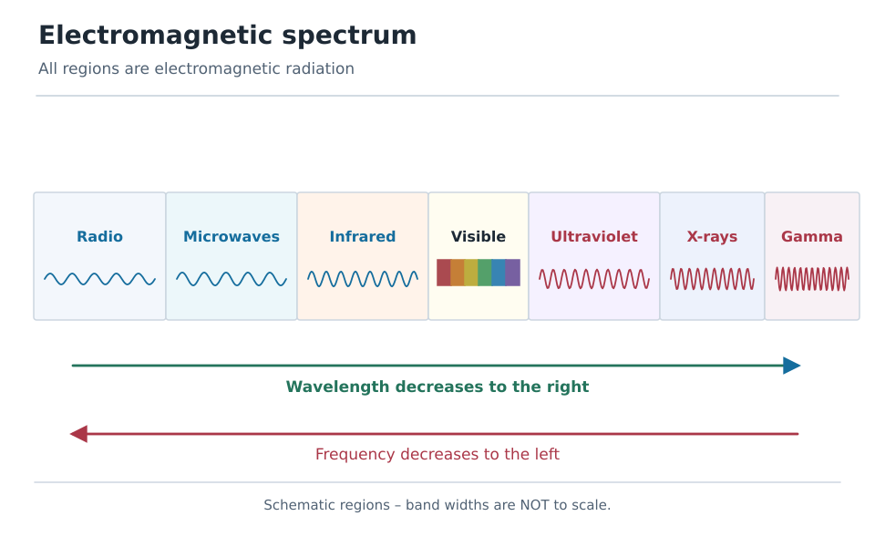

# M11-L1 – The electromagnetic spectrum and wavelength {#L1}

**Course area:** M11 – Electromagnetic radiation, climate and space. **Level:** Lower secondary education. **Prior knowledge:** [M10-L6](M10-L6.md). **Learning objective:** Relate wavelength, frequency and the main spectral regions to sensors and everyday applications.

## Starting question {#S1}

A mobile phone, an infrared thermometer and an X-ray machine use radiation that our senses perceive differently. What connects them?

## Physical concepts and model {#S2}

**Electromagnetic radiation** travels through a vacuum at the speed of light $c\approx3.00\cdot10^8\,\mathrm{m/s}$. It needs no material medium. **Wavelength** $\lambda$ is the distance between equivalent wave phases, while **frequency** $f$ counts oscillations per second. In a vacuum,

$$c=\lambda f,\qquad 1\,\mathrm{Hz}=1\,\mathrm{s}^{-1}.$$

From longer to shorter wavelengths, the approximate sequence is **radio**, **microwave**, **infrared**, **visible**, **ultraviolet**, **X-ray** and **gamma radiation**. Boundaries are not all sharp; applications overlap, and specialist conventions may differ. Visible light extends roughly from 380 to 750 nanometres. Higher frequency also means higher energy per photon, although the wave picture suffices for initial classification. Radio and microwave signals must not be equated with ionising X-rays. Biological effects depend on radiation type, intensity and exposure conditions.

**Original teaching diagram:** spectral ranges arranged on an approximate logarithmic wavelength scale, with example detectors. The categories are illustrated rather than treated as exact regulatory boundaries.

*All electromagnetic waves belong to one spectrum; visible light is only one region.*

## Worked example or application {#S3}

Light of wavelength $600\,\mathrm{nm}$ in vacuum has $\lambda=600\cdot10^{-9}\,\mathrm m$. Hence

$$f=\frac{c}{\lambda}=\frac{3.00\cdot10^8\,\mathrm{m/s}}{6.00\cdot10^{-7}\,\mathrm m}=5.00\cdot10^{14}\,\mathrm{Hz}.$$

A radio signal of frequency $100\,\mathrm{MHz}$ has vacuum wavelength approximately $3.0\,\mathrm m$. These are illustrative calculations; propagation is generally slower in matter.

## Safe observation and experiment {#S4}

**Safe paper activity:** Place radio, a thermal camera, a remote control, daylight and medical X-ray imaging on a spectrum chart. Distinguish the type of radiation from its possible uses. Never open radiation-generating equipment or aim lasers at eyes; X-ray apparatus is not a classroom experiment.

## Check your learning {#S5}

### Questions

1. Which has the shorter wavelength, infrared or X-rays?
2. Calculate the vacuum frequency at $\lambda=500\,\mathrm{nm}$ using $c=3.00\cdot10^8\,\mathrm{m/s}$.
3. Calculate the vacuum wavelength at $f=300\,\mathrm{MHz}$.
4. Why are the boundaries in a spectrum diagram approximate?

### Answers

1. X-rays.
2. $(3.00\cdot10^8)/(5.00\cdot10^{-7})=6.00\cdot10^{14}\,\mathrm{Hz}$.
3. $(3.00\cdot10^8)/(3.00\cdot10^8)=1.00\,\mathrm m$.
4. The bands meet continuously and different disciplines can use different boundary conventions.

## Limits and transition {#S6}

The expression $c=\lambda f$ uses the speed in a **vacuum**; waves may propagate more slowly in a material. A linear chart would compress short wavelengths because the range covers many orders of magnitude. Wavelength classification alone is not a complete radiation-risk assessment.

**Next lesson:** [M11-L2](M11-L2.md)

## Sources {#S7}

- [KMK – Physics standards for lower-secondary qualification (2024)](https://www.kmk.org/fileadmin/Dateien/veroeffentlichungen_beschluesse/2024/2024_06_13-WeBiS_Physik_MSA.pdf) · Page 15: spectrum, radiation–matter interactions, thermal radiation, climate and lunar phases/eclipses; other astronomy extends beyond the specifically listed topics · Last accessed: 2026-11-21 · Content verified: 2026-11-21
- [NASA Science – Introduction to the Electromagnetic Spectrum](https://science.nasa.gov/ems/01_intro/) · Spectral regions, limits of human vision, examples and ionising portions · Last accessed: 2026-11-21 · Content verified: 2026-11-21
