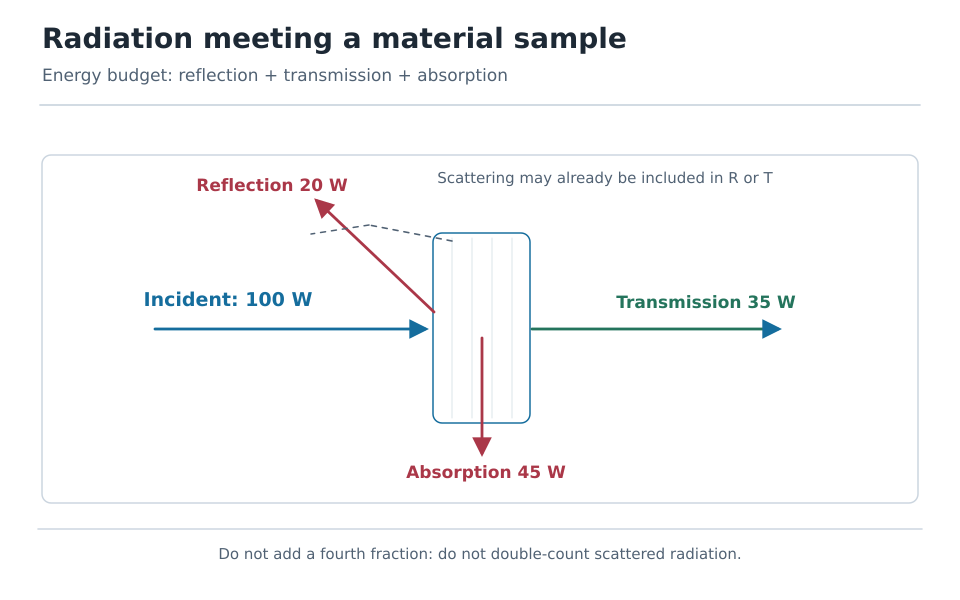

# M11-L2 – Radiation and matter: reflection, absorption, transmission and scattering {#L2}

**Course area:** M11 – Electromagnetic radiation, climate and space. **Level:** Lower secondary education. **Prior knowledge:** [M11-L1](M11-L1.md). **Learning objective:** Analyse radiation interacting with materials and construct an energy balance without double counting.

## Starting question {#S1}

Why can we see through a window, why is white paper bright and why does dark fabric look dark? Where does the incident light go?

## Physical concepts and model {#S2}

When radiation reaches a material, some may be **reflected**, **transmitted** (pass through), or **absorbed**. **Scattering** changes the direction of propagation into different directions. Refraction is a direction change at an interface caused by a change in propagation speed. **Emission** is radiation released by an object. Several processes may occur together and depend on wavelength, material and surface structure.

For a chosen wavelength band and a clearly defined measurement geometry, the incident energy can be divided into three *mutually exclusive* fractions:

$$R+T+A=1.$$

$R$ is the total fraction exiting back into the incident side, $T$ the total exiting through the sample, and $A$ the absorbed fraction. Scattered radiation must already be included under $R$ or $T$ according to where it exits: **scattering is not an additional fourth energy fraction** to add automatically. If only the straight-through beam is measured, uncollected scattered light must be considered separately.

**Original teaching diagram:** incident radiation reaches a slab, with distinct reflected, transmitted and absorbed energy paths, plus a dashed example of scattering.

*Scattering changes direction; with a complete measuring geometry it is already included in R or T.*

## Worked example or application {#S3}

A simplified experiment reports $R=0.20$ and $T=0.35$. Then

$$A=1-0.20-0.35=0.45.$$

For $100\,\mathrm W$ incident radiation, the model gives $45\,\mathrm W$ absorbed, $20\,\mathrm W$ reflected and $35\,\mathrm W$ transmitted. Absorbed energy may later become thermal energy and be emitted as radiation, but that is a distinct process over time.

## Safe observation and experiment {#S4}

**Classroom observation:** Illuminate paper, a matt film and a clear sheet with an approved low-power light source. Compare the appearance from different directions, without looking into the beam. Uncalibrated observations are qualitative; they cannot deliver exact $R$, $T$ and $A$ values.

## Check your learning {#S5}

### Questions

1. Define transmission and absorption.
2. Find $A$ when $R=0.15$ and $T=0.60$.
3. At 80 W incident power and $A=0.25$, what is the absorbed power?
4. Why must scattering not automatically be added to $R+T+A$?

### Answers

1. Transmission means radiation passes through a material; absorption means the material takes up radiation energy.
2. $A=1-0.15-0.60=0.25$.
3. $80\,\mathrm W\cdot0.25=20\,\mathrm W$.
4. Scattered light may already be counted as reflected or transmitted; adding it again would double-count energy.

## Limits and transition {#S6}

The energy balance assumes that all relevant outgoing directions are measured for a specified wavelength range. A sheet transparent in visible light may respond differently to infrared. Object colour cannot determine its exact absorptivity across the entire spectrum.

**Next lesson:** [M11-L3](M11-L3.md)

## Sources {#S7}

- [KMK – Physics standards for lower-secondary qualification (2024)](https://www.kmk.org/fileadmin/Dateien/veroeffentlichungen_beschluesse/2024/2024_06_13-WeBiS_Physik_MSA.pdf) · Page 15: spectrum, radiation–matter interactions, thermal radiation, climate and lunar phases/eclipses; other astronomy extends beyond the specifically listed topics · Last accessed: 2026-11-21 · Content verified: 2026-11-21
- [NASA Science – Introduction to the Electromagnetic Spectrum](https://science.nasa.gov/ems/01_intro/) · Spectral regions, limits of human vision, examples and ionising portions · Last accessed: 2026-11-21 · Content verified: 2026-11-21
