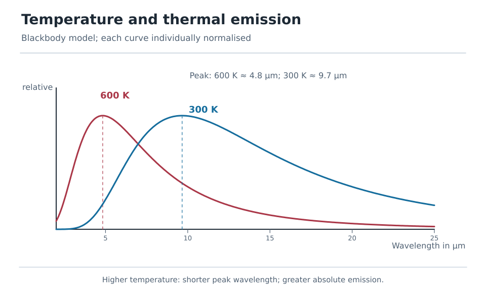

# M11-L3 – Thermal radiation and temperature {#L3}

**Course area:** M11 – Electromagnetic radiation, climate and space. **Level:** Lower secondary education. **Prior knowledge:** [M11-L2](M11-L2.md). **Learning objective:** Describe thermal radiation as electromagnetic emission and explain how absolute temperature affects it.

## Starting question {#S1}

A radiator can warm you without direct contact. Thermal cameras detect contrasts invisible to the eye. What do they actually observe?

## Physical concepts and model {#S2}

Any body above $0\,\mathrm K$ emits **thermal electromagnetic radiation** because of its temperature. At ordinary room temperature, much of that emission lies in the infrared. Heat can also be transferred by **conduction** and **convection**; radiation alone travels through a vacuum.

A **blackbody** is an ideal radiation model whose spectrum depends on temperature. As absolute temperature $T$ rises, the total radiated power per unit area increases strongly. For the ideal model, the **Stefan–Boltzmann law** gives $P/A=\sigma T^4$, and **Wien's displacement law** gives the wavelength of maximum spectral emission:

$$\lambda_{\mathrm{max}}\,T\approx 2.90\cdot10^{-3}\,\mathrm{m\,K}.$$

These laws are **extension material**; they are not claimed to be required formulas in every lower-secondary examination. Actual surfaces deviate from an ideal blackbody; thermal cameras need assumptions about emissivity. **Original teaching diagram:** two individually normalised model curves for 300 K and 600 K, with the warmer peak at shorter wavelength. Normalisation is stated so that the diagram cannot be mistaken for a comparison of absolute emitted power.

*At higher temperatures the spectral peak shifts to shorter wavelengths; curves are individually normalised.*

## Worked example or application {#S3}

For an ideal blackbody at $T=300\,\mathrm K$,

$$\lambda_{\mathrm{max}}\approx\frac{2.90\cdot10^{-3}\,\mathrm{m\,K}}{300\,\mathrm K}=9.67\,\mathrm{\mu m}.$$

At $600\,\mathrm K$, the peak is approximately $4.83\,\mathrm{\mu m}$. In the ideal model the total emission per unit area rises by $(600/300)^4=16$, whereas the figure deliberately shows *normalised* curves.

## Safe observation and experiment {#S4}

**Safe investigation:** Use an approved contactless temperature sensor on several surfaces. Compare matt and shiny finishes at similar temperatures, and discuss emissivity errors. Do not aim measuring devices at the Sun or lasers, or heat objects without supervision.

## Check your learning {#S5}

### Questions

1. Why can thermal radiation travel across a vacuum?
2. Where is the peak of a 300-K blackbody spectrum approximately located?
3. Calculate the peak wavelength at 580 K, using $b=2.90\cdot10^{-3}\,\mathrm{m\,K}$.
4. Why might reflective metal cause misleading readings in a thermal camera?

### Answers

1. It is electromagnetic radiation and requires no medium.
2. In the mid-infrared, near $9.7\,\mathrm{\mu m}$.
3. $2.90\cdot10^{-3}/580\approx5.0\,\mathrm{\mu m}$.
4. Low emissivity and reflected ambient infrared radiation may affect the apparent temperature.

## Limits and transition {#S6}

The blackbody is an idealisation; real surfaces emit and reflect differently at different wavelengths. Thermal radiation is not exclusively infrared: very hot objects also emit visible light.

**Next lesson:** [M11-L4](M11-L4.md)

## Sources {#S7}

- [KMK – Physics standards for lower-secondary qualification (2024)](https://www.kmk.org/fileadmin/Dateien/veroeffentlichungen_beschluesse/2024/2024_06_13-WeBiS_Physik_MSA.pdf) · Page 15: spectrum, radiation–matter interactions, thermal radiation, climate and lunar phases/eclipses; other astronomy extends beyond the specifically listed topics · Last accessed: 2026-11-21 · Content verified: 2026-11-21
- [OpenStax – University Physics 3, 6.1 Blackbody Radiation](https://openstax.org/books/university-physics-volume-3/pages/6-1-blackbody-radiation) · Blackbody spectra, Wien displacement and Stefan–Boltzmann law (extension material) · Last accessed: 2026-11-21 · Content verified: 2026-11-21
