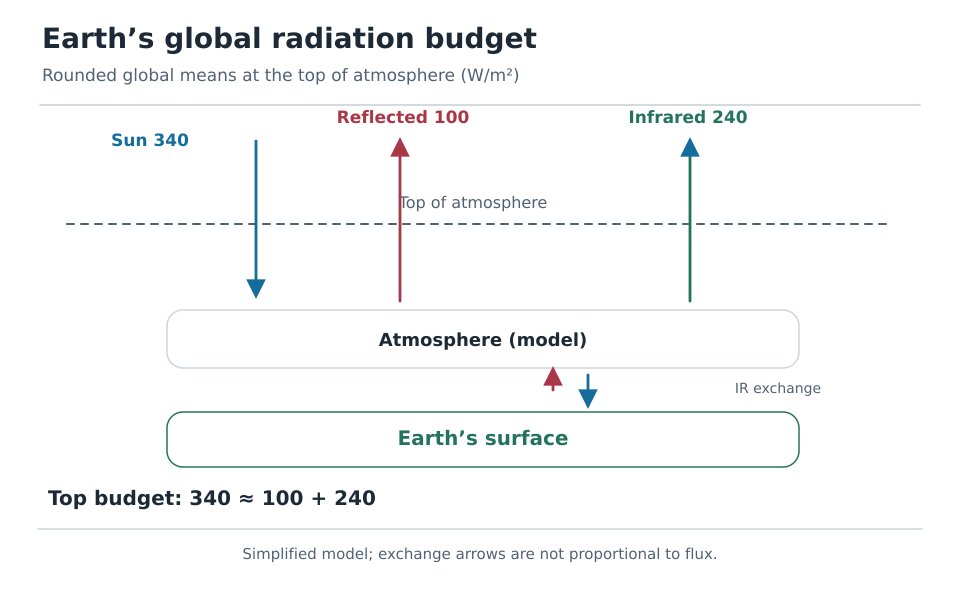

# M11-L4 – Earth’s radiation budget and the greenhouse effect {#L4}

**Course area:** M11 – Electromagnetic radiation, climate and space. **Level:** Lower secondary education. **Prior knowledge:** [M11-L3](M11-L3.md). **Learning objective:** Explain Earth’s planetary radiation budget and distinguish the natural from the human-enhanced greenhouse effect.

## Starting question {#S1}

The Sun brings energy to Earth and Earth sends energy back to space. Why is Earth’s surface warmer on average than it would be without greenhouse gases?

## Physical concepts and model {#S2}

A long-term **radiation budget** compares incoming solar energy absorbed by the Earth system with outgoing energy to space. Some shortwave sunlight is reflected by clouds, atmosphere and surface. The reflected fraction is the **albedo**. The remainder is absorbed by atmosphere and surface. The Earth-atmosphere system emits energy to space mainly as **longwave thermal radiation**.

**Greenhouse gases**, including water vapour and carbon dioxide, absorb some infrared wavelengths and emit radiation in different directions. Thus the surface receives energy from the atmosphere as well as from sunlight: the **natural greenhouse effect**. Human activities have raised concentrations of long-lived greenhouse gases and changed the energy budget. At first, less outgoing infrared energy escapes; the surface-atmosphere system warms and consequently radiates more energy at a higher temperature. This is the **human-enhanced greenhouse effect**. The atmosphere is not a reflecting mirror that traps a fixed stock of heat.

**Original teaching diagram:** rounded annual global-average fluxes at the top of the atmosphere: $340\,\mathrm{W/m^2}$ incoming sunlight, $100\,\mathrm{W/m^2}$ reflected sunlight and $240\,\mathrm{W/m^2}$ outgoing infrared. Smaller arrows indicate two-way infrared exchange between surface and atmosphere; their thickness is **not** to scale.

*In the rounded equilibrium model absorbed sunlight equals outgoing thermal radiation; internal exchange is shown separately.*

## Worked example or application {#S3}

For an idealised near-equilibrium budget at the top of the atmosphere:

$$340\,\mathrm{W/m^2}\approx100\,\mathrm{W/m^2}+240\,\mathrm{W/m^2}.$$

The reflected fraction is $100/340\approx0.294$, or about 29%. These figures are rounded global averages, not a reading at one place or time. The illustrative equilibrium must not be mistaken for a claim that the current planetary energy imbalance is exactly zero.

## Safe observation and experiment {#S4}

**Paper/data exercise:** Sketch two energy budgets, one at the top of the atmosphere and one at the ground. Identify which additional flows enter the surface budget. Consult published measurement and modelling sources for facts, but do not reuse their figures as original course artwork.

## Check your learning {#S5}

### Questions

1. Define planetary albedo.
2. Find average absorbed energy flux for 340 W/m² incoming and 100 W/m² reflected.
3. Why does the surface budget differ from the top-of-atmosphere budget?
4. What is the initial infrared effect of extra atmospheric CO₂ before warming restores some outgoing radiation?

### Answers

1. The fraction of incoming radiation reflected back to space.
2. $340-100=240\,\mathrm{W/m^2}$.
3. The surface exchanges infrared energy with the atmosphere and also exchanges sensible and latent heat.
4. More CO₂ changes absorption and emission in infrared bands, initially reducing outgoing energy; later warming increases emission.

## Limits and transition {#S6}

A three-arrow figure cannot capture the full climate system. Clouds, feedbacks, ocean heat uptake and local variations require richer models. The rounded numbers are from an established NASA teaching budget, not a claim about this year’s measurements. Climate tipping elements are a separate extension and evaluation topic.

**Next lesson:** [M11-L5](M11-L5.md)

## Sources {#S7}

- [KMK – Physics standards for lower-secondary qualification (2024)](https://www.kmk.org/fileadmin/Dateien/veroeffentlichungen_beschluesse/2024/2024_06_13-WeBiS_Physik_MSA.pdf) · Page 15: spectrum, radiation–matter interactions, thermal radiation, climate and lunar phases/eclipses; other astronomy extends beyond the specifically listed topics · Last accessed: 2026-11-21 · Content verified: 2026-11-21
- [NASA Earth Observatory – Climate and Earth’s Energy Budget](https://science.nasa.gov/earth/earth-observatory/climate-and-earths-energy-budget/) · Global radiation budget, rounded mean fluxes and atmospheric infrared exchange · Last accessed: 2026-11-21 · Content verified: 2026-11-21
- [German Environment Agency – How does the greenhouse effect work?](https://www.umweltbundesamt.de/service/uba-fragen/wie-funktioniert-der-treibhauseffekt) · Natural and human-enhanced greenhouse effects, infrared absorption and warming · Last accessed: 2026-11-21 · Content verified: 2026-11-21
