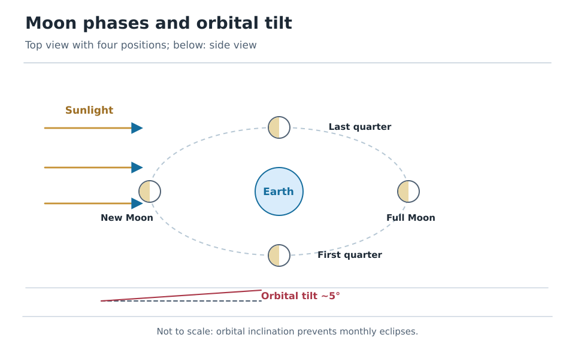

# M11-L5 – Moon phases, eclipses and the planetary system {#L5}

**Course area:** M11 – Electromagnetic radiation, climate and space. **Level:** Lower secondary education. **Prior knowledge:** [M11-L4](M11-L4.md). **Learning objective:** Use illumination geometry to explain moon phases and the conditions for solar and lunar eclipses.

## Starting question {#S1}

We see a full Moon almost every month, but we do not see a lunar eclipse every month. Why?

## Physical concepts and model {#S2}

The Moon does **not** generate its own visible light; it reflects sunlight. At any time the Sun illuminates approximately one half of the lunar sphere. As the **relative positions** of Sun, Earth and Moon change, we see different portions of that illuminated half. This creates the phases: new Moon, first quarter, full Moon, last quarter, and the intermediate waxing and waning phases. A complete phase cycle takes about **29.5 days**. The dark portion seen at a normal quarter Moon is **not** the Earth’s shadow.

A **solar eclipse** can occur at new Moon when the Moon is between the Earth and Sun and its shadow reaches Earth under the right three-dimensional alignment. A **lunar eclipse** can occur at full Moon when the Moon enters Earth’s shadow. Because the Moon’s orbital plane is tilted about $5^\circ$ relative to the plane of Earth’s orbit, the alignment is usually insufficient at new and full Moon.

Earth is a planet orbiting the Sun; the Moon is its natural satellite. Similar illumination geometry helps us understand phases of other bodies. **Original teaching diagram:** top-down arrangement of four Moon positions and a separate side view of orbital tilt. Sizes and distances are not to scale.

*Moon phases depend on the viewing angle of the sunlit hemisphere; eclipses require further three-dimensional alignment.*

## Worked example or application {#S3}

Suppose a fictional calendar begins with new Moon on day 1. Approximately one quarter of $29.5$ days later, about $7.4$ days, the simplified model predicts first quarter. Real phase times depend on actual orbital motion; **7.4 days is an estimate**, not an astronomical ephemeris.

## Safe observation and experiment {#S4}

**Safe ball-and-lamp model:** Use a stationary diffuse lamp as the Sun and a ball as the Moon in a darkened room. Observe the bright part of the ball from an “Earth” position. Never look directly at the Sun and never view a solar eclipse without certified purpose-built solar-viewing protection.

## Check your learning {#S5}

### Questions

1. What causes the Moon’s phases?
2. Which phase is necessary for a solar eclipse and for a lunar eclipse?
3. Why is there not an eclipse at every new or full Moon?
4. Roughly how long is half a lunar phase cycle?

### Answers

1. We see different portions of the sunlit half of the Moon.
2. Solar eclipse: new Moon; lunar eclipse: full Moon; the orbital alignment must also be suitable.
3. The Moon’s orbit is inclined about 5° to Earth’s orbital plane, so the bodies are usually not aligned closely enough.
4. $29.5/2\approx14.8$ days.

## Limits and transition {#S6}

The top-down sketch deliberately distorts the relative sizes and distances. A flat drawing alone cannot establish an eclipse; orbital inclination must also be considered. The basic sketch idealises the edges of shadows.

**Next lesson:** [M11-L6](M11-L6.md)

## Sources {#S7}

- [KMK – Physics standards for lower-secondary qualification (2024)](https://www.kmk.org/fileadmin/Dateien/veroeffentlichungen_beschluesse/2024/2024_06_13-WeBiS_Physik_MSA.pdf) · Page 15: spectrum, radiation–matter interactions, thermal radiation, climate and lunar phases/eclipses; other astronomy extends beyond the specifically listed topics · Last accessed: 2026-11-21 · Content verified: 2026-11-21
- [NASA Science – Moon Phases](https://science.nasa.gov/moon/moon-phases/) · 29.5-day phase cycle and changing view of the sunlit lunar hemisphere · Last accessed: 2026-11-21 · Content verified: 2026-11-21
- [NASA Science – Eclipses and the Moon](https://science.nasa.gov/moon/eclipses/) · Solar eclipses at new Moon, lunar eclipses at full Moon and approximately five-degree inclination · Last accessed: 2026-11-21 · Content verified: 2026-11-21
