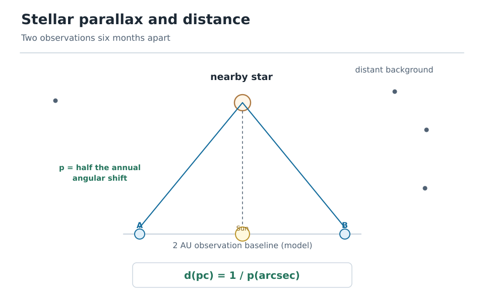

# M11-L6 – Stars, distances and astronomical observation {#L6}

**Course area:** M11 – Electromagnetic radiation, climate and space. **Level:** Lower secondary education. **Prior knowledge:** [M11-L5](M11-L5.md). **Learning objective:** Interpret light-travel time, astronomical distance units and stellar parallax.

## Starting question {#S1}

A photograph of a star shows light from the past, not necessarily the star as it exists today. How far is a light-year, and how can we measure stellar distances?

## Physical concepts and model {#S2}

Astronomical distances are so vast that expressing all of them in kilometres becomes awkward. The **astronomical unit** (AU) is about the mean Earth–Sun distance, $1.496\cdot10^{11}\,\mathrm m$. A **light-year** (ly) is the distance light travels through vacuum in one year, roughly $9.46\cdot10^{15}\,\mathrm m$. It is **a unit of distance, not time**. Sunlight takes about 8.3 minutes to reach Earth.

In **annual stellar parallax**, a nearby star is observed from opposite sides of Earth’s orbit six months apart. Its apparent position shifts very slightly against much more distant background stars. The parallax angle $p$ is **half** the total annual angular shift. If $p$ is measured in arcseconds and $d$ in parsecs, approximately

$$d\,(\mathrm{pc})=\frac{1}{p\,(\mathrm{arcsec})},\qquad 1\,\mathrm{pc}\approx3.26\,\mathrm{ly}.$$

A greater parallax indicates a smaller distance. Other methods are required for much more distant objects. **Original teaching diagram:** two observing points on Earth’s orbit, a nearer star and a distant stellar background. It communicates the geometry, not realistic angular sizes.

*Smaller parallax angles correspond to more distant stars; the illustration is not to scale.*

## Worked example or application {#S3}

For parallax $p=0.20$ arcseconds,

$$d=\frac1{0.20}=5.0\,\mathrm{pc}\approx16.3\,\mathrm{ly}.$$

The light has travelled about 16.3 years. This introductory calculation neglects uncertainty propagation, stellar proper motion and instrumental systematics.

## Safe observation and experiment {#S4}

**Paper/room activity:** View a nearby pencil alternately through the left and right eye against a distant background. It appears to shift. Discuss how the distance between your eyes is analogous to observing Earth at different points in its orbit. This activity does not measure actual stellar distances.

## Check your learning {#S5}

### Questions

1. Is a light-year a unit of time or distance?
2. Approximately how long does sunlight take to cross one AU?
3. Calculate $d$ for $p=0.10$ arcseconds.
4. Why are small stellar parallaxes difficult to measure?

### Answers

1. It is a unit of distance.
2. About 8.3 minutes.
3. $d=1/0.10=10\,\mathrm{pc}\approx32.6\,\mathrm{ly}$.
4. Very distant stars have minute apparent angular shifts that require precise instruments and careful corrections.

## Limits and transition {#S6}

The inverse relation applies to annual parallax in the ordinary geometric approximation, using arcseconds and parsecs. For very distant stars the angle may be too small and other distance indicators are needed. Observations reveal past emitted light, not a simultaneous current state.

**Looking ahead:** The next module begins with [M12-L1 – Atomic structure and models of matter](M12-L1.md).

## Sources {#S7}

- [KMK – Physics standards for lower-secondary qualification (2024)](https://www.kmk.org/fileadmin/Dateien/veroeffentlichungen_beschluesse/2024/2024_06_13-WeBiS_Physik_MSA.pdf) · Page 15: spectrum, radiation–matter interactions, thermal radiation, climate and lunar phases/eclipses; other astronomy extends beyond the specifically listed topics · Last accessed: 2026-11-21 · Content verified: 2026-11-21
- [OpenStax – Astronomy 2e, 19.2 Surveying the Stars](https://openstax.org/books/astronomy-2e/pages/19-2-surveying-the-stars) · Annual parallax, parsecs and light-years; inverse relation · Last accessed: 2026-11-21 · Content verified: 2026-11-21
