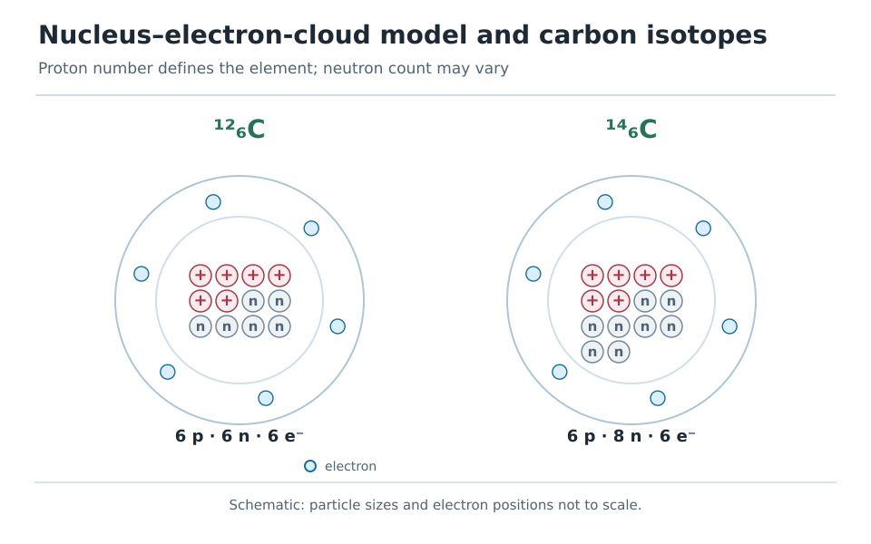

# M12-L1 – Atomic structure and models of matter {#L1}

**Course area:** M12 – Atoms, nuclear transformations and radiation protection. **Level:** Lower secondary education. **Prior knowledge:** [M11-L6](M11-L6.md). **Learning objective:** Identify protons, neutrons and electrons; distinguish atomic number, mass number and isotopes.

## Starting question {#S1}

A carbon atom can contain six or eight neutrons and still be carbon. How can a model explain that?

## Physical concepts and model {#S2}

An **atom** consists of a very small, positively charged **nucleus** and a much more extended **electron cloud**. The nucleus contains positive **protons** ($+e$) and uncharged **neutrons**; the surrounding region contains negative **electrons** ($-e$). A neutral atom contains as many electrons as protons. An ion forms when electrons are lost or gained; ordinary chemical reactions do not change the nucleus.

The **atomic number** $Z$ is the number of protons and defines the chemical element. The **mass number** $A$ counts protons plus neutrons: $N=A-Z$. A **nuclide symbol** $^{A}_{Z}X$ specifies the element and nuclear composition. **Isotopes** are atoms of the same element with different neutron numbers. The nucleus–electron-cloud model explains basic structure and charge; drawn circular orbits are not literal electron paths. Modern quantum models describe electron probability distributions.

**Original diagram:** a carbon nucleus with six protons and six neutrons, accompanied by a schematic distribution of six electrons. Distances and sizes are not to scale.

*Atomic number determines the element; isotopes differ in neutron number.*

## Worked example or application {#S3}

For $^{14}_{6}\mathrm C$, $Z=6$, $A=14$ and $N=14-6=8$. A neutral atom has six electrons. In $^{12}_{6}\mathrm C$ there are six neutrons instead. Both are carbon isotopes. The nuclide symbol alone does **not** specify whether a nucleus is stable or hazardous.

## Safe observation and experiment {#S4}

**Paper modelling:** Draw two nuclei with six protons each, but six and eight neutrons respectively. Give each neutral atom six electrons. Then change only the electron number to form an ion rather than a new element. Do not use radioactive samples.

## Check your learning {#S5}

### Questions

1. Which property defines a chemical element?
2. Find $N$ for $^{23}_{11}\mathrm{Na}$.
3. How many electrons are in a neutral atom of sodium with $Z=11$?
4. Why is a circular electron orbit only a simplification?

### Answers

1. Its proton number $Z$.
2. $N=23-11=12$.
3. Eleven.
4. Quantum mechanics describes electron states and probability distributions, not fixed classical trajectories.

## Limits and transition {#S6}

The nucleus is enormously smaller than the atom; its size is exaggerated in the diagram. Mass number is a **count**, not an exact mass in kilograms. This simple model cannot quantitatively explain binding energies or spectral lines.

**Next lesson:** [M12-L2](M12-L2.md)

## Sources {#S7}

- [Berlin-Brandenburg education server – Physics, grades 7–10: topics](https://bildungsserver.berlin-brandenburg.de/rlp-online/c-faecher/physik/themen-und-inhalte) · Curriculum topic 3.10 radioactivity and nuclear physics; level differentiation · Last accessed: 2026-11-21 · Content verified: 2026-11-21
- [IAEA – Identification of Radioactive Sources and Devices: Definitions](https://nucleus.iaea.org/sites/nss-oui/Published%20Chunks/m_92a7ef8e-2c5b-4379-8b22-d159e05cd885/c_d4d159a0-7137-49b6-b55d-c8697d094424__13_0.Html) · Definitions of nuclide, atomic number, alpha/gamma radiation, half-life, Bq and contamination · Last accessed: 2026-11-21 · Content verified: 2026-11-21
