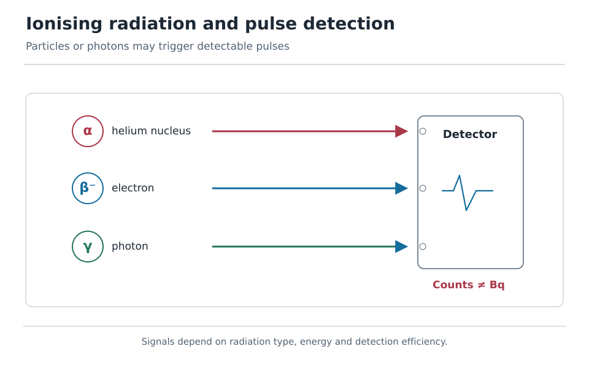

# M12-L2 – Ionising radiation and detection methods {#L2}

**Course area:** M12 – Atoms, nuclear transformations and radiation protection. **Level:** Lower secondary education. **Prior knowledge:** [M12-L1](M12-L1.md). **Learning objective:** Distinguish alpha, beta and gamma radiation, measurement signals and background count rate.

## Starting question {#S1}

A detector sometimes clicks even with no visible radioactive object beside it. What does it measure?

## Physical concepts and model {#S2}

**Ionising radiation** can remove electrons from atoms or molecules. **Alpha radiation** consists of helium nuclei (two protons and two neutrons). **Beta-minus radiation** consists of electrons emitted in nuclear transformations. **Gamma radiation** is high-energy electromagnetic radiation emitted by nuclei. X-rays and neutrons can also be ionising; not all ionising radiation originates in radioactive decay.

In a **Geiger–Müller counter**, ionisation can trigger short electrical pulses. The counter registers events, but cannot by itself reliably identify the radiation type or establish a person's dose without suitable calibration. The measured **count rate** (counts per second, $\mathrm{s^{-1}}$) depends on detector properties, geometry, measuring time, energy and **background**. The **activity** of a source in becquerels is the number of nuclear transformations per second; the two quantities must not be equated.

**Original diagram:** schematic alpha, beta and gamma emissions reaching a detector, separating radiation type from electronic counts.

*Detectors register pulses; their rate does not automatically equal source activity in becquerels.*

## Worked example or application {#S3}

A simulated counter records 150 counts in $60\,\mathrm s$. A separate background run of the same duration gives 30 counts. The total count rate is $150/60=2.50\,\mathrm{s^{-1}}$, background rate $0.50\,\mathrm{s^{-1}}$ and background-subtracted rate in this **simplified model** $2.00\,\mathrm{s^{-1}}$. Nuclear events are random, so repeated measurements fluctuate. This count rate is not a measured activity in Bq.

## Safe observation and experiment {#S4}

**Safe data activity:** Work with supplied or simulated count tables. Calculate total and background rates and compare repetitions. Do not obtain, open or test radioactive sources independently; any authorised school demonstrations require trained staff and institutional safety procedures.

## Check your learning {#S5}

### Questions

1. What kind of radiation consists of helium nuclei?
2. A simulated detector records 90 counts in 30 s. What is the total count rate?
3. If background is 0.6 counts/s, what is the corrected rate?
4. Why is a detector reading in counts/s not automatically a source activity in Bq?

### Answers

1. Alpha radiation.
2. $90/30=3.0\,\mathrm{s^{-1}}$.
3. $3.0-0.6=2.4\,\mathrm{s^{-1}}$.
4. Not every decay is detected; efficiency, geometry and background affect the observed rate.

## Limits and transition {#S6}

Penetration depends on radiation energy and material; simplistic “alpha is always completely blocked by paper” claims are not universal. A pulse counter alone cannot fully characterise a source or replace dose assessment.

**Next lesson:** [M12-L3](M12-L3.md)

## Sources {#S7}

- [Berlin-Brandenburg education server – Physics, grades 7–10: topics](https://bildungsserver.berlin-brandenburg.de/rlp-online/c-faecher/physik/themen-und-inhalte) · Curriculum topic 3.10 radioactivity and nuclear physics; level differentiation · Last accessed: 2026-11-21 · Content verified: 2026-11-21
- [IAEA – Identification of Radioactive Sources and Devices: Definitions](https://nucleus.iaea.org/sites/nss-oui/Published%20Chunks/m_92a7ef8e-2c5b-4379-8b22-d159e05cd885/c_d4d159a0-7137-49b6-b55d-c8697d094424__13_0.Html) · Definitions of nuclide, atomic number, alpha/gamma radiation, half-life, Bq and contamination · Last accessed: 2026-11-21 · Content verified: 2026-11-21
- [German Federal Environment Ministry – Radioactivity measurement guidance](https://www.bundesumweltministerium.de/themen/strahlenschutz/ionisierende-strahlung/ueberwachung-der-radioaktivitaet-in-der-umwelt/messanleitungen) · Environmental monitoring and separate analyses of alpha, beta and gamma emitters · Last accessed: 2026-11-21 · Content verified: 2026-11-21
