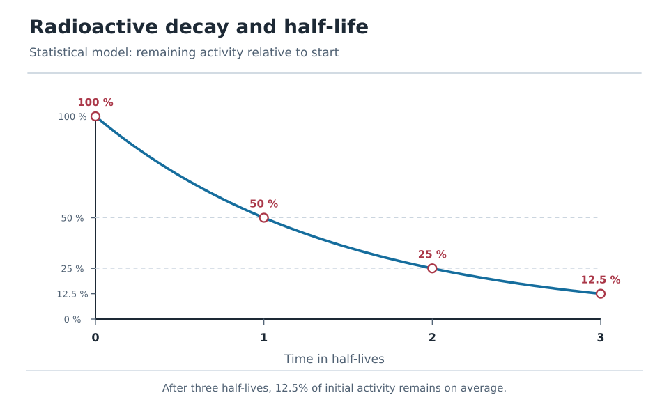

# M12-L3 – Activity, count rate and half-life {#L3}

**Course area:** M12 – Atoms, nuclear transformations and radiation protection. **Level:** Lower secondary education. **Prior knowledge:** [M12-L2](M12-L2.md). **Learning objective:** Calculate radioactive decrease using half-lives and distinguish activity from detector count rate.

## Starting question {#S1}

Why can a source remain active after two half-lives even though three quarters of its initially unstable nuclei have decayed?

## Physical concepts and model {#S2}

**Radioactive decay** of an individual unstable nucleus is random. For large numbers of identical nuclei, the average decrease is predictable. The **half-life** $T_{1/2}$ is the time after which half of the initially unstable nuclei remain on average – or the activity has fallen to half. For one radionuclide without replenishment,

$$N(t)=N_0\left(\frac12\right)^{t/T_{1/2}},\qquad A(t)=A_0\left(\frac12\right)^{t/T_{1/2}}.$$

$N$ is the number of undecayed nuclei; $A$ is **activity** measured in becquerels ($1\,\mathrm{Bq}=1$ nuclear decay per second). A detector's **count rate** is different: it depends on detection efficiency, geometry, and background. Half-life depends on the nuclide, not on how much material is initially present. In this ideal model a remainder persists after any finite interval; “everything has decayed after two half-lives” is false.

**Original diagram:** decrease to 100%, 50%, 25% and 12.5% after zero to three half-lives, clearly identified as a statistical model.

*Mean activity halves after each half-life; individual decays are random.*

## Worked example or application {#S3}

A model sample starts at $A_0=800\,\mathrm{Bq}$ with half-life $T_{1/2}=4\,\mathrm h$. After $12\,\mathrm h$, three half-lives have elapsed:

$$A(12\,\mathrm h)=800\left(\frac12\right)^3\,\mathrm{Bq}=100\,\mathrm{Bq}.$$

After $8\,\mathrm h$ the activity would be $200\,\mathrm{Bq}$. These values are neither detector counts nor dose measurements.

## Safe observation and experiment {#S4}

**Coin simulation:** In each round remove all coins showing heads and count how many remain. Repeat with different sample sizes and compare individual random runs with the expected trend. No ionising radiation is required; the model represents statistical behaviour only.

## Check your learning {#S5}

### Questions

1. What fraction of the starting activity remains after three half-lives?
2. If $A_0=960\,\mathrm{Bq}$ and $T_{1/2}=2\,\mathrm h$, find $A$ after 4 h.
3. How many half-lives reduce activity from 800 to 100 Bq?
4. Why is source activity not automatically the detected count rate?

### Answers

1. $1/8=12.5\,\%$.
2. $960/4=240\,\mathrm{Bq}$.
3. Three.
4. Detector efficiency, geometry, background and radiation type affect observed counts.

## Limits and transition {#S6}

The exponential curve describes the statistical expectation for many nuclei. An individual decay time cannot be predicted; relative fluctuations are larger for small counts. Decay chains can produce more complex activity trends.

**Next lesson:** [M12-L4](M12-L4.md)

## Sources {#S7}

- [IAEA – Identification of Radioactive Sources and Devices: Definitions](https://nucleus.iaea.org/sites/nss-oui/Published%20Chunks/m_92a7ef8e-2c5b-4379-8b22-d159e05cd885/c_d4d159a0-7137-49b6-b55d-c8697d094424__13_0.Html) · Definitions of nuclide, atomic number, alpha/gamma radiation, half-life, Bq and contamination · Last accessed: 2026-11-21 · Content verified: 2026-11-21
- [Berlin-Brandenburg education server – Physics, grades 7–10: topics](https://bildungsserver.berlin-brandenburg.de/rlp-online/c-faecher/physik/themen-und-inhalte) · Curriculum topic 3.10 radioactivity and nuclear physics; level differentiation · Last accessed: 2026-11-21 · Content verified: 2026-11-21
