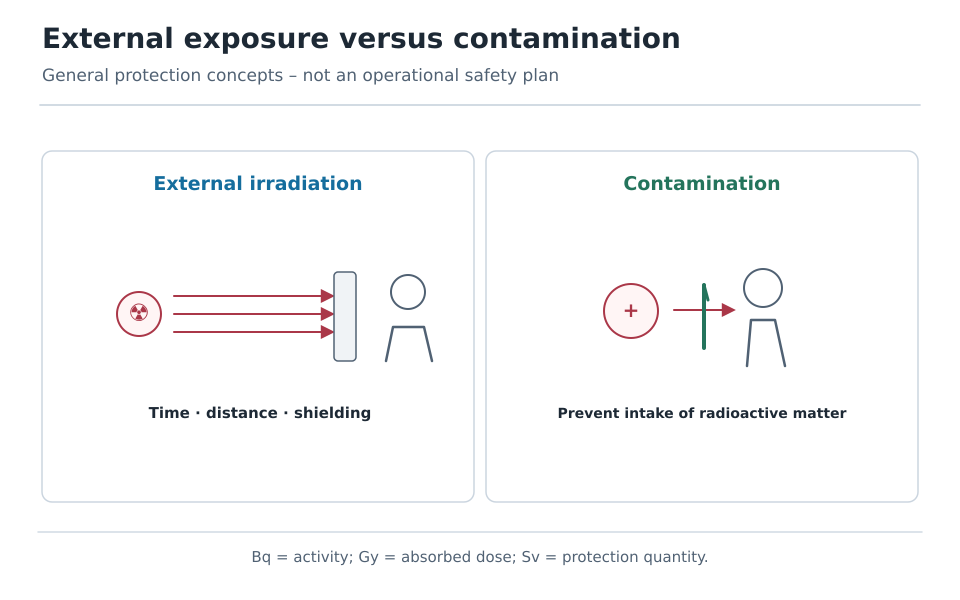

# M12-L4 – Attenuation and biological effects {#L4}

**Course area:** M12 – Atoms, nuclear transformations and radiation protection. **Level:** Lower secondary education. **Prior knowledge:** [M12-L3](M12-L3.md). **Learning objective:** Distinguish external irradiation, contamination, radiation dose and appropriate protections.

## Starting question {#S1}

Why can radiation that penetrates poorly from outside still pose a serious risk if radioactive matter enters the body?

## Physical concepts and model {#S2}

Ionising radiation transfers energy to matter and can ionise atoms or molecules. In living cells, damage may affect DNA. **Irradiation** means that radiation strikes a body; **contamination** means radioactive material is present on or inside it. Exposure alone does not automatically make an object radioactive.

**Activity** in $\mathrm{Bq}$ counts nuclear decays per second. **Absorbed dose** $D$ measures deposited energy per mass: $1\,\mathrm{Gy}=1\,\mathrm{J/kg}$. **Effective dose** in sieverts ($\mathrm{Sv}$) is a protection quantity accounting for radiation type and tissue sensitivity; it cannot simply be read from source activity or a count rate. Health effects depend on radiation type and energy, dose, duration, affected tissue and how the material enters the body.

For **external exposure**, general principles are shorter exposure time, greater distance and suitable shielding. When **contamination** is possible, preventing intake and professionally managed decontamination are essential. Shielding reduces radiation depending on material, energy and geometry; especially for gamma radiation it rarely creates a perfect zero-intensity barrier.

**Original diagram:** short exposure, increased distance, suitable shielding and prevention of intake shown as distinct strategies.

*Radiation protection must distinguish external exposure from intake of radioactive material.*

## Worked example or application {#S3}

In a purely numerical model with constant absorbed-dose rate $\dot D=4\,\mathrm{\mu Gy/h}$ and time $t=0.5\,\mathrm h$, the **absorbed** dose is

$$D=\dot D\,t=4\,\mathrm{\mu Gy/h}\cdot0.5\,\mathrm h=2\,\mathrm{\mu Gy}.$$

This classroom example does **not** permit direct conversion to an effective dose in sieverts or a personal risk assessment.

## Safe observation and experiment {#S4}

**Paper activity:** Compare three imaginary work plans with different durations at the same assumed dose rate. Draw a barrier only as schematic attenuation. Do not conduct exposure trials, use sources or test personal protective arrangements.

## Check your learning {#S5}

### Questions

1. Distinguish irradiation from contamination.
2. Calculate $D$ for $3\,\mathrm{\mu Gy/h}$ over 2 h in the simplified model.
3. How do Bq and Gy differ?
4. Why is a thick barrier alone not a complete safety strategy?

### Answers

1. Irradiation means being exposed to radiation; contamination means radioactive material on or inside a body.
2. $D=6\,\mathrm{\mu Gy}$.
3. Bq measures decays per second; Gy measures deposited energy per mass.
4. Radiation energy, type, geometry and intake routes differ; preventing contamination is essential when radioactive material is present.

## Limits and transition {#S6}

A short dose-rate calculation assumes constant external exposure. Proper risk assessment requires radiation and tissue factors; real decisions require qualified personnel and authorities.

**Next lesson:** [M12-L5](M12-L5.md)

## Sources {#S7}

- [WHO – Ionizing radiation: Questions and Answers](https://www.who.int/news-room/questions-and-answers/item/radiation-ionizing-radiation) · Biological effects, dose, exposure and contamination; medical justification · Last accessed: 2026-11-21 · Content verified: 2026-11-21
- [IAEA – Radiation Basics: Effect on Living Tissue](https://nucleus.iaea.org/sites/nss-oui/Published%20Chunks/m_92a7ef8e-2c5b-4379-8b22-d159e05cd885/c_87f5da28-c649-4182-98b4-57d1fc818ba6__2_0.Html) · Ionisation, cellular injury and dose-related effects · Last accessed: 2026-11-21 · Content verified: 2026-11-21
- [Berlin-Brandenburg education server – Physics, grades 7–10: topics](https://bildungsserver.berlin-brandenburg.de/rlp-online/c-faecher/physik/themen-und-inhalte) · Curriculum topic 3.10 radioactivity and nuclear physics; level differentiation · Last accessed: 2026-11-21 · Content verified: 2026-11-21
