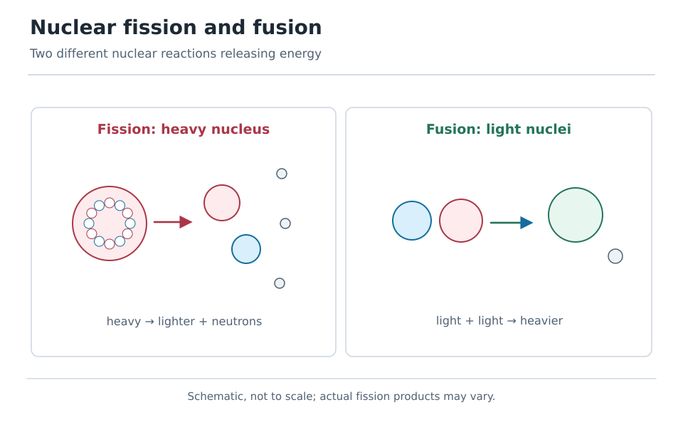

# M12-L5 – Nuclear fission, fusion and energy {#L5}

**Course area:** M12 – Atoms, nuclear transformations and radiation protection. **Level:** Lower secondary education. **Prior knowledge:** [M12-L4](M12-L4.md). **Learning objective:** Contrast fission and fusion and verify conservation of nucleon number in model reactions.

## Starting question {#S1}

The Sun derives much of its energy from fusion; nuclear power plants use fission. What is similar, and what differs?

## Physical concepts and model {#S2}

In **nuclear fission**, a heavy nucleus splits into lighter nuclei after suitable excitation. Neutrons and energy may be released. Some emitted neutrons can cause additional fission; in a nuclear reactor the **chain reaction is controlled**. In **nuclear fusion**, lighter nuclei combine into heavier ones. Getting them close enough requires extreme conditions. Fusion reactions provide a major energy source in stars.

Both processes can release **binding energy** because the total rest energy of reactants and products differs. The mass–energy relation $E=mc^2$ expresses this connection; the mass difference becomes kinetic energy and radiation. Electrical power is obtained only through further conversions – for example heat, steam and a generator – not from an electrical connection to the nucleus itself.

**Original diagram:** separated schematic pathways for fission and fusion, with explicitly non-scale nuclei.

*Fission splits heavy nuclei; fusion joins lighter ones. Both can release binding energy.*

## Worked example or application {#S3}

One **illustrative reaction channel** is

$$^{235}_{92}\mathrm U+{}^{1}_{0}\mathrm n\;\longrightarrow\;{}^{141}_{56}\mathrm{Ba}+{}^{92}_{36}\mathrm{Kr}+3\,{}^{1}_{0}\mathrm n+E.$$

Mass numbers: $235+1=236$ on the left, $141+92+3=236$ on the right. Atomic numbers: $92=56+36$. Actual fission fragments vary; this is only **one possible channel**. A common fusion reaction is $^{2}_{1}\mathrm H+{}^{3}_{1}\mathrm H\rightarrow{}^{4}_{2}\mathrm{He}+{}^{1}_{0}\mathrm n+E$.

## Safe observation and experiment {#S4}

**Safe paper or block model:** Represent each nuclear reactant and product with numbered cards, verify $A$ and $Z$ on both sides, and map the energy conversion chain in a power plant. Do not use radioactive substances, neutron sources or high-energy equipment.

## Check your learning {#S5}

### Questions

1. Which reaction joins two light nuclei?
2. Verify the sum of mass numbers for the example fission reaction.
3. Why is grid electricity not produced directly by a nuclear reaction?
4. Does every fission event produce precisely the same fragments?

### Answers

1. Nuclear fusion.
2. Left 236; right $141+92+3=236$.
3. Released nuclear energy must be converted, commonly through heat and a generator, into electrical energy.
4. No; the possible fission channels and products vary.

## Limits and transition {#S6}

The mass-number balance describes one possible fission channel; energy production cannot be computed merely by adding nucleon masses without binding-energy information. A short schematic cannot assess overall reactor performance. Fusion research should not be confused with established commercially operating fusion power stations.

**Next lesson:** [M12-L6](M12-L6.md)

## Sources {#S7}

- [US Department of Energy – Fission and Fusion: What is the Difference?](https://www.energy.gov/ne/articles/fission-and-fusion-what-difference) · Fission, released neutrons, chain reactions and electricity generation · Last accessed: 2026-11-21 · Content verified: 2026-11-21
- [US Department of Energy – Deuterium–Tritium Fusion Fuel](https://www.energy.gov/science/doe-explainsdeuterium-tritium-fusion-fuel) · Deuterium–tritium reaction to helium and neutron; research status · Last accessed: 2026-11-21 · Content verified: 2026-11-21
- [Berlin-Brandenburg education server – Physics, grades 7–10: topics](https://bildungsserver.berlin-brandenburg.de/rlp-online/c-faecher/physik/themen-und-inhalte) · Curriculum topic 3.10 radioactivity and nuclear physics; level differentiation · Last accessed: 2026-11-21 · Content verified: 2026-11-21
