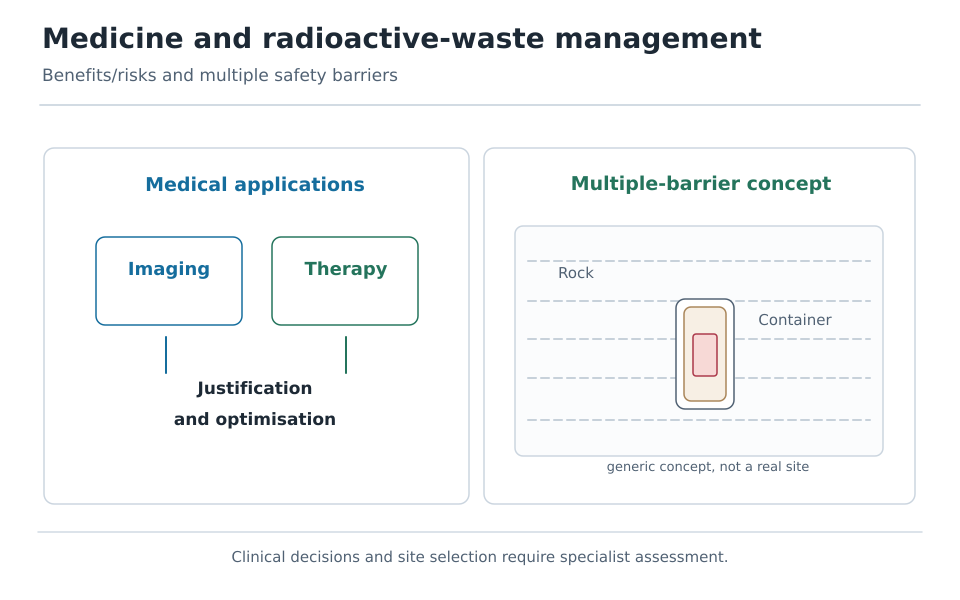

# M12-L6 – Medical uses, risks and radioactive-waste management {#L6}

**Course area:** M12 – Atoms, nuclear transformations and radiation protection. **Level:** Lower secondary education. **Prior knowledge:** [M12-L5](M12-L5.md). **Learning objective:** Evaluate medical benefits and risks and describe the long-term safety challenge of radioactive waste.

## Starting question {#S1}

How can the same physical phenomenon aid cancer treatment yet require safeguards lasting many generations?

## Physical concepts and model {#S2}

Ionising radiation has distinct **medical applications**: **diagnostic** procedures such as X-ray imaging and CT produce images; **nuclear medicine** uses suitable radionuclides for diagnosis or therapy; **radiotherapy** can target cancer cells. Clinical decisions must justify expected benefit against radiation risk and appropriately optimise patient exposure. These are regulated clinical procedures, not school experiments.

Radioactive waste arises in nuclear technology, research and medical use. Its hazards depend not just on **activity** but also on radionuclides, half-lives, heat generation, chemical form and potential release pathways. **Interim storage** is supervised storage pending further management; **final disposal** aims at safe containment over very long periods. In Germany, site selection for high-level radioactive waste involves scientific investigations, geological barriers, engineered packages and public participation. **As of November 2026, a final site for the planned high-level waste repository has not yet been selected.**

**Original diagram:** medical benefit/risk assessment alongside multiple conceptual geological safety barriers, without representing an actual repository site.

*Medical radiation requires benefit–risk assessment; disposal requires substantiated long-term safety.*

## Worked example or application {#S3}

Consider two information cards: (A) a clinically indicated CT scan with a diagnostic benefit, and (B) an unnecessary repeat with no additional clinical information. For A, expected benefit and exposure optimisation may justify the examination; B should be questioned. For disposal, “the rock is thick” is not enough: long-term safety depends on geological characterisation, groundwater pathways, container design and independent assessment.

## Safe observation and experiment {#S4}

**Evidence-based classroom discussion:** In three groups represent patient protection, scientific safety and affected communities. Use the linked primary sources to identify what evidence is required before a medical procedure or a site decision. Do not make patient-specific dose decisions or handle radioactive waste.

## Check your learning {#S5}

### Questions

1. Give one diagnostic and one therapeutic use of ionising radiation.
2. Which principle governs medical irradiation?
3. Why is half-life not the sole criterion for judging radioactive waste?
4. How does interim storage differ from final disposal?

### Answers

1. For example CT imaging for diagnosis and radiotherapy for cancer treatment.
2. The clinical procedure must be justified and the exposure optimised.
3. Amount, radionuclides, physical/chemical form, heat and possible release pathways also matter.
4. Interim storage is controlled holding pending further management; final disposal aims at very long-term safe containment.

## Limits and transition {#S6}

Disposal plans can change with scientific studies and legal decisions; a school diagram cannot substitute for a site assessment. Medical indications and dose decisions require qualified clinicians. Contamination, health and environmental concerns require specialist analysis.

**Looking ahead:** The next module begins with [M13-L1 – Vectors, scalars and components](M13-L1.md).

## Sources {#S7}

- [WHO – Ionizing radiation: Questions and Answers](https://www.who.int/news-room/questions-and-answers/item/radiation-ionizing-radiation) · Biological effects, dose, exposure and contamination; medical justification · Last accessed: 2026-11-21 · Content verified: 2026-11-21
- [German Federal Environment Ministry – Radiation protection in medicine](https://www.bundesumweltministerium.de/themen/strahlenschutz/ionisierende-strahlung/strahlenschutz-in-der-medizin) · Medical benefit-risk considerations, justification and optimisation · Last accessed: 2026-11-21 · Content verified: 2026-11-21
- [BGE – Questions and answers about Germany’s repository site selection](https://www.bge.de/de/endlagersuche/fragen-und-antworten/) · Repository search progress, geological suitability and public participation · Last accessed: 2026-11-21 · Content verified: 2026-11-21
- [German Federal Environment Ministry – Where will radioactive waste be disposed of?](https://www.bundesumweltministerium.de/faq/wo-sollen-die-radioaktiven-abfaelle-endgelagert-werden) · Planned disposal pathways and long-term safety goal for high-level waste · Last accessed: 2026-11-21 · Content verified: 2026-11-21
