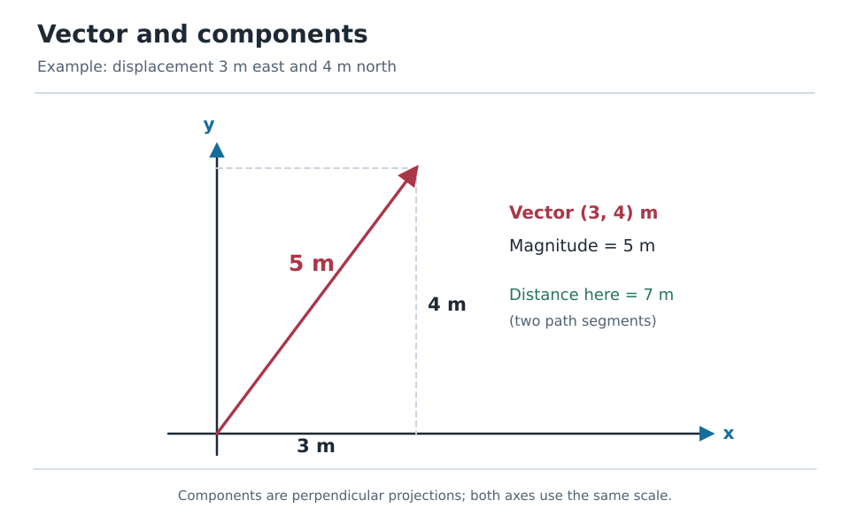

# M13-L1 – Vectors, scalars and components {#L1}

**Course area:** M13 – Vectors, scalars and components. **Level:** introductory upper secondary (methods bridge; national mandate varies). **Prerequisite:** [M12-L6](M12-L6.md). **Learning objective:** Distinguish scalar and vector quantities, identify components and calculate the magnitude of a two-dimensional vector.

## Starting question {#S1}

Two people each travel five metres. One ends five metres east of the start; the other returns after walking a loop. Why is their distance travelled the same while their displacement differs?

## Concepts and relationships {#S2}

A **scalar quantity** has a numerical value and a unit but no spatial direction. Examples include mass, temperature, energy and distance travelled. A **vector quantity** also has direction: displacement, velocity, acceleration and force. An arrow represents a vector: its length conveys magnitude and its direction conveys orientation. For forces, the point of application can also matter.

In perpendicular coordinates, a vector $\vec{A}$ may be described as the ordered pair $(A_x,A_y)$. Components have **signs**: a vector pointing to the left has $A_x<0$. The magnitude is nonnegative:

$$|\vec{A}|=\sqrt{A_x^2+A_y^2}.$$

Add vectors component by component: $\vec{A}+\vec{B}=(A_x+B_x,A_y+B_y)$. The head-to-tail graphical method yields the same resultant. **Distance travelled** is not **displacement**: displacement includes direction from the initial to final position.

*Displacement magnitude is 5 m; the two path segments cover 7 m.*

## Worked example {#S3}

An object moves $3\,\mathrm m$ east and then $4\,\mathrm m$ north. With east as positive $x$ and north as positive $y$, $\vec{s}=(3,4)\,\mathrm m$. Its magnitude is $|\vec{s}|=\sqrt{3^2+4^2}\,\mathrm m=5\,\mathrm m$. The distance along the two straight sections is $3+4=7\,\mathrm m$. The displacement magnitude is therefore not the distance travelled.

## Investigation and practice {#S4}

**Paper investigation:** Draw axes with a ruler and plot arrows $(3,4)$ and $(-1,2)$ in centimetres. Add them graphically and numerically, keeping axes and units visible. No special equipment is required.

## Check your learning {#S5}

### Questions

1. Is a temperature of $-5\,^\circ\mathrm C$ a vector? Explain.
2. Calculate the magnitude and quadrant of $\vec a=(-6,8)\,\mathrm m$.
3. Add $\vec a=(3,4)\,\mathrm m$ and $\vec b=(-1,2)\,\mathrm m$.
4. How can displacement equal zero while distance travelled is positive?

### Answers

1. No. The minus sign indicates a point on a temperature scale, not a spatial direction.
2. $|\vec a|=10\,\mathrm m$; up and to the left (quadrant II).
3. $\vec a+\vec b=(2,6)\,\mathrm m$.
4. A closed path ends at its starting position even though the individual segments have positive lengths.

## Model limitations {#S6}

Components change when coordinate axes change, while magnitude does not. Describing force effects may additionally require the point of application.

## Further reading (internal) {#S7}

- [M12-L6](M12-L6.md) · Review prerequisite
- [M13-L2](M13-L2.md) · Next lesson

## Sources (external) {#S8}

- [KMK – Physics standards for the German Abitur (2020)](https://www.kmk.org/fileadmin/Dateien/veroeffentlichungen_beschluesse/2020/2020_06_18-BildungsstandardsAHR_Physik.pdf) · Sections 2.5.2–2.5.4: superposition, mathematics, prediction, uncertainty and models · Last accessed: 2026-11-21 · Content verified: 2026-11-21
- [Berlin-Brandenburg – Upper-secondary Physics curriculum, Part C (2022)](https://bildungsserver.berlin-brandenburg.de/fileadmin/bbb/unterricht/rahmenlehrplaene/gymnasiale_oberstufe/curricula/2022/Teil_C_RLP_GOST_2022_Physik.pdf) · Sections 3.1.1–3.1.2: motion, graphs, data analysis and uncertainty · Last accessed: 2026-11-21 · Content verified: 2026-11-21
- [OpenStax – College Physics, 2.2 Vectors, Scalars and Coordinate Systems](https://openstax.org/books/college-physics/pages/2-2-vectors-scalars-and-coordinate-systems) · Section 2.2: scalar/vector distinctions and reference directions · Last accessed: 2026-11-21 · Content verified: 2026-11-21

## Evidence {#S9}

