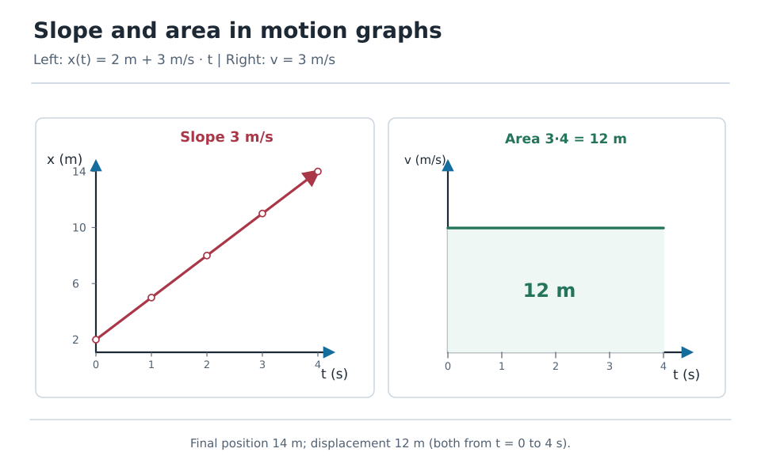

# M13-L2 – Functions, slopes and areas in graphs {#L2}

**Course area:** M13 – Vectors, scalars and components. **Level:** introductory upper secondary (methods bridge; national mandate varies). **Prerequisite:** [M13-L1](M13-L1.md). **Learning objective:** Read physical axes and units, interpret slopes and areas, and calculate linear relationships.

## Starting question {#S1}

Why does the slope of a position–time graph represent velocity, whereas the area under a velocity–time graph represents displacement?

## Concepts and relationships {#S2}

In physics a graph models a relationship between measured quantities. **Axis labels and units** determine what a slope or area means. For constant velocity, $x(t)=x_0+vt$; the position–time slope is

$$v=\frac{\Delta x}{\Delta t}.$$

Its unit is $\mathrm{m/s}$. A steeper positive slope means faster movement in the positive direction; a negative slope indicates motion in the negative direction. On a velocity–time graph, the **signed area** $\Delta x=\int v(t)\,dt$ gives displacement (for constant $v$, simply $v\,\Delta t$). Total distance travelled is the area under $|v|$ instead; forward and backward portions must not cancel. Area under an acceleration–time graph gives velocity change. For a curved line, the tangent slope represents an instantaneous value, to be developed further later.

*Position–time slope gives velocity, while velocity–time area gives displacement.*

## Worked example {#S3}

A cart starts at $x_0=2\,\mathrm m$ and moves at constant $v=3\,\mathrm{m/s}$. At $t=4\,\mathrm s$, $x=2+3\cdot4=14\,\mathrm m$. The intercept of its $x$-$t$ graph is $2\,\mathrm m$ and the slope is $3\,\mathrm{m/s}$. The rectangular area under the $v$-$t$ graph from $0$ to $4\,\mathrm s$ is $12\,\mathrm m$: this is **displacement**, not the final position.

## Investigation and practice {#S4}

**Table-to-graph exercise:** On squared paper, plot positions $x=2,5,8,11,14\,\mathrm m$ for times $t=0,1,2,3,4\,\mathrm s$. On a second graph plot constant $v=3\,\mathrm{m/s}$. Label each axis with a quantity and unit.

## Check your learning {#S5}

### Questions

1. What is the unit of slope on a position–time graph?
2. Find $x$ at $t=6\,\mathrm s$ if $x=1\,\mathrm m+2\,\mathrm{m/s}\cdot t$.
3. A body travels for $2\,\mathrm s$ at $+4\,\mathrm{m/s}$ and $2\,\mathrm s$ at $-4\,\mathrm{m/s}$. Find displacement and distance.
4. What distinguishes a secant from a tangent on a curved position–time graph?

### Answers

1. Metres per second ($\mathrm{m/s}$).
2. $x=13\,\mathrm m$.
3. Displacement $0\,\mathrm m$; distance $16\,\mathrm m$.
4. A secant yields an average slope over an interval; a tangent yields an instantaneous slope.

## Model limitations {#S6}

An area has physical meaning only when the axis quantities support that interpretation. Do not treat scattered data points as a perfect line without justification.

## Further reading (internal) {#S7}

- [M13-L1](M13-L1.md) · Review prerequisite
- [M13-L3](M13-L3.md) · Next lesson

## Sources (external) {#S8}

- [KMK – Physics standards for the German Abitur (2020)](https://www.kmk.org/fileadmin/Dateien/veroeffentlichungen_beschluesse/2020/2020_06_18-BildungsstandardsAHR_Physik.pdf) · Sections 2.5.2–2.5.4: superposition, mathematics, prediction, uncertainty and models · Last accessed: 2026-11-21 · Content verified: 2026-11-21
- [Berlin-Brandenburg – Upper-secondary Physics curriculum, Part C (2022)](https://bildungsserver.berlin-brandenburg.de/fileadmin/bbb/unterricht/rahmenlehrplaene/gymnasiale_oberstufe/curricula/2022/Teil_C_RLP_GOST_2022_Physik.pdf) · Sections 3.1.1–3.1.2: motion, graphs, data analysis and uncertainty · Last accessed: 2026-11-21 · Content verified: 2026-11-21
- [OpenStax – College Physics, 2.8 Graphical Analysis of One-Dimensional Motion](https://openstax.org/books/college-physics/pages/2-8-graphical-analysis-of-one-dimensional-motion) · Section 2.8: slope of position–time graphs and velocity interpretation · Last accessed: 2026-11-21 · Content verified: 2026-11-21

## Evidence {#S9}

