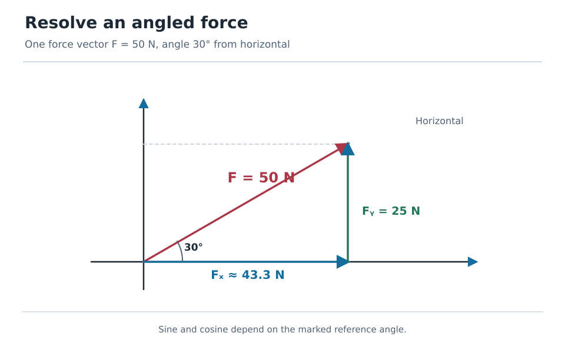

# M13-L3 – Trigonometric relationships in mechanics {#L3}

**Course area:** M13 – Vectors, scalars and components. **Level:** introductory upper secondary (methods bridge; national mandate varies). **Prerequisite:** [M13-L2](M13-L2.md). **Learning objective:** Use sine, cosine and angle conventions to resolve a force into perpendicular components.

## Starting question {#S1}

A rope pulls a sled diagonally upward. Which portion pulls it horizontally and which portion reduces its load on the ground?

## Concepts and relationships {#S2}

A vector $\vec F$ can be represented by **projections** onto two perpendicular axes. If $\alpha$ is measured **from the positive horizontal direction**, then

$$F_x=F\cos\alpha,\qquad F_y=F\sin\alpha.$$

Here $F=|\vec F|$ is the magnitude. Signs depend on the quadrant and axis convention. For an incline at angle $\theta$, gravity $F_G=mg$ has components $F_{G,\parallel}=mg\sin\theta$ down the slope and $F_{G,\perp}=mg\cos\theta$ into the slope. The normal force equals $mg\cos\theta$ **in magnitude only in a suitable situation**, with no other perpendicular forces, no acceleration perpendicular to the surface and sustained contact. Resolving a force does not change it; components are an alternative description of the same vector.

*For an angle to the horizontal F_x = F cos α and F_y = F sin α.*

## Worked example {#S3}

A rope pulls with $F=50\,\mathrm N$ at $30^\circ$ above the horizontal. $F_x=50\cos30^\circ\approx43.3\,\mathrm N$, while $F_y=50\sin30^\circ=25\,\mathrm N$. The check $\sqrt{43.3^2+25^2}\approx50\,\mathrm N$ reproduces the original magnitude. The horizontal pulling component is less than $50\,\mathrm N$.

## Investigation and practice {#S4}

**Safe diagram study:** Draw a $30^\circ$ vector and its right-angled component triangle. Measure the projected arrow lengths with a ruler and compare the ratios with $\cos30^\circ$ and $\sin30^\circ$. No real pulling apparatus is needed.

## Check your learning {#S5}

### Questions

1. Which component is adjacent to the angle measured from the horizontal?
2. Find $F_x,F_y$ for $F=20\,\mathrm N$ directed $30^\circ$ above the positive horizontal.
3. For $m=5\,\mathrm{kg}$ on a $30^\circ$ incline, find $mg\sin30^\circ$ with $g=9.81\,\mathrm{m/s^2}$.
4. Why is $N=mg\cos\theta$ not always valid for an object in contact with an incline?

### Answers

1. The horizontal component $F_x=F\cos\alpha$.
2. $F_x\approx17.3\,\mathrm N$, $F_y=10\,\mathrm N$.
3. $F_{G,\parallel}=24.525\,\mathrm N\approx24.5\,\mathrm N$ down the slope.
4. Additional forces, loss of contact or perpendicular acceleration can change the normal force.

## Model limitations {#S6}

The trigonometric formula relies on defining the angle correctly. Signs and directions follow the selected axes: “sine is always the vertical component” is false.

## Further reading (internal) {#S7}

- [M13-L2](M13-L2.md) · Review prerequisite
- [M13-L4](M13-L4.md) · Next lesson

## Sources (external) {#S8}

- [KMK – Physics standards for the German Abitur (2020)](https://www.kmk.org/fileadmin/Dateien/veroeffentlichungen_beschluesse/2020/2020_06_18-BildungsstandardsAHR_Physik.pdf) · Sections 2.5.2–2.5.4: superposition, mathematics, prediction, uncertainty and models · Last accessed: 2026-11-21 · Content verified: 2026-11-21
- [Berlin-Brandenburg – Upper-secondary Physics curriculum, Part C (2022)](https://bildungsserver.berlin-brandenburg.de/fileadmin/bbb/unterricht/rahmenlehrplaene/gymnasiale_oberstufe/curricula/2022/Teil_C_RLP_GOST_2022_Physik.pdf) · Sections 3.1.1–3.1.2: motion, graphs, data analysis and uncertainty · Last accessed: 2026-11-21 · Content verified: 2026-11-21
- [OpenStax – College Physics, 2.2 Vectors, Scalars and Coordinate Systems](https://openstax.org/books/college-physics/pages/2-2-vectors-scalars-and-coordinate-systems) · Section 2.2: scalar/vector distinctions and reference directions · Last accessed: 2026-11-21 · Content verified: 2026-11-21

## Evidence {#S9}

