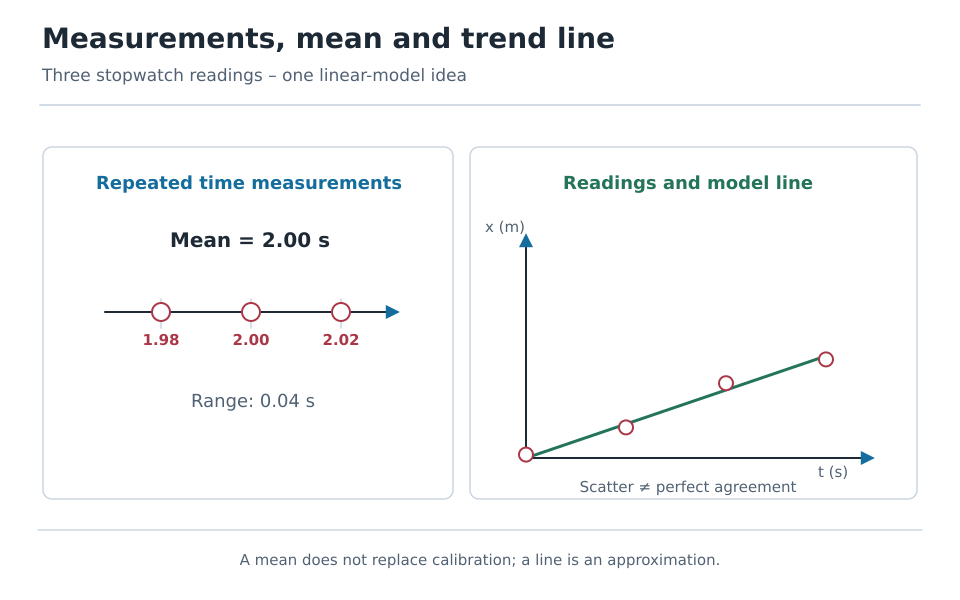

# M13-L4 – Measurement uncertainty, best-fit lines and model testing {#L4}

**Course area:** M13 – Vectors, scalars and components. **Level:** introductory upper secondary (methods bridge; national mandate varies). **Prerequisite:** [M13-L3](M13-L3.md). **Learning objective:** Analyse repeated measurements, distinguish random from systematic effects and assess a fitted straight-line model.

## Starting question {#S1}

Three stopwatches return slightly different times for one procedure. Which number should be reported, and how confident can we be?

## Concepts and relationships {#S2}

**Measurement uncertainty** characterises the spread of values plausibly attributable to a measurand; it is not a personal mistake and not automatically the same as one deviation. **Random influences** cause variation between repeats, while **systematic influences** can shift all readings together, for example a misaligned zero. The mean $\bar t=(1/n)\sum t_i$ summarises repeated values but does not remove systematic bias.

A **best-fit line** $y=ax+b$ represents a trend in measured data. Its slope has physical units (such as $\mathrm{m/s}$ for a position–time graph). A sketched line should not be forced through every data point. **Residuals** $r_i=y_i-(ax_i+b)$ are the differences between observations and predicted values. Structured residual patterns suggest the model may be inadequate. An observed spread does **not automatically imply a 95% confidence interval**; statistical assumptions and procedures are needed for such a claim.

*Repeated readings exhibit variation, and a model line is only an approximation.*

## Worked example {#S3}

Repeated measurements give $t_1=1.98\,\mathrm s$, $t_2=2.02\,\mathrm s$ and $t_3=2.00\,\mathrm s$. The mean is $\bar t=2.00\,\mathrm s$ and the range is $0.04\,\mathrm s$. For these three readings the **sample standard deviation** is $s=\sqrt{[(1.98-2)^2+(2.02-2)^2+0]/(3-1)}=0.02\,\mathrm s$. This describes variation; a full uncertainty statement would also consider instrument properties.

## Investigation and practice {#S4}

**Data exercise:** Draw several position–time measurements for a nearly constant-speed toy on squared paper. Sketch a plausible straight line through the cloud. Compute its slope from two widely separated points **on the line**, rather than selecting arbitrary individual observations. Mark any unusual residuals.

## Check your learning {#S5}

### Questions

1. Why does averaging not fix a stopwatch with a shifted zero?
2. Find the mean of $2.1$, $2.0$ and $1.9\,\mathrm s$.
3. What does a slope of $1.5\,\mathrm{m/s}$ mean for a position–time best-fit line?
4. Why is a curved residual pattern a warning sign?

### Answers

1. A shared systematic offset persists in the average.
2. $\bar t=2.0\,\mathrm s$.
3. The line models constant velocity of $1.5\,\mathrm{m/s}$.
4. It suggests that a linear model may not capture the data-generating relationship.

## Model limitations {#S6}

The three-reading example is an introduction, not a complete uncertainty budget compliant with metrology standards. Precise coverage statements require raw data, calibration evidence and assumptions.

## Further reading (internal) {#S7}

- [M13-L3](M13-L3.md) · Review prerequisite
- [M13-L5](M13-L5.md) · Next lesson

## Sources (external) {#S8}

- [Berlin-Brandenburg – Upper-secondary Physics curriculum, Part C (2022)](https://bildungsserver.berlin-brandenburg.de/fileadmin/bbb/unterricht/rahmenlehrplaene/gymnasiale_oberstufe/curricula/2022/Teil_C_RLP_GOST_2022_Physik.pdf) · Sections 3.1.1–3.1.2: motion, graphs, data analysis and uncertainty · Last accessed: 2026-11-21 · Content verified: 2026-11-21
- [NIST – Technical Note 1297, Appendix D1: Terminology](https://www.nist.gov/pml/nist-technical-note-1297/nist-tn-1297-appendix-d1-terminology) · Section D1: uncertainty, random and systematic measurement errors · Last accessed: 2026-11-21 · Content verified: 2026-11-21
- [KMK – Physics standards for the German Abitur (2020)](https://www.kmk.org/fileadmin/Dateien/veroeffentlichungen_beschluesse/2020/2020_06_18-BildungsstandardsAHR_Physik.pdf) · Sections 2.5.2–2.5.4: superposition, mathematics, prediction, uncertainty and models · Last accessed: 2026-11-21 · Content verified: 2026-11-21

## Evidence {#S9}

