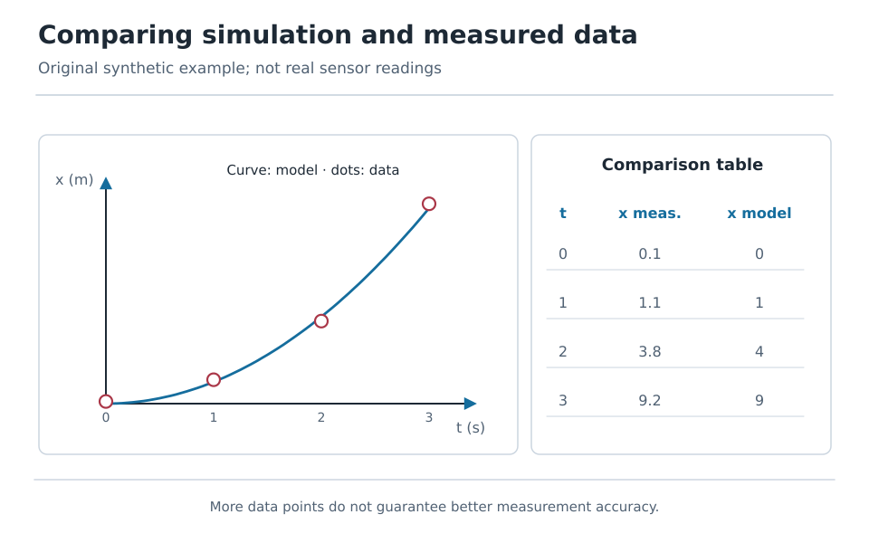

# M13-L5 – Digital measurement, data analysis and simulation {#L5}

**Course area:** M13 – Vectors, scalars and components. **Level:** introductory upper secondary (methods bridge; national mandate varies). **Prerequisite:** [M13-L4](M13-L4.md). **Learning objective:** Compare digitally sampled values with predictions and assess sampling rate, finite differences and simulation validity.

## Starting question {#S1}

A motion sensor can record hundreds of readings every second. Does that automatically produce a more accurate physical model?

## Concepts and relationships {#S2}

Digital measurement systems sample quantities at **discrete time steps** $\Delta t$. The **sampling frequency** $f_s=1/\Delta t$ is not the same as measurement accuracy. Consecutive positions give interval-average velocity $v_i=(x_{i+1}-x_i)/\Delta t$. A finite interval yields an **average**, not an exact instantaneous velocity. Shorter intervals improve time resolution but may amplify fluctuations when differences are calculated from noisy positions.

A **simulation** computes predictions from specified equations and initial conditions. It is neither a real observation nor proof that the governing equations are correct. Compare three columns: measured values, model predictions and residuals $r_i=x_{\mathrm{meas},i}-x_{\mathrm{model},i}$. Checks include units, timestamps, sensor calibration, noise, assumptions and independent plausibility tests. More points may simply repeat the same systematic error many times.

*Digital readings are compared against predictions without conflating a simulation and a measurement.*

## Worked example {#S3}

For the **idealised** relation $x(t)=t^2\,\mathrm m$, where $t$ is in seconds, positions at $t=0,1,2,3\,\mathrm s$ are $0,1,4,9\,\mathrm m$. The interval-average velocities for $\Delta t=1\,\mathrm s$ are $1$, $3$ and $5\,\mathrm{m/s}$; they belong to intervals, not the individual start times. The corresponding model has constant acceleration $2\,\mathrm{m/s^2}$. Real sensor readings would generally deviate slightly.

## Investigation and practice {#S4}

**Spreadsheet exercise:** In a local spreadsheet enter $t=0,1,2,3$, synthetic $x_{\mathrm{meas}}=0.1;1.1;3.8;9.2\,\mathrm m$, and $x_{\mathrm{model}}=t^2\,\mathrm m$. Calculate differences and plot the measured points together with the separate model curve. These are **synthetic values**, not recorded sensor data.

## Check your learning {#S5}

### Questions

1. What is $\Delta t$ when $f_s=20\,\mathrm{Hz}$?
2. Calculate interval-average velocity from $x(1)=1\,\mathrm m$ and $x(2)=4\,\mathrm m$.
3. Find the residual for measured $3.8\,\mathrm m$ versus predicted $4.0\,\mathrm m$.
4. Why do 10,000 simulated points not prove a model?

### Answers

1. $\Delta t=1/20\,\mathrm s=0.05\,\mathrm s$.
2. $v=(4-1)/(2-1)=3\,\mathrm{m/s}$.
3. $r=3.8-4.0=-0.2\,\mathrm m$.
4. The values are generated by the chosen equations; independent measurements and model checks remain necessary.

## Model limitations {#S6}

Smaller sampling steps do not guarantee accuracy. Finite differences amplify measurement noise; every simulation is bounded by its assumptions.

## Further reading (internal) {#S7}

- [M13-L4](M13-L4.md) · Review prerequisite
- [M13-L6](M13-L6.md) · Next lesson

## Sources (external) {#S8}

- [Berlin-Brandenburg – Upper-secondary Physics curriculum, Part C (2022)](https://bildungsserver.berlin-brandenburg.de/fileadmin/bbb/unterricht/rahmenlehrplaene/gymnasiale_oberstufe/curricula/2022/Teil_C_RLP_GOST_2022_Physik.pdf) · Sections 3.1.1–3.1.2: motion, graphs, data analysis and uncertainty · Last accessed: 2026-11-21 · Content verified: 2026-11-21
- [QUA-LiS NRW – Media competence and upper-secondary Physics curriculum (2022)](https://lehrplannavigator.nrw.de/system/files/media/document/file/gost_ph_klp_beitraege_medienkompetenzrahmen_nrw_synopse_2022_06_09.pdf) · Introductory phase: digital acquisition, mathematical modelling, data displays and evaluation · Last accessed: 2026-11-21 · Content verified: 2026-11-21
- [KMK – Physics standards for the German Abitur (2020)](https://www.kmk.org/fileadmin/Dateien/veroeffentlichungen_beschluesse/2020/2020_06_18-BildungsstandardsAHR_Physik.pdf) · Sections 2.5.2–2.5.4: superposition, mathematics, prediction, uncertainty and models · Last accessed: 2026-11-21 · Content verified: 2026-11-21

## Evidence {#S9}

