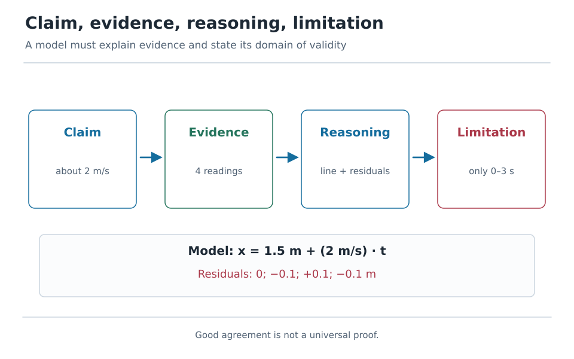

# M13-L6 – Scientific argumentation and model limits {#L6}

**Course area:** M13 – Vectors, scalars and components. **Level:** introductory upper secondary (methods bridge; national mandate varies). **Prerequisite:** [M13-L5](M13-L5.md). **Learning objective:** Evaluate a physical claim using data, explicit model assumptions and a properly limited conclusion.

## Starting question {#S1}

Four points lie almost on a straight line. Is that enough to claim that the object moves at a perfectly constant speed everywhere and forever?

## Concepts and relationships {#S2}

A defensible physical argument distinguishes **claim, evidence, reasoning and limitation**. A claim might be: “Over the observed interval the motion is approximately uniform.” Evidence consists of data with units and uncertainties. Reasoning connects them to the model $x(t)=x_0+vt$ and examines residuals. Limitations specify the time range, apparatus and alternative explanations.

A **model** is a purposeful approximation: the constant-$v$ model may describe a short segment even though starting, stopping or changing forces require another model. Good agreement is not a logical proof for all circumstances. When evaluating a graph, examine axis scaling, units, error bars, sample size, selective reporting and the difference between observation and interpretation. **Correlation** alone does not establish causation.

*A qualified physical conclusion must consider both evidence and model assumptions.*

## Worked example {#S3}

At $t=0,1,2,3\,\mathrm s$, suppose **synthetic** positions are $x=1.5;3.4;5.6;7.4\,\mathrm m$. The model $x_{\mathrm{model}}=1.5\,\mathrm m+(2\,\mathrm{m/s})t$ predicts $1.5;3.5;5.5;7.5\,\mathrm m$. Residuals (observed minus predicted) are $0;-0.1;+0.1;-0.1\,\mathrm m$. A suitable conclusion is “compatible with approximately $2\,\mathrm{m/s}$ over the measured range”, not “exactly constant without error forever”.

## Investigation and practice {#S4}

**Argumentation workshop:** One group drafts the strongest conclusion supported by these four synthetic points; the other identifies assumptions and credible alternative models. Both groups then propose extra data and an independent check beyond the current time window.

## Check your learning {#S5}

### Questions

1. Give a physical claim and one measurement-based piece of evidence for it.
2. Find the residual for $x_{\mathrm{meas}}=5.6\,\mathrm m$ and $x_{\mathrm{model}}=5.5\,\mathrm m$.
3. What additional experiment could test constant velocity more strongly?
4. Why does a similar curve shape not establish causation?

### Answers

1. For example: “Velocity is approximately constant”; evidence: positions increase by similar amounts in equal time intervals.
2. $r=+0.1\,\mathrm m$.
3. Collect repeated readings over a longer interval, ideally with a different technique and documented uncertainty.
4. Confounding variables, alternative explanations or chance may create a relationship without the proposed causal mechanism.

## Model limitations {#S6}

A few readings justify only a limited claim. Without uncertainty assessment, repetitions and independent checks, strong claims about accuracy or causation are not supported.

## Further reading (internal) {#S7}

- [M13-L5](M13-L5.md) · Review prerequisite
**Looking ahead:** The next module begins with [M14-L1 – Motion with constant acceleration](M14-L1.md).

## Sources (external) {#S8}

- [KMK – Physics standards for the German Abitur (2020)](https://www.kmk.org/fileadmin/Dateien/veroeffentlichungen_beschluesse/2020/2020_06_18-BildungsstandardsAHR_Physik.pdf) · Sections 2.5.2–2.5.4: superposition, mathematics, prediction, uncertainty and models · Last accessed: 2026-11-21 · Content verified: 2026-11-21
- [Berlin-Brandenburg – Upper-secondary Physics curriculum, Part C (2022)](https://bildungsserver.berlin-brandenburg.de/fileadmin/bbb/unterricht/rahmenlehrplaene/gymnasiale_oberstufe/curricula/2022/Teil_C_RLP_GOST_2022_Physik.pdf) · Sections 3.1.1–3.1.2: motion, graphs, data analysis and uncertainty · Last accessed: 2026-11-21 · Content verified: 2026-11-21
- [NIST – Technical Note 1297, Appendix D1: Terminology](https://www.nist.gov/pml/nist-technical-note-1297/nist-tn-1297-appendix-d1-terminology) · Section D1: uncertainty, random and systematic measurement errors · Last accessed: 2026-11-21 · Content verified: 2026-11-21

## Evidence {#S9}

