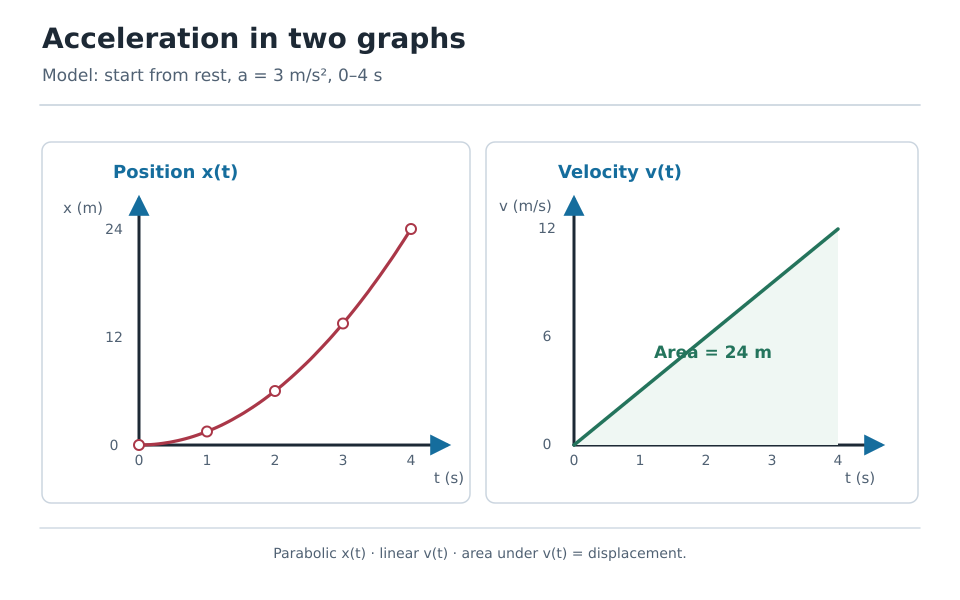

# M14-L1 – Motion with constant acceleration {#L1}

**Course area:** M14 – Motion models and mechanics in the introductory phase. **Level:** introductory upper secondary (state-specific scope). **Prerequisite:** [M13-L6](M13-L6.md). **Learning objective:** Describe motion at constant acceleration quantitatively using x(t), v(t), and graphs.

## Starting question {#S1}

A cart begins from rest. Its velocity increases by the same amount every second. What shape does its position–time graph have?

## Concepts and relationships {#S2}

**Acceleration** is the rate of change of velocity: $a=\Delta v/\Delta t$, measured in $\mathrm{m/s^2}$. When acceleration is **constant** along a straight line, after time $t$ measured from the chosen start:

$$v(t)=v_0+at,\qquad x(t)=x_0+v_0t+\tfrac12at^2.$$

Eliminating time, $v^2=v_0^2+2as$ where $s=x-x_0$ is signed displacement. Both positive and negative values of $a$ are possible; signs depend on the chosen axis. Negative acceleration does not invariably mean slowing down: for an object travelling in the negative direction it can **increase** the speed.

On a **velocity–time graph**, slope represents $a$ and signed area represents displacement. A **position–time graph** is parabolic when $a\ne0$; the tangent slope gives $v(t)$. Motion at constant velocity, with $a=0$, is the straight-line special case. In every question identify initial position and velocity, signs and the modelled interval before calculating.

*At constant acceleration, position is quadratic in time while velocity is linear.*

## Worked example {#S3}

A model cart starts at $x_0=0$ from rest ($v_0=0$) and accelerates constantly at $a=3\,\mathrm{m/s^2}$ for $4\,\mathrm s$. Final velocity is $v=0+3\cdot4=12\,\mathrm{m/s}$; position is $x=\frac12\cdot3\cdot4^2=24\,\mathrm m$. The triangular area below the velocity–time line is $\frac12\cdot4\cdot12=24\,\mathrm m$, confirming the displacement.

## Investigation and practice {#S4}

**Graph activity:** Construct a synthetic data table for $t=0,1,2,3,4\,\mathrm s$ and $a=3\,\mathrm{m/s^2}$. Plot position–time, velocity–time and acceleration–time graphs separately, with units. Compare graph shape, slopes and areas; explicitly label the values as model data.

## Check your learning {#S5}

### Questions

1. Find $v$ after $3\,\mathrm s$ for $v_0=2\,\mathrm{m/s}$ and $a=2\,\mathrm{m/s^2}$.
2. Calculate displacement for the same interval and model.
3. A cart starts at $v_0=10\,\mathrm{m/s}$ with $a=-2\,\mathrm{m/s^2}$. When does it first stop?
4. Can speed increase when acceleration is negative? Give an example.

### Answers

1. $v=8\,\mathrm{m/s}$.
2. $s=2\cdot3+\tfrac12\cdot2\cdot3^2=15\,\mathrm m$.
3. $0=10-2t$ gives $t=5\,\mathrm s$.
4. Yes: $v_0=-2\,\mathrm{m/s}$ and $a=-1\,\mathrm{m/s^2}$ result in a growing speed while velocity becomes more negative.

## Model limitations {#S6}

The constant-acceleration model fails when forces change substantially with time. A small set of readings cannot prove exactly constant acceleration; initial conditions and measurement uncertainties matter.

## Further reading (internal) {#S7}

- [M13-L6](M13-L6.md) · Review prerequisite
- [M14-L2](M14-L2.md) · Next lesson

## Sources (external) {#S8}

- [NRW – Upper-secondary Physics core curriculum (2022)](https://www.schulentwicklung.nrw.de/lehrplaene/lehrplan/332/gost_klp_ph_2022_06_07.pdf) · pp. 26 onward: introductory phase, mechanics, kinematics, dynamics and circular motion; mandate is state-specific · Last accessed: 2026-11-21 · Content verified: 2026-11-21
- [Berlin-Brandenburg – Upper-secondary Physics curriculum, Part C (2022)](https://bildungsserver.berlin-brandenburg.de/fileadmin/bbb/unterricht/rahmenlehrplaene/gymnasiale_oberstufe/curricula/2022/Teil_C_RLP_GOST_2022_Physik.pdf) · Chapter 3.1: elective introductory-phase topics – projectile motion, experimentation and circular motion · Last accessed: 2026-11-21 · Content verified: 2026-11-21
- [OpenStax – University Physics 1, 3.4 Motion with Constant Acceleration](https://openstax.org/books/university-physics-volume-1/pages/3-4-motion-with-constant-acceleration) · Section 3.4: kinematic equations and constant-acceleration assumptions · Last accessed: 2026-11-21 · Content verified: 2026-11-21

## Evidence {#S9}

