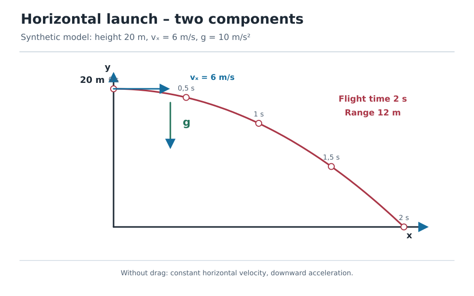

# M14-L2 – Free fall and projectile motion {#L2}

**Course area:** M14 – Motion models and mechanics in the introductory phase. **Level:** introductory upper secondary (state-specific scope). **Prerequisite:** [M14-L1](M14-L1.md). **Learning objective:** Calculate free fall and horizontal launch as superposed motions and state the assumptions.

## Starting question {#S1}

A ball travels horizontally past the edge of a table. Why does it follow a curved path rather than falling first and moving horizontally afterwards?

## Concepts and relationships {#S2}

Near Earth, gravitational acceleration is often approximated by $g\approx9.81\,\mathrm{m/s^2}$. For the following school calculations we explicitly use the simplified value $g=10\,\mathrm{m/s^2}$. Take horizontal $x$ and upward-positive $y$. With **horizontal launch** and negligible air resistance,

$$x(t)=x_0+v_{0x}t,\qquad y(t)=y_0-\tfrac12gt^2.$$

Horizontal velocity is constant ($a_x=0$); downward vertical velocity grows in magnitude, with $v_y=-gt$. These components act **simultaneously** and share the same time $t$. The trajectory is parabolic. For a body **released from rest**, $v_{0x}=0$ and fall time from height $h$ is $t=\sqrt{2h/g}$. In this ideal model, a body released from the same height at the same instant lands alongside one launched horizontally.

These heights and ranges are mathematical examples, not instructions to perform hazardous projectile experiments.

*Horizontal and vertical motion occur simultaneously.*

## Worked example {#S3}

Imagine a horizontal launch from $h=20\,\mathrm m$ with $v_{0x}=6\,\mathrm{m/s}$. Use the simplified $g=10\,\mathrm{m/s^2}$. Solving $0=20-\frac12\cdot10t^2$ gives $t=2\,\mathrm s$. The horizontal range is $\Delta x=6\cdot2=12\,\mathrm m$. Just before impact, $v_y=-20\,\mathrm{m/s}$ while $v_x=6\,\mathrm{m/s}$ remains constant.

## Investigation and practice {#S4}

**Safe model activity:** In a spreadsheet list $t=0,0.5,1,1.5,2\,\mathrm s$. Calculate $x=6t$, $y=20-5t^2$ and plot the trajectory. Identify the numbers as theoretical simulation values; do not reproduce a launch from height.

## Check your learning {#S5}

### Questions

1. Find the fall time from rest for $h=5\,\mathrm m$ at $g=10\,\mathrm{m/s^2}$.
2. How far does a horizontally moving object travel in $1.5\,\mathrm s$ at constant $v_x=4\,\mathrm{m/s}$?
3. What is its horizontal acceleration when air drag is neglected?
4. Why do a released body and one launched horizontally land at the same time in the ideal model?

### Answers

1. $t=\sqrt{2\cdot5/10}=1\,\mathrm s$.
2. $\Delta x=4\cdot1.5=6\,\mathrm m$.
3. $a_x=0$.
4. Both start with $v_{0y}=0$ from the same height and have identical vertical acceleration $-g$.

## Model limitations {#S6}

In reality, drag and buoyancy affect trajectories and $g$ is not exactly constant everywhere. The ideal parabola is an approximation and does not justify an unsafe experiment.

## Further reading (internal) {#S7}

- [M14-L1](M14-L1.md) · Review prerequisite
- [M14-L3](M14-L3.md) · Next lesson

## Sources (external) {#S8}

- [NRW – Upper-secondary Physics core curriculum (2022)](https://www.schulentwicklung.nrw.de/lehrplaene/lehrplan/332/gost_klp_ph_2022_06_07.pdf) · pp. 26 onward: introductory phase, mechanics, kinematics, dynamics and circular motion; mandate is state-specific · Last accessed: 2026-11-21 · Content verified: 2026-11-21
- [Berlin-Brandenburg – Upper-secondary Physics curriculum, Part C (2022)](https://bildungsserver.berlin-brandenburg.de/fileadmin/bbb/unterricht/rahmenlehrplaene/gymnasiale_oberstufe/curricula/2022/Teil_C_RLP_GOST_2022_Physik.pdf) · Chapter 3.1: elective introductory-phase topics – projectile motion, experimentation and circular motion · Last accessed: 2026-11-21 · Content verified: 2026-11-21
- [OpenStax – University Physics 1, 4.3 Projectile Motion](https://openstax.org/books/university-physics-volume-1/pages/4-3-projectile-motion) · Section 4.3: separate horizontal and vertical components of projectile motion · Last accessed: 2026-11-21 · Content verified: 2026-11-21

## Evidence {#S9}

