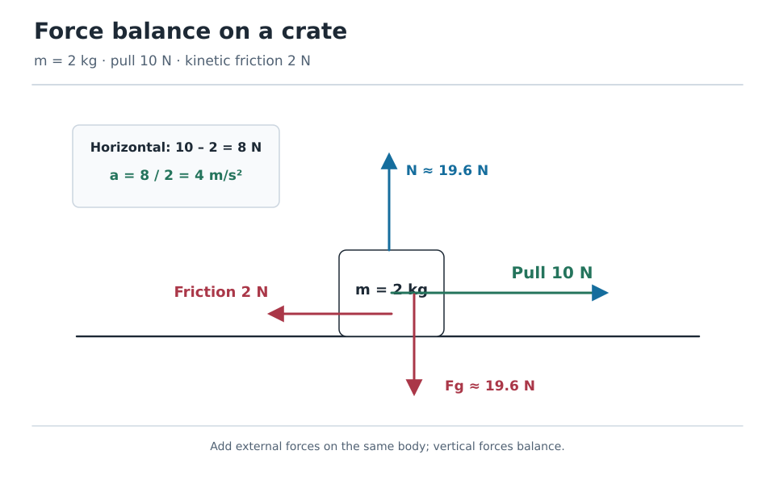

# M14-L3 – Newton’s laws in multistep situations {#L3}

**Course area:** M14 – Motion models and mechanics in the introductory phase. **Level:** introductory upper secondary (state-specific scope). **Prerequisite:** [M14-L2](M14-L2.md). **Learning objective:** Build free-body diagrams, apply Newton’s second law by components and distinguish interaction force pairs.

## Starting question {#S1}

Two people pull a crate in opposite directions. Does the mere presence of a pull to the right guarantee acceleration to the right?

## Concepts and relationships {#S2}

Newton’s three laws provide a dynamical model for speeds far below the speed of light. **Inertia:** With zero net external force, velocity remains constant, including rest. **Dynamics:** The vector sum of **external** forces equals $\sum\vec F=m\vec a$. **Interaction:** If object A pushes or pulls B, then B exerts an equal and opposite force on A. These forces act on **different objects** and therefore never cancel on the free-body diagram of just one object.

Start a problem by selecting the **system** and drawing every force acting on it. Horizontally, one may write $F_\mathrm{pull}-F_\mathrm{friction}=ma_x$; vertically, for a body on a level support, often $N-mg=0$. Motion depends on the **net** force, not the largest individual force. Forces that balance on one body are not automatically a Newton-third-law pair.

The simple form of the second law assumes a suitable approximately **inertial reference frame** and constant mass in the school model. Accelerating and rotating frames need additional care.

*Net external force produces acceleration; vertical forces balance in this model.*

## Worked example {#S3}

A $2\,\mathrm{kg}$ crate is pulled right with $10\,\mathrm N$ and experiences $2\,\mathrm N$ kinetic friction to the left. The net horizontal force is $10-2=8\,\mathrm N$, so $a=8/2=4\,\mathrm{m/s^2}$. Weight ($\approx19.6\,\mathrm N$) and the equal normal force cancel only **vertically**. The crate accelerates horizontally.

## Investigation and practice {#S4}

**Paper and simulation activity:** Draw free-body diagrams for the same crate with pulls of 0 N, 2 N and 10 N while it is sliding against 2 N friction. Discuss why static friction changes with applied force and must not automatically be assigned a fixed 2 N before sliding begins.

## Check your learning {#S5}

### Questions

1. Find $a$ if $m=4\,\mathrm{kg}$ and net force is $12\,\mathrm N$.
2. Why are weight and the normal force on a stationary crate not an action–reaction pair?
3. An object moves with constant velocity. What is its net external force?
4. A 9 N pull acts right, 4 N drag left, and $m=1\,\mathrm{kg}$. Find $a$.

### Answers

1. $a=12/4=3\,\mathrm{m/s^2}$.
2. Both act on the same crate; interaction forces must act on different objects.
3. $\sum\vec F=0$ in the chosen inertial frame.
4. $F_\mathrm{net}=5\,\mathrm N$ to the right and $a=5\,\mathrm{m/s^2}$.

## Model limitations {#S6}

Friction values are model-dependent. When combining bodies into one system, identify which contact forces are internal and which are external.

## Further reading (internal) {#S7}

- [M14-L2](M14-L2.md) · Review prerequisite
- [M14-L4](M14-L4.md) · Next lesson

## Sources (external) {#S8}

- [NRW – Upper-secondary Physics core curriculum (2022)](https://www.schulentwicklung.nrw.de/lehrplaene/lehrplan/332/gost_klp_ph_2022_06_07.pdf) · pp. 26 onward: introductory phase, mechanics, kinematics, dynamics and circular motion; mandate is state-specific · Last accessed: 2026-11-21 · Content verified: 2026-11-21
- [OpenStax – University Physics 1, 6.1 Solving Problems with Newton’s Laws](https://openstax.org/books/university-physics-volume-1/pages/6-1-solving-problems-with-newtons-laws) · Section 6.1: free-body diagrams and net external forces · Last accessed: 2026-11-21 · Content verified: 2026-11-21

## Evidence {#S9}

