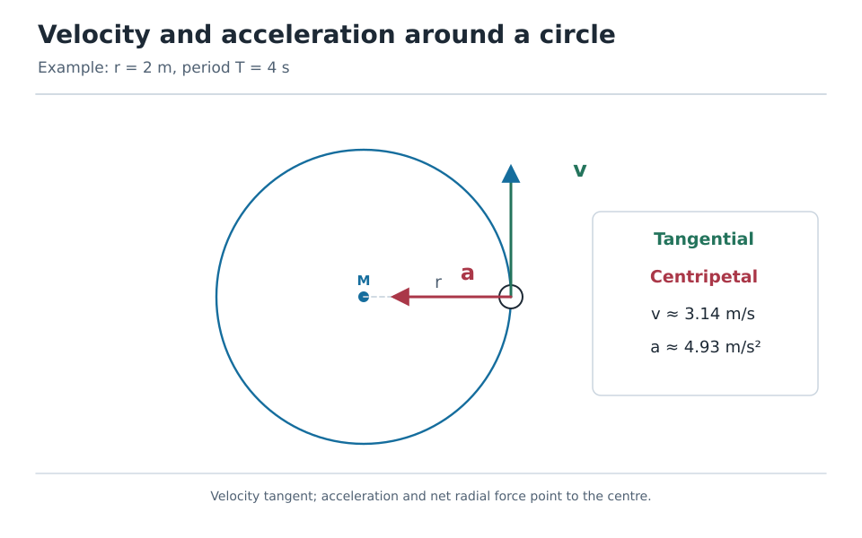

# M14-L4 – Circular motion and centripetal acceleration {#L4}

**Course area:** M14 – Motion models and mechanics in the introductory phase. **Level:** introductory upper secondary (state-specific scope). **Prerequisite:** [M14-L3](M14-L3.md). **Learning objective:** Separate tangential velocity from inward acceleration and calculate uniform circular motion.

## Starting question {#S1}

A wheel turns at constant speed. The magnitude of its velocity stays constant. Why is it still accelerating?

## Concepts and relationships {#S2}

Velocity is a **vector**. During uniform circular motion its direction continually changes even if its magnitude is fixed. Consequently the object has **centripetal acceleration** toward the circle’s centre:

$$a_\mathrm c=\frac{v^2}{r}=\omega^2r,\qquad v=\frac{2\pi r}{T}.$$

Here $r$ is radius, $T$ the period and $\omega=2\pi/T$ the angular speed. The required **net radial force** is $F_\mathrm c=ma_\mathrm c$. “Centripetal force” is not an extra kind of force: a rope’s tension, friction or gravity may supply the needed inward resultant. **Velocity** is tangent to the circle, whereas **acceleration** is radially inward and perpendicular to velocity.

If speed changes as well, tangential acceleration must also be included. An apparent outward “centrifugal force” arises in a rotating non-inertial frame; it is not an additional external force acting on the orbiting body in a stationary inertial frame.

*Uniform circular motion keeps speed constant but continually changes velocity direction.*

## Worked example {#S3}

An object travels in a circle of radius $r=2\,\mathrm m$, completing a revolution in $T=4\,\mathrm s$. Then $v=2\pi\cdot2/4=\pi\,\mathrm{m/s}\approx3.14\,\mathrm{m/s}$ and $a_\mathrm c=v^2/r=\pi^2/2\approx4.93\,\mathrm{m/s^2}$. For $m=0.5\,\mathrm{kg}$, $F_\mathrm c\approx2.47\,\mathrm N$. The force arrow points toward the centre at each position.

## Investigation and practice {#S4}

**Paper rotation model:** Mark four equally spaced points around a circle. At each point draw tangent velocity and radially inward acceleration. Label a possible physical cause of the inward force. No fast-spinning equipment is required.

## Check your learning {#S5}

### Questions

1. Which direction does instantaneous velocity point during circular motion?
2. If $v$ doubles while radius is fixed, by what factor does $a_\mathrm c$ change?
3. Calculate $a_\mathrm c$ for $v=4\,\mathrm{m/s}$ and $r=2\,\mathrm m$.
4. Is centripetal force an extra independent interaction?

### Answers

1. Along a tangent to the path.
2. It becomes four times larger because $a_\mathrm c\propto v^2$.
3. $a_\mathrm c=4^2/2=8\,\mathrm{m/s^2}$.
4. No. It denotes the inward resultant of real forces.

## Model limitations {#S6}

Nonuniform circular motion also has tangential acceleration; limited friction or tension may end circular motion. The arrows in a diagram illustrate directions rather than exact force magnitudes.

## Further reading (internal) {#S7}

- [M14-L3](M14-L3.md) · Review prerequisite
- [M14-L5](M14-L5.md) · Next lesson

## Sources (external) {#S8}

- [NRW – Upper-secondary Physics core curriculum (2022)](https://www.schulentwicklung.nrw.de/lehrplaene/lehrplan/332/gost_klp_ph_2022_06_07.pdf) · pp. 26 onward: introductory phase, mechanics, kinematics, dynamics and circular motion; mandate is state-specific · Last accessed: 2026-11-21 · Content verified: 2026-11-21
- [Berlin-Brandenburg – Upper-secondary Physics curriculum, Part C (2022)](https://bildungsserver.berlin-brandenburg.de/fileadmin/bbb/unterricht/rahmenlehrplaene/gymnasiale_oberstufe/curricula/2022/Teil_C_RLP_GOST_2022_Physik.pdf) · Chapter 3.1: elective introductory-phase topics – projectile motion, experimentation and circular motion · Last accessed: 2026-11-21 · Content verified: 2026-11-21
- [OpenStax – University Physics 1, 6.3 Centripetal Force](https://openstax.org/books/university-physics-volume-1/pages/6-3-centripetal-force) · Section 6.3: centripetal acceleration and inward net force · Last accessed: 2026-11-21 · Content verified: 2026-11-21

## Evidence {#S9}

