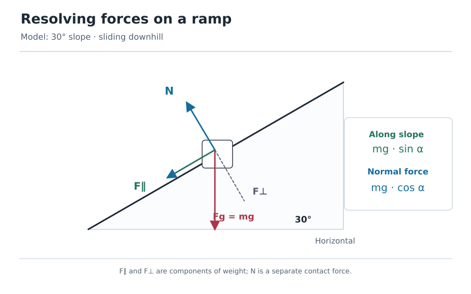

# M14-L5 – Forces on an inclined plane {#L5}

**Course area:** M14 – Motion models and mechanics in the introductory phase. **Level:** introductory upper secondary (state-specific scope). **Prerequisite:** [M14-L4](M14-L4.md). **Learning objective:** Resolve weight parallel/perpendicular to a slope and calculate acceleration with friction.

## Starting question {#S1}

Why is a heavy crate easier to hold on a gentle ramp than on a steep one even though its weight stays the same?

## Concepts and relationships {#S2}

For a slope inclined by angle $\alpha$ above the horizontal, choose axes **parallel** and **perpendicular** to the surface. Weight $\vec F_g=m\vec g$ always points vertically down. Its components have magnitudes

$$F_\parallel=mg\sin\alpha,\qquad F_\perp=mg\cos\alpha.$$

If the body remains in contact and no other perpendicular forces act, the normal force is $N=F_\perp$. During **sliding**, approximate kinetic friction by $F_\mathrm f=\mu_kN$, opposite the sliding direction. For downhill sliding under gravity and kinetic friction alone, $ma=mg\sin\alpha-\mu_kmg\cos\alpha$, hence $a=g(\sin\alpha-\mu_k\cos\alpha)$. This only applies where the assumed direction of sliding is consistent with the situation.

For an initially **stationary** object, static friction must be checked separately: it adjusts to oppose impending motion up to the maximum $\mu_sN$. Never substitute kinetic friction for static friction or assume that the normal force on a slope is always $mg$.

*Weight splits into along- and across-slope components; the normal force is a separate interaction.*

## Worked example {#S3}

A crate of mass $m=2\,\mathrm{kg}$ slides downhill on a $30^\circ$ slope. For a teaching calculation take $g=10\,\mathrm{m/s^2}$ and $\mu_k=0.20$. Downhill component: $F_\parallel=2\cdot10\cdot0.5=10\,\mathrm N$. Normal force: $N=20\cos30^\circ\approx17.32\,\mathrm N$. Friction: $F_\mathrm f\approx3.46\,\mathrm N$ uphill. Net downhill force is $6.54\,\mathrm N$, giving $a\approx3.27\,\mathrm{m/s^2}$.

## Investigation and practice {#S4}

**Geometric model:** Draw slopes of $15^\circ$, $30^\circ$ and $45^\circ$. Construct the directions of $F_g$, $F_\parallel$ and $F_\perp$ and compare their magnitudes using trigonometry. Do not release heavy rolling objects on unsecured ramps.

## Check your learning {#S5}

### Questions

1. Find $F_\parallel$ for $m=3\,\mathrm{kg}$, $g=10\,\mathrm{m/s^2}$ and $\alpha=30^\circ$.
2. Find the normal force $N$ under those conditions with no extra perpendicular forces.
3. Which way does friction act while the crate slides downhill?
4. Why is $F_\mathrm f=\mu_kN$ not sufficient for a stationary crate?

### Answers

1. $F_\parallel=3\cdot10\cdot0.5=15\,\mathrm N$.
2. $N=30\cos30^\circ\approx25.98\,\mathrm N$.
3. Kinetic friction acts uphill.
4. Static friction varies up to a limiting value, so its actual magnitude need not equal kinetic friction.

## Model limitations {#S6}

Real friction depends on materials, surface condition and sometimes speed. Without knowing whether motion has begun and what other forces act, its magnitude and direction cannot be assumed.

## Further reading (internal) {#S7}

- [M14-L4](M14-L4.md) · Review prerequisite
- [M14-L6](M14-L6.md) · Next lesson

## Sources (external) {#S8}

- [NRW – Upper-secondary Physics core curriculum (2022)](https://www.schulentwicklung.nrw.de/lehrplaene/lehrplan/332/gost_klp_ph_2022_06_07.pdf) · pp. 26 onward: introductory phase, mechanics, kinematics, dynamics and circular motion; mandate is state-specific · Last accessed: 2026-11-21 · Content verified: 2026-11-21
- [OpenStax – University Physics 1, 5.6 Common Forces](https://openstax.org/books/university-physics-volume-1/pages/5-6-common-forces) · Section 5.6: gravity components and normal force on an incline · Last accessed: 2026-11-21 · Content verified: 2026-11-21

## Evidence {#S9}

