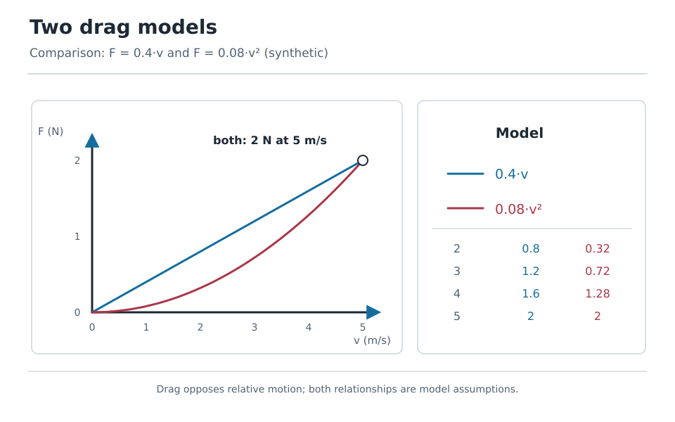

# M14-L6 – Comparing friction and air-drag models {#L6}

**Course area:** M14 – Motion models and mechanics in the introductory phase. **Level:** introductory upper secondary (state-specific scope). **Prerequisite:** [M14-L5](M14-L5.md). **Learning objective:** Distinguish approximately constant sliding friction from velocity-dependent drag and assess model applicability.

## Starting question {#S1}

A paper sheet falls through air much more slowly than a metal sphere. Why cannot one fixed friction force account for both?

## Concepts and relationships {#S2}

**Dry kinetic friction** between solid surfaces is often approximated during sliding by the simple Coulomb model $F_\mathrm f\approx\mu_kN$. Within that model its magnitude is largely independent of sliding speed and points against relative motion. **Fluid drag** in air or water, however, commonly depends on velocity. Two model regimes are $F_D=kv$ for certain low-speed flows and $F_D=cv^2$ in others, where $v$ is the **magnitude of velocity relative to the fluid**. The actual drag force acts against that motion.

The coefficient $c$ bundles properties such as fluid density, shape and cross-sectional area under simplified conditions; in $F_D=cv^2$ its unit is $\mathrm{kg/m}$. For downward-positive motion under gravity, $ma=mg-cv^2$. **Terminal speed** is reached when the forces balance:

$$v_\mathrm{term}=\sqrt{mg/c}.$$

At that point the body continues at constant speed; it does not stop in midair. A linear $F_D=kv$ model would yield $v_\mathrm{term}=mg/k$. Choosing between models requires relevant observations, not merely a curve that looks plausible.

*Linear and quadratic drag agree at one point but not over the full speed range.*

## Worked example {#S3}

For a hypothetical falling object with $m=0.20\,\mathrm{kg}$, $g=10\,\mathrm{m/s^2}$ and $c=0.08\,\mathrm{kg/m}$, weight is $mg=2\,\mathrm N$. At $v=2\,\mathrm{m/s}$, $F_D=0.08\cdot2^2=0.32\,\mathrm N$ and the net downward force is $1.68\,\mathrm N$. At $v=5\,\mathrm{m/s}$, drag is 2 N so $a=0$. The predicted terminal speed is $\sqrt{2/0.08}=5\,\mathrm{m/s}$.

## Investigation and practice {#S4}

**Synthetic model comparison:** Plot $F_D=0.4v$ and $F_D=0.08v^2$ in newtons for $v=0,1,2,3,4,5\,\mathrm{m/s}$. Both give 2 N at 5 m/s but differ in between. Explain why agreement at one point is insufficient to confirm a model.

## Check your learning {#S5}

### Questions

1. Find $F_D$ for $v=3\,\mathrm{m/s}$ and $c=0.08\,\mathrm{kg/m}$.
2. What happens to $cv^2$ when speed doubles?
3. What does force balance mean at terminal speed?
4. Why should an approximately constant $\mu_kN$ law not automatically model air drag?

### Answers

1. $F_D=0.08\cdot9=0.72\,\mathrm N$.
2. Its magnitude becomes four times larger.
3. $mg=F_D$, hence $a=0$ while velocity remains constant and nonzero.
4. Air drag often depends strongly on relative speed, flow regime, shape and fluid density.

## Model limitations {#S6}

Linear and quadratic drag describe different regimes, not interchangeable universal laws. The coefficient can change with shape, orientation and flow; real high-altitude drop tests are inappropriate for school learners.

## Further reading (internal) {#S7}

- [M14-L5](M14-L5.md) · Review prerequisite
- [M14-L7](M14-L7.md) · Next lesson

## Sources (external) {#S8}

- [NRW – Upper-secondary Physics core curriculum (2022)](https://www.schulentwicklung.nrw.de/lehrplaene/lehrplan/332/gost_klp_ph_2022_06_07.pdf) · pp. 26 onward: introductory phase, mechanics, kinematics, dynamics and circular motion; mandate is state-specific · Last accessed: 2026-11-21 · Content verified: 2026-11-21
- [OpenStax – University Physics 1, 6.4 Drag Force and Terminal Speed](https://openstax.org/books/university-physics-volume-1/pages/6-4-drag-force-and-terminal-speed) · Section 6.4: velocity-dependent fluid resistance and terminal speed · Last accessed: 2026-11-21 · Content verified: 2026-11-21

## Evidence {#S9}

