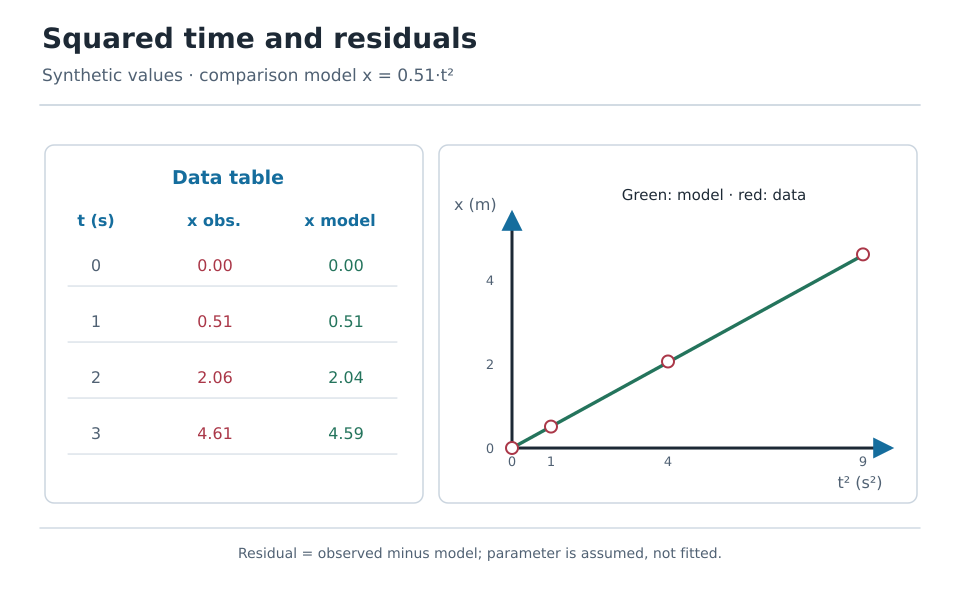

# M14-L7 – Mechanics experiments and error analysis {#L7}

**Course area:** M14 – Motion models and mechanics in the introductory phase. **Level:** introductory upper secondary (state-specific scope). **Prerequisite:** [M14-L6](M14-L6.md). **Learning objective:** Analyse data series, assess model parameters, report uncertainty and limit conclusions appropriately.

## Starting question {#S1}

A cart seems to accelerate. How can position–time readings test whether its acceleration is approximately constant?

## Concepts and relationships {#S2}

A good experiment starts with a **precise question**, a testable hypothesis and a plan: Which variable changes, which is measured and what is kept constant? In mechanics, a **secured, bounded** trolley track may be used with markers and digital timing. For a start from rest and assumed constant acceleration, $x(t)=x_0+\tfrac12at^2$. Plotting $x-x_0$ against $t^2$ should therefore yield an approximately straight line with slope $a/2$. A curved position–time plot alone cannot establish the model assumptions.

Record units, zero settings, timing resolution and likely systematic effects. **Random variation** can be investigated through repetitions; systematic sensor delay may persist after repeated measurements. A **residual** is $x_\mathrm{reading}-x_\mathrm{model}$. A patterned set of residuals can reveal an inadequate model. Measurement uncertainty should accompany a claim and is not the same thing as the maximum residual.

The following series is **synthetic, not data from a real experiment**. It illustrates the process without pretending that measurements were made.

*Differences from a chosen model are residuals, not direct measurement uncertainties.*

## Worked example {#S3}

For $t=0,1,2,3\,\mathrm s$, take synthetic positions $x=0,0.51,2.06,4.61\,\mathrm m$. A chosen comparison model $x_\mathrm{model}=0.51t^2$ predicts $0,0.51,2.04,4.59\,\mathrm m$. The residuals are $0,0,+0.02,+0.02\,\mathrm m$. The slope in a position-versus-$t^2$ graph is $0.51\,\mathrm{m/s^2}$, corresponding to $a=1.02\,\mathrm{m/s^2}$. This value is an **assumed model parameter**, not a statistically estimated experimental result. Real analysis would require model fitting, uncertainty and additional repeated measurements.

## Investigation and practice {#S4}

**Safe classroom design:** Write a procedure for a light cart on a short, secured and bounded track, including end stop, three repeats at each timing marker and units. Alternatively use provided or synthetic data only. Make a plot of $x$ against $t^2$ and a residual plot; contrast it with constant-velocity motion.

## Check your learning {#S5}

### Questions

1. Why is a plot of $x$ against $t^2$ helpful when acceleration is assumed constant from rest?
2. Find $x_\mathrm{model}$ at $t=2\,\mathrm s$ from $x_\mathrm{model}=0.51t^2$.
3. Find the residual for $x_\mathrm{reading}=2.06\,\mathrm m$ at $t=2\,\mathrm s$.
4. How do random scatter and systematic measurement error differ?

### Answers

1. Because $x-x_0=\tfrac12at^2$ is linear in $t^2$ with slope $a/2$.
2. $x_\mathrm{model}=0.51\cdot4=2.04\,\mathrm m$.
3. $r=2.06-2.04=+0.02\,\mathrm m$.
4. Random effects vary between repeats; systematic effects produce a persistent offset or bias.

## Model limitations {#S6}

Without calibrated distances and timing, independent repeats and documented uncertainties, agreement with this chosen model does not establish a reliable experimental parameter. Synthetic numbers are not empirical evidence.

## Further reading (internal) {#S7}

- [M14-L6](M14-L6.md) · Review prerequisite
**Looking ahead:** The next module begins with [M15-L1 – Mechanical work, energy and conservative forces](M15-L1.md).

## Sources (external) {#S8}

- [Berlin-Brandenburg – Upper-secondary Physics curriculum, Part C (2022)](https://bildungsserver.berlin-brandenburg.de/fileadmin/bbb/unterricht/rahmenlehrplaene/gymnasiale_oberstufe/curricula/2022/Teil_C_RLP_GOST_2022_Physik.pdf) · Chapter 3.1: elective introductory-phase topics – projectile motion, experimentation and circular motion · Last accessed: 2026-11-21 · Content verified: 2026-11-21
- [NIST – Measurement Uncertainty](https://www.nist.gov/itl/sed/topic-areas/measurement-uncertainty) · Metrology guidance: measurement uncertainty, statistical and systematic effects · Last accessed: 2026-11-21 · Content verified: 2026-11-21
- [OpenStax – University Physics 1, 3.4 Motion with Constant Acceleration](https://openstax.org/books/university-physics-volume-1/pages/3-4-motion-with-constant-acceleration) · Section 3.4: kinematic equations and constant-acceleration assumptions · Last accessed: 2026-11-21 · Content verified: 2026-11-21

## Evidence {#S9}

