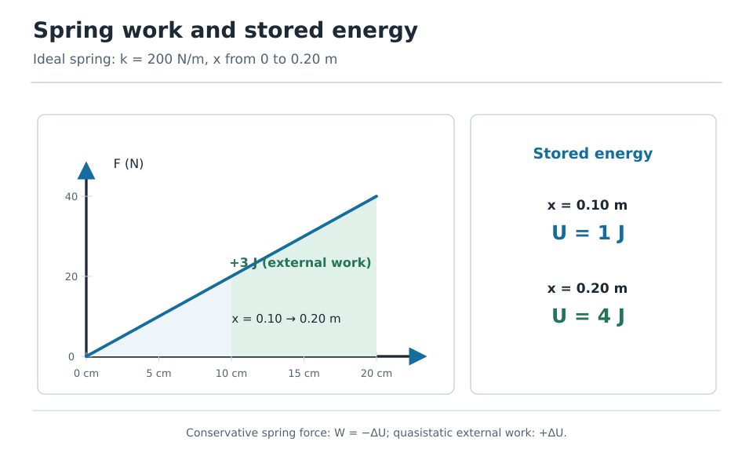

# M15-L1 – Mechanical work, energy and conservative forces {#L1}

**Course area:** M15 – Conservation laws, collisions and gravitation. **Level:** introductory upper secondary (state-specific scope). **Prerequisite:** [M14-L7](M14-L7.md). **Learning objective:** Calculate spring and gravitational potential energy and interpret work by conservative forces as the negative change in potential energy.

## Starting question {#S1}

A spring is extended from 10 cm to 20 cm. Does doubling the extension double the required work? The force law gives a different answer.

## Concepts and relationships {#S2}

**Mechanical work** represents energy transfer by a force acting along a displacement. For a constant force, $W=Fs\cos\alpha$; for a variable force, work is the signed area under the force–displacement graph. Its unit is $1\,\mathrm J=1\,\mathrm{N\,m}$. Work is positive when the force acts along the displacement and negative when it opposes motion.

A **conservative force** does work between two positions that is independent of the path taken. It has an associated potential energy $U$, so $W_{\mathrm{conservative}}=-\Delta U$. Near Earth's surface, for an approximately uniform gravitational field, $U_g=mgh$ relative to a selected zero level. An ideal spring of stiffness $k$ and extension $x$ obeys $F_{\mathrm{spring}}=-kx$ and stores $U_s=\tfrac12kx^2$. The negative sign means the spring force points toward equilibrium.

**Pay attention to whose work is being calculated.** The spring's work is the opposite of the work done by the person slowly stretching it. With a quasistatic motion and negligible losses, $W_{\mathrm{external}}=+\Delta U_s$ and $W_{\mathrm{spring}}=-\Delta U_s$. Friction cannot be represented by a position-only potential energy in this simple model: its work depends on the path length.

Changing the zero height shifts numerical potential energies but not their differences. If force is not constant, integrate it or estimate the area from measurements.

*Green trapezoid area is 3 J: external work stretching slowly, while the spring performs −3 J.*

## Worked example {#S3}

An ideal spring with $k=200\,\mathrm{N/m}$ is stretched from $x_1=0.10\,\mathrm m$ to $x_2=0.20\,\mathrm m$. First, $U_1=\tfrac12\cdot200\cdot0.10^2=1\,\mathrm J$; next, $U_2=4\,\mathrm J$. The stored energy increases by $3\,\mathrm J$. The hands slowly stretching it do $+3\,\mathrm J$ of work, while the spring does $-3\,\mathrm J$. Between 0.10 and 0.20 m, the force-magnitude graph contains a trapezoid of heights 20 N and 40 N: $(20+40)\cdot0.10/2=3\,\mathrm J$.

## Investigation and practice {#S4}

**Testable sketch:** Plot force magnitudes at 0, 5, 10, 15 and 20 cm for $k=200\,\mathrm{N/m}$. Compare the areas over 0–10 cm and 10–20 cm without physically stretching a strong spring. Use the original figure to discuss the quantities.

## Check your learning {#S5}

### Questions

1. Find spring energy for $k=200\,\mathrm{N/m}$ and $x=0.15\,\mathrm m$.
2. How much external work is needed to stretch the spring slowly from 0 to 0.10 m?
3. What happens to spring energy when extension is doubled at fixed $k$?
4. A $2\,\mathrm{kg}$ mass rises by $3\,\mathrm m$ with model value $g=10\,\mathrm{m/s^2}$. Find $\Delta U_g$.

### Answers

1. $U_s=\tfrac12\cdot200\cdot0.15^2=2.25\,\mathrm J$.
2. $W_{\mathrm{external}}=1\,\mathrm J$.
3. It becomes four times larger because $U_s$ depends on $x^2$.
4. $\Delta U_g=mgh=2\cdot10\cdot3=60\,\mathrm J$.

## Model limitations {#S6}

Hooke’s law applies to a spring within its ideal linear-elastic range. Material hysteresis, internal friction, and permanent deformation are omitted. The $mgh$ model assumes approximately constant $g$; gravitational potential differs at large altitudes.

## Further reading (internal) {#S7}

- [M14-L7](M14-L7.md) · Review prerequisite
- [M15-L2](M15-L2.md) · Next lesson

## Sources (external) {#S8}

- [NRW – Upper-secondary Physics core curriculum (2022)](https://lehrplannavigator.nrw.de/system/files/media/document/file/gost_klp_ph_2022_06_07.pdf) · pp. 26, 28: introductory mechanics and circular motion/gravitation; conservation and collisions · Last accessed: 2026-11-21 · Content verified: 2026-11-21
- [Berlin-Brandenburg – Upper-secondary Physics curriculum, Part C (2022)](https://bildungsserver.berlin-brandenburg.de/fileadmin/bbb/unterricht/rahmenlehrplaene/gymnasiale_oberstufe/curricula/2022/Teil_C_RLP_GOST_2022_Physik.pdf) · pp. 21–22: optional introductory-phase momentum and energy; gravity also covered in qualification phase 3.2.1 · Last accessed: 2026-11-21 · Content verified: 2026-11-21
- [OpenStax – University Physics 1, 7.1 Work](https://openstax.org/books/university-physics-volume-1/pages/7-1-work) · Section 7.1: work by constant and variable forces · Last accessed: 2026-11-21 · Content verified: 2026-11-21
- [OpenStax – University Physics 1, 8.1 Potential Energy](https://openstax.org/books/university-physics-volume-1/pages/8-1-potential-energy-of-a-system) · Section 8.1: spring and gravitational potential energy · Last accessed: 2026-11-21 · Content verified: 2026-11-21
- [OpenStax – University Physics 1, 8.2 Conservative Forces](https://openstax.org/books/university-physics-volume-1/pages/8-2-conservative-and-non-conservative-forces) · Section 8.2: conservative forces and path independence · Last accessed: 2026-11-21 · Content verified: 2026-11-21

## Evidence {#S9}

