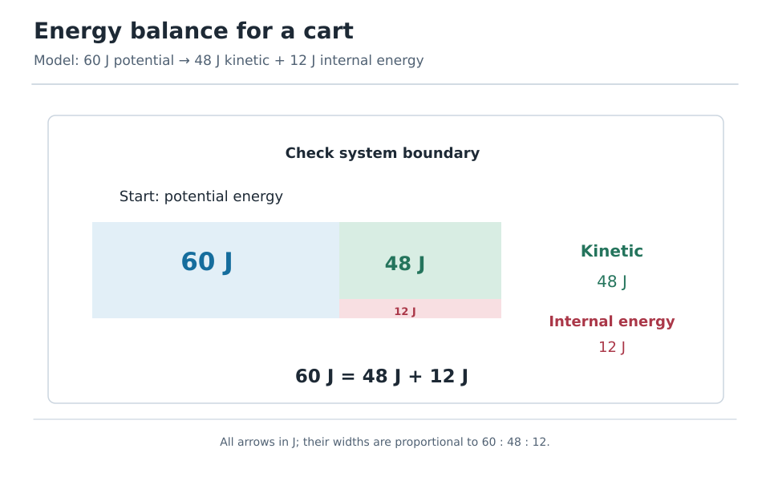

# M15-L2 – Conservation of energy across several stages {#L2}

**Course area:** M15 – Conservation laws, collisions and gravitation. **Level:** introductory upper secondary (state-specific scope). **Prerequisite:** [M15-L1](M15-L1.md). **Learning objective:** Construct multi-stage energy balances including thermal transfer and dissipation, and state the conditions for mechanical-energy conservation.

## Starting question {#S1}

A cart descends a ramp and brakes along a rough section. Its final kinetic energy is less than the initial gravitational potential energy. Where did the difference go?

## Concepts and relationships {#S2}

In an **isolated system**, total energy is conserved. It can be transferred between gravitational potential energy $U$, kinetic energy $K=\tfrac12mv^2$, internal energy, and other forms. However, **mechanical energy** $E_\mathrm{mech}=K+U$ remains constant only if nonconservative interactions do not convert or transfer mechanical energy.

Begin with a **system boundary**. For a cart, Earth's gravitational interaction, and a rough track, we can write $U_{\mathrm{start}}+K_{\mathrm{start}}=U_{\mathrm{finish}}+K_{\mathrm{finish}}+\Delta E_{\mathrm{thermal}}$ if no other transfers occur. Equivalently, $\Delta(K+U)=W_{\mathrm{nonconservative}}$. Negative work by friction does not mean that energy was destroyed: the internal energy of the contacting bodies increases.

A **Sankey diagram** displays energy flows in joules, with arrow widths proportional to the energy amounts under a single scale. Report a percentage as an efficiency only if *useful output* and a relevant input energy are clearly defined. Energy is not simply 'used up': it is transferred or dispersed into other forms.

*60 J of gravitational potential energy becomes 48 J kinetic and 12 J internal energy.*

## Worked example {#S3}

A $2\,\mathrm{kg}$ cart starts from rest at height $h=3\,\mathrm m$. We explicitly use the simplified $g=10\,\mathrm{m/s^2}$, ignore rotation and take the final height as zero. Its initial gravitational potential energy is $60\,\mathrm J$. Along the track, $12\,\mathrm J$ becomes internal energy. Thus the cart reaches the bottom with $K=60-12=48\,\mathrm J$. From $K=\tfrac12mv^2$, $v=\sqrt{2\cdot48/2}=\sqrt{48}\approx6.93\,\mathrm{m/s}$. The mechanical subsystem loses 12 J; the total system does not.

## Investigation and practice {#S4}

**Energy-flow check:** Draw a 60 J input arrow and 48 J and 12 J outgoing arrows with appropriate widths. State whether your system includes the cart alone or the cart, Earth, and track. Identify a possible measurement for each energy amount.

## Check your learning {#S5}

### Questions

1. What is the starting potential energy for $m=2\,\mathrm{kg}$ and $h=4\,\mathrm m$ with $g=10\,\mathrm{m/s^2}$?
2. Out of 80 J, 20 J is transferred to internal energy. What kinetic energy remains if nothing else changes?
3. What speed corresponds to 60 J of kinetic energy for a $3\,\mathrm{kg}$ body?
4. Is the statement “friction destroys energy” correct?

### Answers

1. $80\,\mathrm J$.
2. $K=60\,\mathrm J$.
3. $v=\sqrt{2K/m}=\sqrt{40}\approx6.32\,\mathrm{m/s}$.
4. No. Mechanical energy is transferred to other forms, especially internal energy; total energy is conserved.

## Model limitations {#S6}

Rolling wheels also store rotational energy. Sound, deformation, and thermal transfer to the environment can add further flows. The example is an intentionally simplified numerical model, not an actual measurement.

## Further reading (internal) {#S7}

- [M15-L1](M15-L1.md) · Review prerequisite
- [M15-L3](M15-L3.md) · Next lesson

## Sources (external) {#S8}

- [NRW – Upper-secondary Physics core curriculum (2022)](https://lehrplannavigator.nrw.de/system/files/media/document/file/gost_klp_ph_2022_06_07.pdf) · pp. 26, 28: introductory mechanics and circular motion/gravitation; conservation and collisions · Last accessed: 2026-11-21 · Content verified: 2026-11-21
- [Berlin-Brandenburg – Upper-secondary Physics curriculum, Part C (2022)](https://bildungsserver.berlin-brandenburg.de/fileadmin/bbb/unterricht/rahmenlehrplaene/gymnasiale_oberstufe/curricula/2022/Teil_C_RLP_GOST_2022_Physik.pdf) · pp. 21–22: optional introductory-phase momentum and energy; gravity also covered in qualification phase 3.2.1 · Last accessed: 2026-11-21 · Content verified: 2026-11-21
- [OpenStax – University Physics 1, 8.3 Conservation of Energy](https://openstax.org/books/university-physics-volume-1/pages/8-3-conservation-of-energy) · Section 8.3: energy balances and nonconservative work · Last accessed: 2026-11-21 · Content verified: 2026-11-21
- [OpenStax – University Physics 1, 8.1 Potential Energy](https://openstax.org/books/university-physics-volume-1/pages/8-1-potential-energy-of-a-system) · Section 8.1: spring and gravitational potential energy · Last accessed: 2026-11-21 · Content verified: 2026-11-21

## Evidence {#S9}

