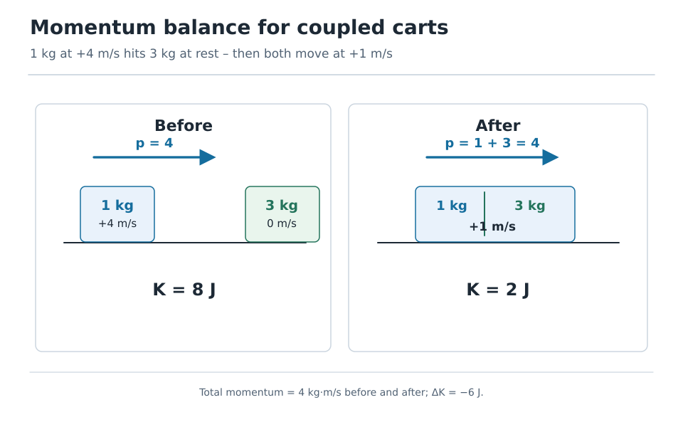

# M15-L3 – Momentum and its conservation {#L3}

**Course area:** M15 – Conservation laws, collisions and gravitation. **Level:** introductory upper secondary (state-specific scope). **Prerequisite:** [M15-L2](M15-L2.md). **Learning objective:** Calculate vector momentum and impulse and use momentum conservation when the net external impulse on a system is negligible.

## Starting question {#S1}

Two dynamics carts join after a collision. Why is their common speed lower even though total momentum remains unchanged?

## Concepts and relationships {#S2}

A body's **momentum** is the vector quantity $\vec p=m\vec v$ with units $\mathrm{kg\,m/s}=\mathrm{N\,s}$. In one dimension signs encode direction; in multiple dimensions analyse separate components. **Impulse** is the change in momentum: $\vec J=\Delta\vec p=\int\vec F\,dt$; for a constant force $\vec J=\vec F\Delta t$.

For several bodies, $\Delta\vec p_\mathrm{total}=\vec J_\mathrm{external}$. When the external impulse over the time interval is negligible, total momentum is conserved: $\sum_i m_i\vec v_{i,\mathrm{before}}=\sum_i m_i\vec v_{i,\mathrm{after}}$. Internal collision forces occur in equal-and-opposite pairs and cancel from the total balance, provided both bodies are included within the system boundary.

**Conservation of momentum does not imply conservation of kinetic energy.** If objects deform or remain attached after collision, part of the initial kinetic energy can become internal energy or sound. Total momentum can remain constant when external impulse is small. Work out separate momentum and energy balances rather than confusing them.

*With negligible external impulse, total momentum remains 4 kg m/s while kinetic energy decreases.*

## Worked example {#S3}

A $m_1=1\,\mathrm{kg}$ cart moving at $v_1=+4\,\mathrm{m/s}$ hits a stationary $m_2=3\,\mathrm{kg}$ cart. They couple and move together. Initially, $p_\mathrm{before}=1\cdot4+3\cdot0=+4\,\mathrm{kg\,m/s}$. Afterwards, $(1+3)v=4$, giving $v=+1\,\mathrm{m/s}$. Kinetic energy was initially $8\,\mathrm J$ and is finally $\tfrac12\cdot4\cdot1^2=2\,\mathrm J$, with $6\,\mathrm J$ converted to other forms. The individual cart momenta are $+4\,\mathrm{kg\,m/s}$ and $0\,\mathrm{kg\,m/s}$ before the collision, and $+1\,\mathrm{kg\,m/s}$ and $+3\,\mathrm{kg\,m/s}$ afterwards.

## Investigation and practice {#S4}

**Model comparison:** Simulate different cart masses in a single horizontal direction, make external impulse negligible, and check the sum $p_\mathrm{before}-p_\mathrm{after}$. A real demonstration must use slow, supervised school equipment only.

## Check your learning {#S5}

### Questions

1. Find the momentum of a $2\,\mathrm{kg}$ cart moving at $v=-3\,\mathrm{m/s}$.
2. A constant $10\,\mathrm N$ force acts rightward for $0.2\,\mathrm s$. What is $\Delta p$?
3. Two $2\,\mathrm{kg}$ carts moving at $+3$ and $-1\,\mathrm{m/s}$ couple. Find their final velocity.
4. Why is kinetic energy not necessarily conserved when carts stick together?

### Answers

1. $p=2\cdot(-3)=-6\,\mathrm{kg\,m/s}$.
2. $\Delta p=F\Delta t=+2\,\mathrm{N\,s}$.
3. $v=(2\cdot3+2\cdot(-1))/4=+1\,\mathrm{m/s}$.
4. Deformation, thermal energy and sound preserve total energy, but may reduce kinetic energy.

## Model limitations {#S6}

A long impact or strong friction with the floor may invalidate the negligible-external-impulse assumption. For a system containing only one cart, the other cart exerts an external force; for the combined two-cart system it is internal.

## Further reading (internal) {#S7}

- [M15-L2](M15-L2.md) · Review prerequisite
- [M15-L4](M15-L4.md) · Next lesson

## Sources (external) {#S8}

- [NRW – Upper-secondary Physics core curriculum (2022)](https://lehrplannavigator.nrw.de/system/files/media/document/file/gost_klp_ph_2022_06_07.pdf) · pp. 26, 28: introductory mechanics and circular motion/gravitation; conservation and collisions · Last accessed: 2026-11-21 · Content verified: 2026-11-21
- [Berlin-Brandenburg – Upper-secondary Physics curriculum, Part C (2022)](https://bildungsserver.berlin-brandenburg.de/fileadmin/bbb/unterricht/rahmenlehrplaene/gymnasiale_oberstufe/curricula/2022/Teil_C_RLP_GOST_2022_Physik.pdf) · pp. 21–22: optional introductory-phase momentum and energy; gravity also covered in qualification phase 3.2.1 · Last accessed: 2026-11-21 · Content verified: 2026-11-21
- [OpenStax – University Physics 1, 9.3 Conservation of Momentum](https://openstax.org/books/university-physics-volume-1/pages/9-3-conservation-of-linear-momentum) · Section 9.3: total momentum and external forces · Last accessed: 2026-11-21 · Content verified: 2026-11-21
- [OpenStax – University Physics 1, 9.2 Impulse and Collisions](https://openstax.org/books/university-physics-volume-1/pages/9-2-impulse-and-collisions) · Section 9.2: impulse and change in momentum · Last accessed: 2026-11-21 · Content verified: 2026-11-21

## Evidence {#S9}

