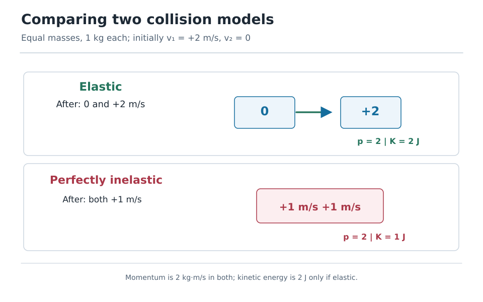

# M15-L4 – Elastic and inelastic collisions {#L4}

**Course area:** M15 – Conservation laws, collisions and gravitation. **Level:** introductory upper secondary (state-specific scope). **Prerequisite:** [M15-L3](M15-L3.md). **Learning objective:** Distinguish elastic, inelastic, and perfectly inelastic one-dimensional collisions using separate momentum and energy balances.

## Starting question {#S1}

Two identical carts collide. In one case, the incoming cart passes its motion to the other; in a second case, the carts join. What is conserved in each?

## Concepts and relationships {#S2}

A collision is **elastic** when both the total momentum and the total kinetic energy of the isolated two-body system are conserved. An **inelastic** collision conserves momentum (without external impulse) but not kinetic energy. In a **perfectly inelastic** collision the two bodies share the final velocity $v=(m_1v_1+m_2v_2)/(m_1+m_2)$.

In a central, one-dimensional, ideally elastic collision of two equal masses, with one initially at rest, the bodies exchange velocities. This follows from solving $p_\mathrm{before}=p_\mathrm{after}$ and $K_\mathrm{before}=K_\mathrm{after}$ together. For equal masses in a perfectly inelastic collision, the shared final velocity is half the incoming cart's speed.

**Total energy** is still conserved in an inelastic collision. It is the total *kinetic* energy that decreases: deformation, internal energy, and sound account for the difference. Vehicle crashes are not appropriate experiments for learners; slow educational carts and simulations can demonstrate these ideas safely.

*Total momentum stays 2 kg m/s in both cases; kinetic energy remains constant only for the elastic collision.*

## Worked example {#S3}

A cart of $m_1=1\,\mathrm{kg}$ and $v_1=+2\,\mathrm{m/s}$ strikes an identical stationary cart. **Ideal elastic:** $v_{1,\mathrm{after}}=0$, $v_{2,\mathrm{after}}=+2\,\mathrm{m/s}$, so momentum $p=2\,\mathrm{kg\,m/s}$ and kinetic energy $K=2\,\mathrm J$ are unchanged. **Perfectly inelastic:** Both move at $v_{\mathrm{after}}=(1\cdot2+1\cdot0)/2=1\,\mathrm{m/s}$. Momentum remains $2\,\mathrm{kg\,m/s}$, but $K_\mathrm{after}=\tfrac12\cdot2\cdot1^2=1\,\mathrm J$. The difference, $1\,\mathrm J$, went into other forms of energy.

## Investigation and practice {#S4}

**A table, not a crash:** For each model, list both velocities, total momentum, and total kinetic energy before and after. Draw momentum arrows with the same scale. Does the observation “the cart bounced” alone prove that the collision is elastic?

## Check your learning {#S5}

### Questions

1. Two equal-mass carts have velocities $+3$ and $0\,\mathrm{m/s}$ before an ideal central elastic collision. What are the final velocities?
2. What shared final velocity results for the same carts in a perfectly inelastic collision?
3. For two $1\,\mathrm{kg}$ carts at $+2$ and $0\,\mathrm{m/s}$, how much kinetic energy is converted in a perfectly inelastic collision?
4. Is total energy of an isolated system conserved during an inelastic collision?

### Answers

1. $v_{1,\mathrm{after}}=0$ and $v_{2,\mathrm{after}}=+3\,\mathrm{m/s}$.
2. $v_{\mathrm{after}}=+1.5\,\mathrm{m/s}$.
3. $\Delta K=2-1=1\,\mathrm J$, converted rather than destroyed.
4. Yes. Energy is transferred, for instance, to deformation, internal energy, and sound.

## Model limitations {#S6}

The velocity-exchange rule requires equal masses and an ideal head-on one-dimensional elastic collision. Real impacts take time and can be oblique, rotating, and frictional.

## Further reading (internal) {#S7}

- [M15-L3](M15-L3.md) · Review prerequisite
- [M15-L5](M15-L5.md) · Next lesson

## Sources (external) {#S8}

- [NRW – Upper-secondary Physics core curriculum (2022)](https://lehrplannavigator.nrw.de/system/files/media/document/file/gost_klp_ph_2022_06_07.pdf) · pp. 26, 28: introductory mechanics and circular motion/gravitation; conservation and collisions · Last accessed: 2026-11-21 · Content verified: 2026-11-21
- [Berlin-Brandenburg – Upper-secondary Physics curriculum, Part C (2022)](https://bildungsserver.berlin-brandenburg.de/fileadmin/bbb/unterricht/rahmenlehrplaene/gymnasiale_oberstufe/curricula/2022/Teil_C_RLP_GOST_2022_Physik.pdf) · pp. 21–22: optional introductory-phase momentum and energy; gravity also covered in qualification phase 3.2.1 · Last accessed: 2026-11-21 · Content verified: 2026-11-21
- [OpenStax – University Physics 1, 9.4 Types of Collisions](https://openstax.org/books/university-physics-volume-1/pages/9-4-types-of-collisions) · Section 9.4: elastic and inelastic collisions · Last accessed: 2026-11-21 · Content verified: 2026-11-21
- [OpenStax – University Physics 1, 9.3 Conservation of Momentum](https://openstax.org/books/university-physics-volume-1/pages/9-3-conservation-of-linear-momentum) · Section 9.3: total momentum and external forces · Last accessed: 2026-11-21 · Content verified: 2026-11-21

## Evidence {#S9}

