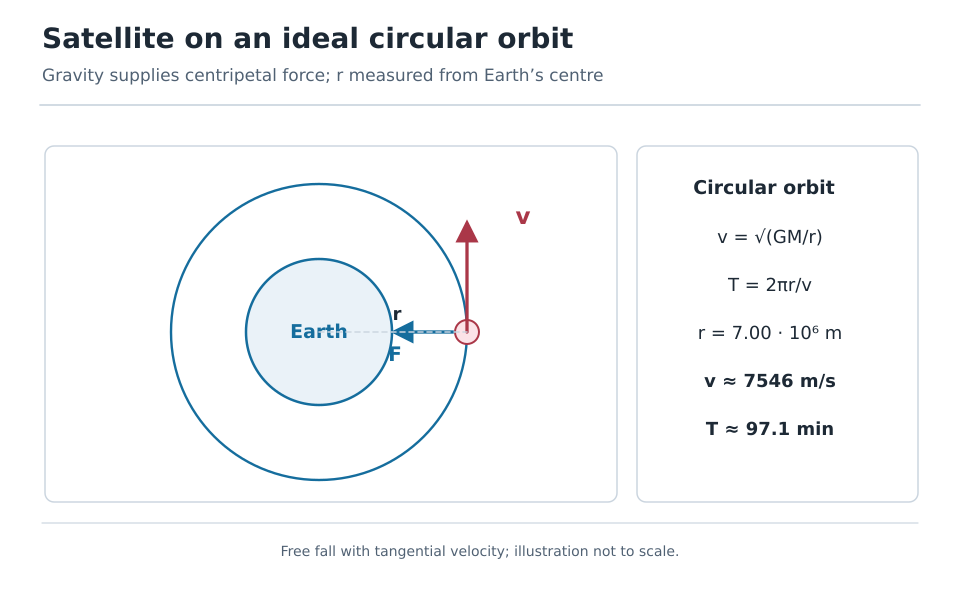

# M15-L5 – Gravity and orbital motion {#L5}

**Course area:** M15 – Conservation laws, collisions and gravitation. **Level:** introductory upper secondary (state-specific scope). **Prerequisite:** [M15-L4](M15-L4.md). **Learning objective:** Apply Newton’s gravitational law to circular satellite orbits and calculate orbital speed and orbital period.

## Starting question {#S1}

Why does a satellite not simply crash into Earth, even though gravity continuously attracts it? Its tangential motion and the curvature of its path must be considered together.

## Concepts and relationships {#S2}

Two point masses $m$ and $M$ separated by $r$ attract with magnitude $F_G=GmM/r^2$, where $G\approx6.6743\cdot10^{-11}\,\mathrm{N\,m^2/kg^2}$. Outside a spherically symmetric mass distribution, the full mass may be treated as concentrated at its centre. The distance $r$ is measured from the **centre of Earth**, not from its surface.

For an **ideal circular orbit**, gravity supplies the required centripetal force: $GmM/r^2=mv^2/r$. Cancelling $m$ gives $v=\sqrt{GM/r}$ and orbital period $T=2\pi r/v=2\pi\sqrt{r^3/(GM)}$. In this simple model, orbital speed does not depend on the satellite's own mass.

The satellite is in **free fall**: velocity is tangent to the path, whereas acceleration points inward to the centre. 'In orbit' does not mean 'outside gravity'. The model neglects residual atmospheric drag in low orbits, Earth's flattening, and perturbations by other bodies. The drawn circular path is not to scale.

*Satellite velocity is tangential while acceleration points toward Earth’s centre.*

## Worked example {#S3}

For an Earth-orbit model, take $GM\approx3.986\cdot10^{14}\,\mathrm{m^3/s^2}$ and orbital radius $r=7.00\cdot10^6\,\mathrm m$ from Earth's centre. Then $v=\sqrt{GM/r}\approx7546\,\mathrm{m/s}$. The circumference is $2\pi r$, so $T\approx2\pi\cdot7.00\cdot10^6/7546\approx5829\,\mathrm s\approx97.1\,\mathrm{min}$. Earth has an approximate mean radius of $6.37\cdot10^6\,\mathrm m$, making this model orbit roughly 630 km above the surface.

## Investigation and practice {#S4}

**Digital-model variation:** Double $r$ while holding the central mass fixed. Compare $F_G$, $v$, and $T$ from their power laws. Label a tangent velocity arrow and an inward radial acceleration arrow.

## Check your learning {#S5}

### Questions

1. What happens to gravitational force when the separation doubles at fixed masses?
2. What happens to circular orbital speed when $r$ doubles?
3. By what factor does period $T$ change when orbital radius doubles?
4. Why must $r=R_\mathrm{Earth}+h$ be used for a satellite near Earth?

### Answers

1. It falls to one quarter: $F_G\propto r^{-2}$.
2. It falls by a factor $\sqrt2$: $v\propto r^{-1/2}$.
3. It increases by $2^{3/2}=2\sqrt2\approx2.83$.
4. Gravity uses centre-to-centre separation, not height above the surface.

## Model limitations {#S6}

Accurate orbital calculations may require a nonspherical gravity model, atmospheric drag, and third-body perturbations. A circular orbit cannot describe arbitrary launch conditions or eccentric paths.

## Further reading (internal) {#S7}

- [M15-L4](M15-L4.md) · Review prerequisite
- [M15-L6](M15-L6.md) · Next lesson

## Sources (external) {#S8}

- [NRW – Upper-secondary Physics core curriculum (2022)](https://lehrplannavigator.nrw.de/system/files/media/document/file/gost_klp_ph_2022_06_07.pdf) · pp. 26, 28: introductory mechanics and circular motion/gravitation; conservation and collisions · Last accessed: 2026-11-21 · Content verified: 2026-11-21
- [Berlin-Brandenburg – Upper-secondary Physics curriculum, Part C (2022)](https://bildungsserver.berlin-brandenburg.de/fileadmin/bbb/unterricht/rahmenlehrplaene/gymnasiale_oberstufe/curricula/2022/Teil_C_RLP_GOST_2022_Physik.pdf) · pp. 21–22: optional introductory-phase momentum and energy; gravity also covered in qualification phase 3.2.1 · Last accessed: 2026-11-21 · Content verified: 2026-11-21
- [OpenStax – University Physics 1, 13.1 Universal Gravitation](https://openstax.org/books/university-physics-volume-1/pages/13-1-newtons-law-of-universal-gravitation) · Section 13.1: gravitational force and dependence on separation · Last accessed: 2026-11-21 · Content verified: 2026-11-21
- [OpenStax – University Physics 1, 13.4 Satellite Orbits](https://openstax.org/books/university-physics-volume-1/pages/13-4-satellite-orbits-and-energy) · Section 13.4: circular orbit, speed and period · Last accessed: 2026-11-21 · Content verified: 2026-11-21

## Evidence {#S9}

