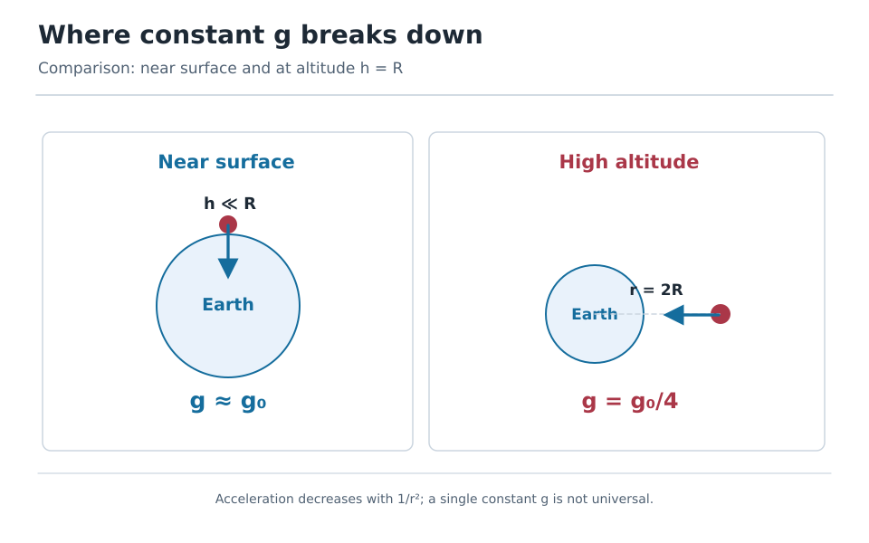

# M15-L6 – Limits of classical models {#L6}

**Course area:** M15 – Conservation laws, collisions and gravitation. **Level:** introductory upper secondary (state-specific scope). **Prerequisite:** [M15-L5](M15-L5.md). **Learning objective:** Evaluate assumptions, domains of validity, and the meaning of measurement discrepancies in spring, collision, and gravitational models.

## Starting question {#S1}

The standard near-surface fall equation often works well in a classroom. Why is the same calculation unsuitable for a satellite, even though both objects are attracted by Earth?

## Concepts and relationships {#S2}

A **model** is a justified simplification. State the system boundary, target observable, assumptions, and range of validity before applying it. Over short distances near Earth's surface, $g\approx\mathrm{constant}$ is often adequate. At greater heights, local gravitational acceleration follows $g(r)=GM/r^2$. At $r=2R_\mathrm{Earth}$, $g(r)=g(R_\mathrm{Earth})/4$.

A **point-mass model** ignores size, rotation, material properties, and internal energy. It can be very effective for tracking centre-of-mass motion; in collisions, deformation, sound, and angular momentum may matter. An ideally elastic collision is a limiting case, not a promise about real carts.

**A measurement discrepancy is not automatically a model failure.** Evaluate uncertainty and the measurement process before deciding whether a difference is statistically plausible or systematic. Conversely, good agreement over a narrow range does not establish universal validity. At much larger scales or extreme speeds, relativity or quantum theory may become necessary; neither is an automatic replacement for every classroom calculation.

Compare models using the same measurable quantity, units, and controlled conditions. A good explanation includes a labelled sketch, governing equation, and explicit statement of assumptions.

*Doubling centre-to-centre distance reduces gravitational acceleration to one quarter.*

## Worked example {#S3}

Let Earth have radius $R$ and surface gravitational acceleration $g_0=GM/R^2$. At height $h=R$, the distance from Earth's centre is $r=R+h=2R$. Hence $g(h)=GM/(2R)^2=g_0/4$. With an illustrative $g_0=9.8\,\mathrm{m/s^2}$, this gives $g(h)=2.45\,\mathrm{m/s^2}$. A constant-$g$ model would be seriously wrong there; the radial dependence must be used. The figure compares accelerations, not fall times or actual satellite measurements.

## Investigation and practice {#S4}

**Model workshop:** Prepare a table for “falling through 1 m”, “falling from great height”, and “colliding model carts”. Mark: point masses? constant $g$? negligible friction? elastic collision? Identify one first measurement for testing each assumption.

## Check your learning {#S5}

### Questions

1. Find $g$ at height $h=R$ as a fraction of $g_0$.
2. Find $g$ at height $h=R/2$ as a fraction of $g_0$.
3. Give two reasons why treating real colliding bodies as point masses may be inadequate.
4. Does agreement at two measurement points prove that a model works over every possible range?

### Answers

1. $g/g_0=1/4$.
2. $r=1.5R$, so $g/g_0=1/(1.5)^2=4/9\approx0.444$.
3. Possible reasons: deformation, rotation, friction, time-dependent contact forces, and thermal transfer.
4. No. Agreement supports a model within its tested range only; uncertainty and alternatives remain relevant.

## Model limitations {#S6}

The $1/r^2$ equation assumes spherical symmetry and Newtonian gravity. Real Earth is not perfectly spherical or homogeneous; rotation and orbital effects are noted as limitations rather than calculated here.

## Further reading (internal) {#S7}

- [M15-L5](M15-L5.md) · Review prerequisite
**Looking ahead:** The next module begins with [M16-L1 – Electric charge and the electric field](M16-L1.md).

## Sources (external) {#S8}

- [NRW – Upper-secondary Physics core curriculum (2022)](https://lehrplannavigator.nrw.de/system/files/media/document/file/gost_klp_ph_2022_06_07.pdf) · pp. 26, 28: introductory mechanics and circular motion/gravitation; conservation and collisions · Last accessed: 2026-11-21 · Content verified: 2026-11-21
- [Berlin-Brandenburg – Upper-secondary Physics curriculum, Part C (2022)](https://bildungsserver.berlin-brandenburg.de/fileadmin/bbb/unterricht/rahmenlehrplaene/gymnasiale_oberstufe/curricula/2022/Teil_C_RLP_GOST_2022_Physik.pdf) · pp. 21–22: optional introductory-phase momentum and energy; gravity also covered in qualification phase 3.2.1 · Last accessed: 2026-11-21 · Content verified: 2026-11-21
- [OpenStax – University Physics 1, 13.1 Universal Gravitation](https://openstax.org/books/university-physics-volume-1/pages/13-1-newtons-law-of-universal-gravitation) · Section 13.1: gravitational force and dependence on separation · Last accessed: 2026-11-21 · Content verified: 2026-11-21
- [OpenStax – University Physics 1, 13.7 Einstein’s Theory of Gravity](https://openstax.org/books/university-physics-volume-1/pages/13-7-einsteins-theory-of-gravity) · Section 13.7: limits of Newtonian gravitation · Last accessed: 2026-11-21 · Content verified: 2026-11-21
- [NIST – Measurement Uncertainty](https://www.nist.gov/itl/sed/topic-areas/measurement-uncertainty) · Metrology reference: account for uncertainty before interpreting model residuals · Last accessed: 2026-11-21 · Content verified: 2026-11-21

## Evidence {#S9}

