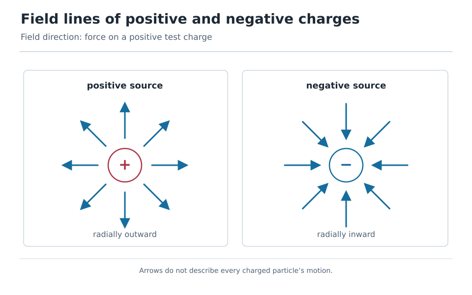

# M16-L1 – Electric charge and the electric field {#L1}

**Course area:** M16 – Electric fields and charge distributions. **Level:** Abitur qualification phase (general core; advanced extensions marked). **Prerequisite:** [M15-L6](M15-L6.md). **Learning objective:** Distinguish source charge, test charge, field direction and field-line conventions.

## Starting question {#S1}

A charged sphere can exert a force on another sphere without touching it. How can this interaction be represented without mistaking a drawn field line for a real wire?

## Concepts and relationships {#S2}

An object carries **electric charge** $Q$ when its positive and negative elementary charge contributions do not balance. The unit is the **coulomb** (C). Like charges repel; unlike charges attract. Charge is conserved: ordinary charging redistributes charge between bodies rather than creating it.

In the **field model**, a source charge changes the electric properties of the space around it. A small **positive test charge** $q>0$ experiences a force $\vec F$ that indicates field direction. The field exists even without a test charge. In an ideal positive point-charge field, field lines point radially outward; for a negative point charge, they point inward. Between opposite charges, lines run from positive to negative. These lines are **representations**, not material threads or mandatory paths of particle motion.

The tangent to a field line gives local field direction; denser lines indicate greater field strength within a consistent diagram convention. Lines cannot cross where the field direction is unique. Arrow direction always corresponds to the force on a *positive* test charge. A negative test charge experiences the opposite force. In the ideal limit, a test charge does not significantly disturb the source field.

*Electric field lines indicate force direction on a positive test charge, not trajectories.*

## Worked example {#S3}

Imagine a positive source charge at the centre of a circle. For a positive test charge placed to the right, left, above and below, draw a force arrow **outward** at each position. Change the test charge to negative: all four force arrows reverse, while the source charge's electric field lines remain outward.

## Investigation and practice {#S4}

**Safe paper-model check:** Draw eight field lines for a positive point source and eight for a negative point source. Add force vectors for positive and negative test charges. Explain why actual extended conducting objects require a different field model.

## Check your learning {#S5}

### Questions

1. What is the SI unit of electric charge?
2. Which way do field lines point near a negative point charge?
3. A positive test charge experiences a force to the right. Which way does $\vec E$ point?
4. Why should field lines not be interpreted as particle trajectories?

### Answers

1. The coulomb (C).
2. Radially inward toward the source charge.
3. Right; field direction is the force direction on a positive test charge.
4. Motion also depends on initial velocity, mass and other forces; field lines show only local direction.

## Model limitations {#S6}

Point charges and isolated stationary sources are idealisations. A real test charge can disturb the field; the picture is not a to-scale force map and ignores time-varying fields.

## Further reading (internal) {#S7}

- [M15-L6](M15-L6.md) · Review prerequisite
- [M16-L2](M16-L2.md) · Next lesson

## Sources (external) {#S8}

- [KMK – Physics standards for the Abitur (2020)](https://www.kmk.org/fileadmin/Dateien/veroeffentlichungen_beschluesse/2020/2020_06_18-BildungsstandardsAHR_Physik.pdf) · p. 20, 2.6.1: field strength, capacitance and capacitor energy at both levels; Coulomb law and potential difference additionally advanced · Last accessed: 2026-11-21 · Content verified: 2026-11-21
- [OpenStax – University Physics 2, 5.4 Electric Field](https://openstax.org/books/university-physics-volume-2/pages/5-4-electric-field) · Section 5.4: field definition, direction, test charge and superposition · Last accessed: 2026-11-21 · Content verified: 2026-11-21
- [LEIFIphysik – Electric field and field-line representation](https://www.leifiphysik.de/elektrizitaetslehre/ladungen-elektrisches-feld/grundwissen/elektrisches-feld-und-feldliniendarstellung) · Background: field strength, direction and uniform field · Last accessed: 2026-11-21 · Content verified: 2026-11-21

## Evidence {#S9}

