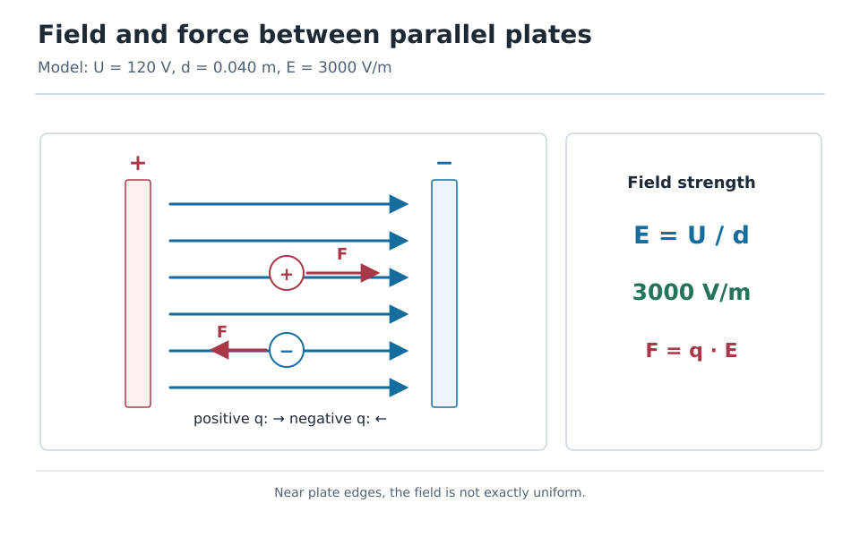

# M16-L2 – Field strength and a uniform electric field {#L2}

**Course area:** M16 – Electric fields and charge distributions. **Level:** Abitur qualification phase (general core; advanced extensions marked). **Prerequisite:** [M16-L1](M16-L1.md). **Learning objective:** Calculate electric field strength as force per charge and in an ideal uniform plate field.

## Starting question {#S1}

Two test charges of different size feel forces of different magnitude in the same plate field. How can we define a property of the location rather than of the test charge?

## Concepts and relationships {#S2}

The electric **field strength** vector is $\vec E=\vec F/q$ for a sufficiently small test charge. Its units are $\mathrm{N/C}$, equivalently $\mathrm{V/m}$. For $q>0$, $\vec E$ and $\vec F$ point the same way; for $q<0$ they point in opposite directions. The quotient characterises the source field, whereas the force alone does not.

Between large parallel plates carrying opposite charges, the field is approximately **uniform** in the central region: field lines are straight, parallel and evenly spaced. Neglecting edge effects, its magnitude is $E=U/d$, where $U$ is the potential difference and $d$ is the separation. Thus $1\,\mathrm{V/m}=1\,\mathrm{N/C}$. The field curves near plate edges, so the uniform-field approximation breaks down there.

The formula $E=U/d$ describes the magnitude of an idealised parallel-plate field, not every electric field. A charge in the field experiences $\vec F=q\vec E$. The direction of its acceleration depends on its sign. An electric field can change a particle's trajectory, but mass and initial velocity are also required to predict that trajectory.

*At 120 V across 4 cm, the ideal field is 3000 V/m; charge sign determines force direction.*

## Worked example {#S3}

An ideal plate system has $U=120\,\mathrm V$ across $d=0.040\,\mathrm m$. Therefore $E=120/0.040=3000\,\mathrm{V/m}$. A positive test charge $q=2.0\,\mathrm{\mu C}=2.0\cdot10^{-6}\,\mathrm C$ experiences $F=qE=0.0060\,\mathrm N$ in the field direction. A negative charge of equal magnitude experiences the same force magnitude in the opposite direction.

## Investigation and practice {#S4}

**Paper-model investigation:** Draw plates labelled 120 V and 4 cm apart, then calculate the field at 2 cm with the same voltage. Discuss why a rising field at reduced spacing is not permission to build a hazardous high-voltage arrangement. Do not construct mains-voltage or exposed high-voltage experiments.

## Check your learning {#S5}

### Questions

1. What are the equivalent SI units of electric field strength?
2. Calculate $E$ for $U=60\,\mathrm V$ and $d=0.020\,\mathrm m$.
3. What force acts on $q=-3\,\mathrm{\mu C}$ for $E=2000\,\mathrm{N/C}$?
4. Does $E=U/d$ hold everywhere around finite plates?

### Answers

1. $\mathrm{N/C}=\mathrm{V/m}$.
2. $E=3000\,\mathrm{V/m}$.
3. $|F|=0.006\,\mathrm N$ opposite to field direction.
4. No. It approximates the uniform central region; edge effects change the field.

## Model limitations {#S6}

The plate model ignores edge fields, breakdown, space charge and test-charge effects. The numerical voltage is a calculation, not a recommended experiment.

## Further reading (internal) {#S7}

- [M16-L1](M16-L1.md) · Review prerequisite
- [M16-L3](M16-L3.md) · Next lesson

## Sources (external) {#S8}

- [KMK – Physics standards for the Abitur (2020)](https://www.kmk.org/fileadmin/Dateien/veroeffentlichungen_beschluesse/2020/2020_06_18-BildungsstandardsAHR_Physik.pdf) · p. 20, 2.6.1: field strength, capacitance and capacitor energy at both levels; Coulomb law and potential difference additionally advanced · Last accessed: 2026-11-21 · Content verified: 2026-11-21
- [OpenStax – University Physics 2, 5.4 Electric Field](https://openstax.org/books/university-physics-volume-2/pages/5-4-electric-field) · Section 5.4: field definition, direction, test charge and superposition · Last accessed: 2026-11-21 · Content verified: 2026-11-21
- [LEIFIphysik – Electric field and field-line representation](https://www.leifiphysik.de/elektrizitaetslehre/ladungen-elektrisches-feld/grundwissen/elektrisches-feld-und-feldliniendarstellung) · Background: field strength, direction and uniform field · Last accessed: 2026-11-21 · Content verified: 2026-11-21
- [LEIFIphysik – Potential and electric voltage](https://www.leifiphysik.de/elektrizitaetslehre/ladungen-elektrisches-feld/grundwissen/potential-und-elektrische-spannung) · Background: electrical work, voltage and potential · Last accessed: 2026-11-21 · Content verified: 2026-11-21

## Evidence {#S9}

