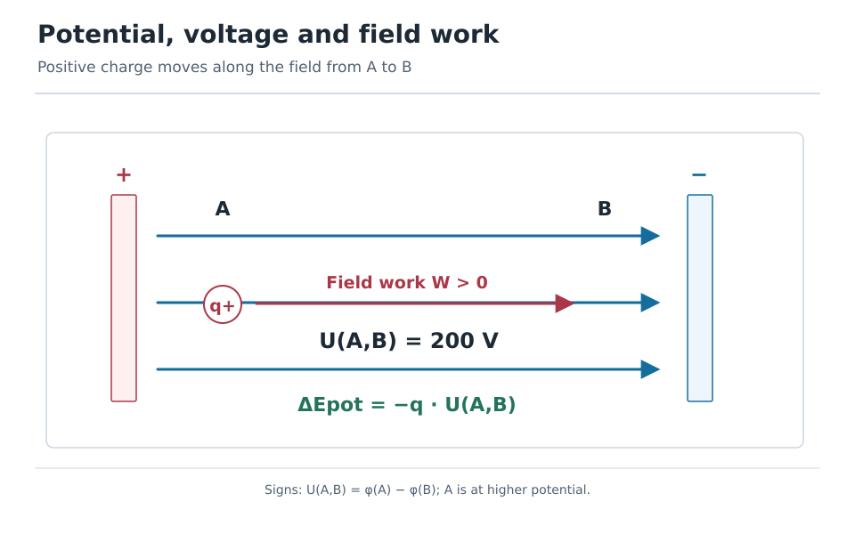

# M16-L3 – Electric work, energy and potential {#L3}

**Course area:** M16 – Electric fields and charge distributions. **Level:** Abitur qualification phase (general core; advanced extensions marked). **Prerequisite:** [M16-L2](M16-L2.md). **Learning objective:** Calculate electrical energy changes from charge and voltage, explaining potential difference as an advanced-level extension.

## Starting question {#S1}

A charge moves in an electric field. The field force can turn potential energy into kinetic energy. How much energy is transferred, and whose work has a positive sign?

## Concepts and relationships {#S2}

In an electrostatic field, electric **potential energy** can be converted into kinetic energy. For two points A and B, define voltage $U_{AB}=\varphi_A-\varphi_B$ as the potential difference. Electric potential $\varphi$ is potential energy per unit charge, and its zero level is arbitrary. Treating this as a separate field concept is an **additional advanced-level topic** in the KMK standards.

For the work **done by the electric field** as charge $q$ travels from A to B, $W_{\mathrm{field}}=qU_{AB}=-\Delta E_{\mathrm{pot}}$. For positive charge moving from higher to lower potential, field work is positive and potential energy falls. For negative charge, include the sign of $q$. An external force slowly moving a charge against the field does work with the opposite sign.

For displacement $d$ along a uniform field from A to B, $U_{AB}=Ed$ when $d$ is the positive distance along the field. Voltage is not force: $1\,\mathrm V=1\,\mathrm{J/C}$. The **electronvolt** (eV) is a unit of energy: $1\,\mathrm{eV}=1.602176634\cdot10^{-19}\,\mathrm J$. It equals the magnitude of energy gained or lost by one elementary charge crossing a one-volt potential difference.

*For q > 0 and U(A,B) > 0, field work is positive and potential energy decreases.*

## Worked example {#S3}

A positive charge $q=+3.0\,\mathrm{nC}$ moves from A to B with $U_{AB}=200\,\mathrm V$. The field does $W=qU_{AB}=3.0\cdot10^{-9}\cdot200=6.0\cdot10^{-7}\,\mathrm J=0.60\,\mathrm{\mu J}$. The potential-energy change is $-0.60\,\mathrm{\mu J}$. With the same displacement and a negative charge, field work reverses sign.

## Investigation and practice {#S4}

**Sign-convention exercise:** Sketch two plates and points A and B. For both signs of $q$, label $\vec E$, $\vec F$, $W_{\mathrm{field}}$ and $\Delta E_{\mathrm{pot}}$ separately. Always check the definition $U_{AB}=\varphi_A-\varphi_B$.

## Check your learning {#S5}

### Questions

1. What field work is done when $q=2\,\mathrm{\mu C}$ crosses $U_{AB}=5\,\mathrm V$ from A to B?
2. What is the SI unit of electric potential?
3. If $q>0$ and $U_{AB}<0$, what is the sign of $W_{\mathrm{field}}$?
4. Why is $\Delta E_{\mathrm{pot}}=-W_{\mathrm{field}}$ rather than always $+W_{\mathrm{field}}$?

### Answers

1. $W=1.0\cdot10^{-5}\,\mathrm J=10\,\mathrm{\mu J}$.
2. Volt, equivalent to joule per coulomb.
3. Negative: the electric field does negative work for that displacement.
4. Positive field work comes from a decrease in potential energy; the two changes have opposite signs by definition.

## Model limitations {#S6}

This energy treatment applies to stationary conservative electric fields. Electric fields induced by changing magnetic fields cannot always be represented globally by a single scalar potential.

## Further reading (internal) {#S7}

- [M16-L2](M16-L2.md) · Review prerequisite
- [M16-L4](M16-L4.md) · Next lesson

## Sources (external) {#S8}

- [KMK – Physics standards for the Abitur (2020)](https://www.kmk.org/fileadmin/Dateien/veroeffentlichungen_beschluesse/2020/2020_06_18-BildungsstandardsAHR_Physik.pdf) · p. 20, 2.6.1: field strength, capacitance and capacitor energy at both levels; Coulomb law and potential difference additionally advanced · Last accessed: 2026-11-21 · Content verified: 2026-11-21
- [OpenStax – University Physics 2, 7.2 Electric Potential and Potential Difference](https://openstax.org/books/university-physics-volume-2/pages/7-2-electric-potential-and-potential-difference) · Section 7.2: potential difference, work and energy · Last accessed: 2026-11-21 · Content verified: 2026-11-21
- [LEIFIphysik – Potential and electric voltage](https://www.leifiphysik.de/elektrizitaetslehre/ladungen-elektrisches-feld/grundwissen/potential-und-elektrische-spannung) · Background: electrical work, voltage and potential · Last accessed: 2026-11-21 · Content verified: 2026-11-21

## Evidence {#S9}

