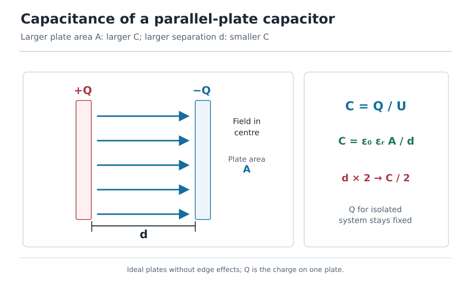

# M16-L4 – Capacitance and charge storage {#L4}

**Course area:** M16 – Electric fields and charge distributions. **Level:** Abitur qualification phase (general core; advanced extensions marked). **Prerequisite:** [M16-L3](M16-L3.md). **Learning objective:** Determine capacitance from charge and voltage and interpret its geometrical dependence for parallel plates.

## Starting question {#S1}

Why can a large capacitor hold more separated charge than a small one at the same voltage? The source voltage is not the only factor: conductor geometry matters.

## Concepts and relationships {#S2}

A **capacitor** consists of two conducting regions insulated from each other. When charged, they carry opposite charges $+Q$ and $-Q$, so total charge of an initially neutral two-plate assembly remains zero. $Q$ denotes the **magnitude** of charge on one plate. **Capacitance** is $C=Q/U$, measured in farads: $1\,\mathrm F=1\,\mathrm{C/V}$.

For ideal parallel plates of area $A$ separated by $d$ with a linear homogeneous dielectric, approximately $C=\varepsilon_0\varepsilon_r A/d$, where $\varepsilon_0\approx8.854\cdot10^{-12}\,\mathrm{F/m}$. Greater plate area raises capacitance; greater spacing lowers it. $\varepsilon_r$ is dimensionless. This model requires plate separation to be small compared with plate dimensions so that edge fields can be neglected.

A capacitor **stores energy in the electric field**, not usable net charge. In an isolated charged capacitor, $Q$ remains approximately constant; when attached to an ideal voltage supply, $U$ remains constant and $Q$ may change as geometry changes. Those are different boundary conditions and should not be mixed.

*For ideal plates, capacitance increases with area and decreases with separation.*

## Worked example {#S3}

An ideal capacitor with $C=4.7\,\mathrm{\mu F}$ is held at $U=12\,\mathrm V$. Charge magnitude on one plate is $Q=CU=4.7\cdot10^{-6}\cdot12=56.4\cdot10^{-6}\,\mathrm C=56.4\,\mathrm{\mu C}$. The opposite plate carries $-56.4\,\mathrm{\mu C}$ if the assembly started neutral.

## Investigation and practice {#S4}

**Simulation comparison:** Sketch two similar parallel-plate capacitors with separations d and 2d, respectively, at equal plate area. Compare an attached voltage supply with an isolated charged capacitor as separate situations. Do not open electronic appliances or touch potentially charged capacitors.

## Check your learning {#S5}

### Questions

1. Find $C$ for $Q=20\,\mathrm{\mu C}$ and $U=10\,\mathrm V$.
2. Find $Q$ for $C=220\,\mathrm{nF}$ and $U=5\,\mathrm V$.
3. What happens to capacitance when d is doubled in the ideal plate model?
4. Which quantity stays approximately constant for a charged, ideally isolated capacitor?

### Answers

1. $C=2.0\,\mathrm{\mu F}$.
2. $Q=1.10\,\mathrm{\mu C}$.
3. Capacitance is halved at unchanged area and dielectric.
4. The magnitude Q on a plate, provided no charge flows in or out.

## Model limitations {#S6}

The plate model neglects fringing fields, leakage and voltage-dependent dielectric properties. Charge can remain after disconnecting a supply; real capacitors may be hazardous.

## Further reading (internal) {#S7}

- [M16-L3](M16-L3.md) · Review prerequisite
- [M16-L5](M16-L5.md) · Next lesson

## Sources (external) {#S8}

- [KMK – Physics standards for the Abitur (2020)](https://www.kmk.org/fileadmin/Dateien/veroeffentlichungen_beschluesse/2020/2020_06_18-BildungsstandardsAHR_Physik.pdf) · p. 20, 2.6.1: field strength, capacitance and capacitor energy at both levels; Coulomb law and potential difference additionally advanced · Last accessed: 2026-11-21 · Content verified: 2026-11-21
- [OpenStax – University Physics 2, 8.1 Capacitors and Capacitance](https://openstax.org/books/university-physics-volume-2/pages/8-1-capacitors-and-capacitance) · Section 8.1: capacitance and parallel-plate geometry · Last accessed: 2026-11-21 · Content verified: 2026-11-21
- [LEIFIphysik – Capacitors and capacitance](https://www.leifiphysik.de/elektrizitaetslehre/kondensator-kapazitaet) · Topic overview: charge, capacitance and plates · Last accessed: 2026-11-21 · Content verified: 2026-11-21

## Evidence {#S9}

