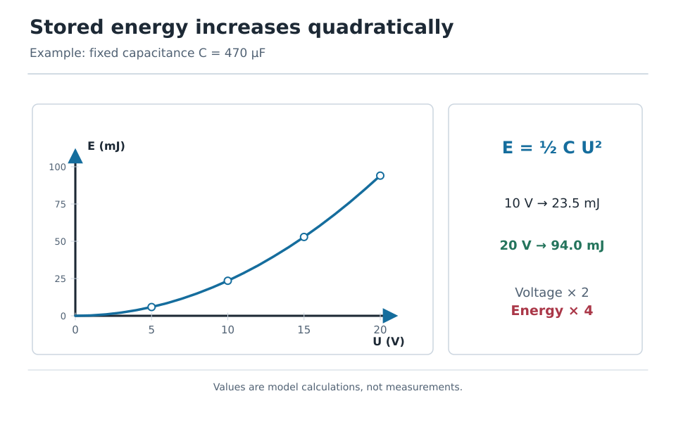

# M16-L5 – Energy stored in a capacitor and applications {#L5}

**Course area:** M16 – Electric fields and charge distributions. **Level:** Abitur qualification phase (general core; advanced extensions marked). **Prerequisite:** [M16-L4](M16-L4.md). **Learning objective:** Determine capacitor energy from C and U and explain its quadratic dependence on voltage.

## Starting question {#S1}

A capacitor is charged first to 10 V and then to 20 V. Voltage doubles. Does the stored energy merely double?

## Concepts and relationships {#S2}

An ideal capacitor with constant capacitance $C$ obeys $Q=CU$. During charging, the voltage rises from zero to its final value $U$. The external work needed for a small increment $\mathrm dQ$ is $\mathrm dW=U(Q)\,\mathrm dQ$; voltage is **not constant** during charging. The area under $U(Q)=Q/C$ gives

$$E_{\mathrm{cap}}=\int_0^Q\frac{Q'}{C}\,\mathrm dQ'=\frac{Q^2}{2C}=\frac12 CU^2=\frac12 QU.$$

The unit is the joule. The triangular area in the $U$ versus $Q$ plot explains the **one-half** factor; simply using QU overcounts the stored energy. At **constant C**, doubling U quadruples energy. Real capacitors have leakage, internal resistances and sometimes variable C, which affect the balance.

Capacitors are used for short energy bursts, smoothing and signal processing; they are not automatically equivalent to batteries. Stored charge can remain hazardous after a device has been disconnected from power. Use only calculations or approved simulations here.

*At fixed capacitance, doubling voltage quadruples stored energy.*

## Worked example {#S3}

For $C=470\,\mathrm{\mu F}=470\cdot10^{-6}\,\mathrm F$ and $U=10\,\mathrm V$, $E=\tfrac12\cdot470\cdot10^{-6}\cdot100=0.0235\,\mathrm J=23.5\,\mathrm{mJ}$. At $20\,\mathrm V$, $E=0.0940\,\mathrm J=94.0\,\mathrm{mJ}$, four times as much. The corresponding magnitudes of plate charge are 4.7 mC and 9.4 mC, assuming constant capacitance.

## Investigation and practice {#S4}

**Spreadsheet/paper investigation:** For fixed $C=470\,\mathrm{\mu F}$, calculate energy at 0, 5, 10, 15 and 20 V. Plot $E(U)$ and $U(Q)$. Explain why one graph is curved and the other straight. Do not perform a real charging experiment with a large capacitor.

## Check your learning {#S5}

### Questions

1. Find $E$ for $C=100\,\mathrm{\mu F}$ and $U=10\,\mathrm V$.
2. What is the energy for the same capacitance at 20 V?
3. Why does $E=\frac12 CU^2$ include one-half?
4. How does $E$ change if C is halved while Q remains constant?

### Answers

1. $E=0.0050\,\mathrm J=5.0\,\mathrm{mJ}$.
2. $E=0.020\,\mathrm J=20\,\mathrm{mJ}$.
3. Voltage increases linearly with charge while charging; the area under the curve is a triangle.
4. Energy doubles because $E=Q^2/(2C)$; work or energy transfer must be included.

## Model limitations {#S6}

These equations require a linear, time-independent capacitance. A supply-connected capacitor has different boundary conditions from an isolated one; discharge losses and breakdown are omitted.

## Further reading (internal) {#S7}

- [M16-L4](M16-L4.md) · Review prerequisite
- [M16-L6](M16-L6.md) · Next lesson

## Sources (external) {#S8}

- [KMK – Physics standards for the Abitur (2020)](https://www.kmk.org/fileadmin/Dateien/veroeffentlichungen_beschluesse/2020/2020_06_18-BildungsstandardsAHR_Physik.pdf) · p. 20, 2.6.1: field strength, capacitance and capacitor energy at both levels; Coulomb law and potential difference additionally advanced · Last accessed: 2026-11-21 · Content verified: 2026-11-21
- [OpenStax – University Physics 2, 8.3 Energy Stored in a Capacitor](https://openstax.org/books/university-physics-volume-2/pages/8-3-energy-stored-in-a-capacitor) · Section 8.3: stored electrical energy · Last accessed: 2026-11-21 · Content verified: 2026-11-21
- [LEIFIphysik – Energy stored in a charged capacitor](https://www.leifiphysik.de/elektrizitaetslehre/kondensator-kapazitaet/grundwissen/elektrische-energie-im-geladenen-kondensator) · Background: energy formula from the triangular area · Last accessed: 2026-11-21 · Content verified: 2026-11-21

## Evidence {#S9}

