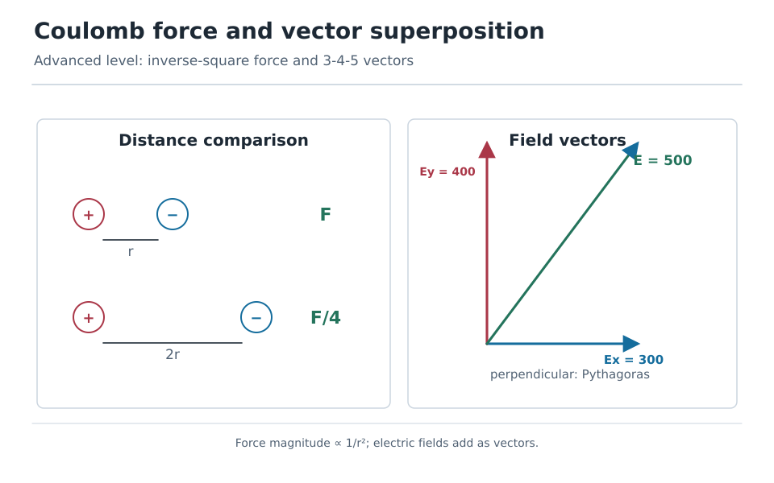

# M16-L6 – Advanced level: Coulomb’s law and superposition {#L6}

**Course area:** M16 – Electric fields and charge distributions. **Level:** Abitur qualification phase (general core; advanced extensions marked). **Prerequisite:** [M16-L5](M16-L5.md). **Learning objective:** Calculate Coulomb forces including signs, distance and vector direction, and add electric-field vectors.

## Starting question {#S1}

Two point charges are moved twice as far apart. How strongly does their force change? And how can the electric field from several source charges be calculated?

## Concepts and relationships {#S2}

For stationary **point charges** in vacuum, the magnitude of electric force is $F=k\,|Q_1Q_2|/r^2$ with $k=1/(4\pi\varepsilon_0)\approx8.99\cdot10^9\,\mathrm{N\,m^2/C^2}$. Like charges repel; unlike charges attract. Doubling $r$ divides the force by four. Doubling just one charge magnitude doubles it.

The **superposition principle** requires field contributions from individual charges at the point of interest to be added as **vectors**: $\vec E_{\mathrm{net}}=\sum_i\vec E_i$. A positive point source has an outward radial field, while a negative source has an inward one. For perpendicular components, $E=\sqrt{E_x^2+E_y^2}$, not just $E_x+E_y$. At other angles, resolve each vector into components.

Coulomb's law is an **additional advanced-level topic** under the KMK Abitur standards. Field concepts and electric field strength also belong to the general-level core. Superposition is a useful advanced treatment of the model; the exact problem difficulty varies by state.

*Doubling separation quarters the Coulomb force; perpendicular components 300 and 400 N/C combine to 500 N/C.*

## Worked example {#S3}

Two point charges $Q_1=+2.0\,\mathrm{\mu C}$ and $Q_2=-3.0\,\mathrm{\mu C}$ are $r=0.30\,\mathrm m$ apart. $F=8.99\cdot10^9\cdot(2\cdot10^{-6})(3\cdot10^{-6})/(0.30)^2\approx0.599\,\mathrm N$. The force is **attractive**. In a separate model, two perpendicular field components $E_x=300\,\mathrm{N/C}$ and $E_y=400\,\mathrm{N/C}$ yield a magnitude of $500\,\mathrm{N/C}$ at angle $\arctan(4/3)\approx53.1^\circ$ above the +x-axis.

## Investigation and practice {#S4}

**Vector drawing:** Draw perpendicular field vectors 3 cm and 4 cm long at a scale of 1 cm = 100 N/C. Add the 5-cm resultant and measure its angle. Repeat with one vector reversed. Do not perform high-voltage or electrostatic-discharge experiments.

## Check your learning {#S5}

### Questions

1. How does Coulomb force change when distance is doubled?
2. Find the force for $Q_1=Q_2=+1\,\mathrm{\mu C}$ at $r=0.10\,\mathrm m$.
3. In which direction does the field point around a negative point charge?
4. Find the resultant of perpendicular components $E_x=60$ and $E_y=80\,\mathrm{N/C}$.

### Answers

1. It becomes one-quarter as large.
2. $F=8.99\cdot10^9\cdot10^{-12}/0.01\approx0.899\,\mathrm N$, repulsive.
3. Radially inward toward the negative source charge.
4. $E=\sqrt{60^2+80^2}=100\,\mathrm{N/C}$.

## Model limitations {#S6}

Point charges, vacuum, electrostatics and fixed source charges are assumptions. Extended objects have charge distributions; matter and rapidly changing fields require more detailed models.

## Further reading (internal) {#S7}

- [M16-L5](M16-L5.md) · Review prerequisite
**Looking ahead:** The next module begins with [M17-L1 – Magnetic flux density and field models](M17-L1.md).

## Sources (external) {#S8}

- [KMK – Physics standards for the Abitur (2020)](https://www.kmk.org/fileadmin/Dateien/veroeffentlichungen_beschluesse/2020/2020_06_18-BildungsstandardsAHR_Physik.pdf) · p. 20, 2.6.1: field strength, capacitance and capacitor energy at both levels; Coulomb law and potential difference additionally advanced · Last accessed: 2026-11-21 · Content verified: 2026-11-21
- [OpenStax – University Physics 2, 5.3 Coulomb’s Law](https://openstax.org/books/university-physics-volume-2/pages/5-3-coulombs-law) · Section 5.3: Coulomb law, inverse-square dependence and charge signs · Last accessed: 2026-11-21 · Content verified: 2026-11-21
- [OpenStax – University Physics 2, 5.4 Electric Field](https://openstax.org/books/university-physics-volume-2/pages/5-4-electric-field) · Section 5.4: field definition, direction, test charge and superposition · Last accessed: 2026-11-21 · Content verified: 2026-11-21
- [LEIFIphysik – Electric field and field-line representation](https://www.leifiphysik.de/elektrizitaetslehre/ladungen-elektrisches-feld/grundwissen/elektrisches-feld-und-feldliniendarstellung) · Background: field strength, direction and uniform field · Last accessed: 2026-11-21 · Content verified: 2026-11-21

## Evidence {#S9}

