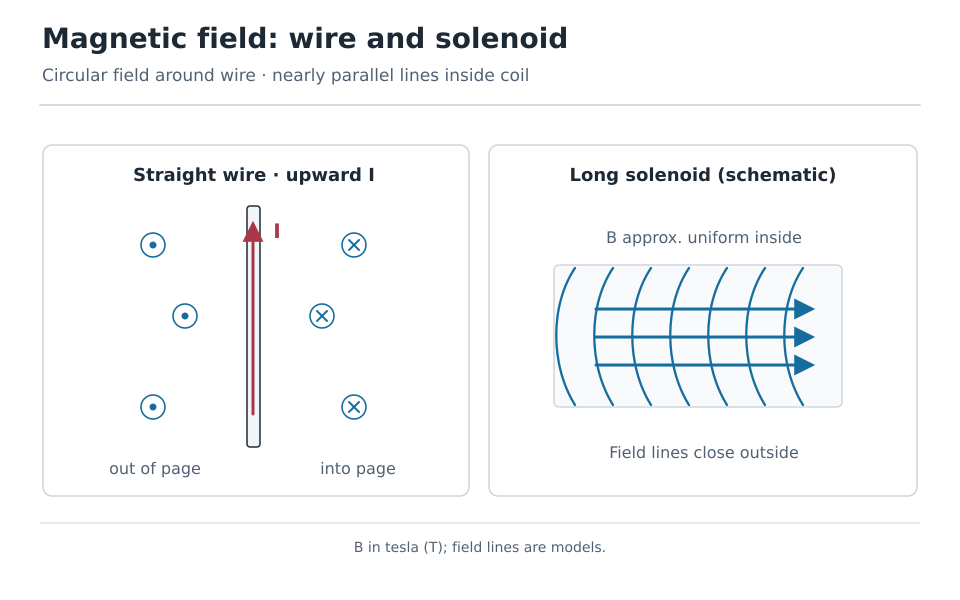

# M17-L1 – Magnetic flux density and field models {#L1}

**Course area:** M17 – Magnetic fields and charged-particle motion. **Level:** qualification phase, advanced material marked. **Prerequisite:** [M16-L6](M16-L6.md). **Learning objective:** Interpret magnetic flux density B in tesla and explain field representations of a straight wire and a solenoid.

## Starting question {#S1}

A compass needle changes direction near a wire carrying a current. What determines the new alignment, and how do we represent the magnetic effect?

## Concepts and relationships {#S2}

A **magnetic field** is a physical field whose direction and strength are described by the vector **magnetic flux density** $\vec B$. Its SI unit is the **tesla** (T). The field exists even if no compass is placed inside it. A magnetic field line is an imaginary representation: its tangent gives the local direction of the field, not necessarily a particle trajectory. Magnetic field lines form closed loops. Outside a bar magnet they run from north to south and return within the magnet. No isolated magnetic poles have been observed.

Around a long, straight conductor carrying a current, magnetic field lines form circles. For **conventional current**, the right-hand grip rule applies: point your thumb along the current; curled fingers indicate the direction of $\vec B$. In a long current-carrying solenoid the lines are approximately parallel inside and curve around outside. For an ideal, sufficiently long air-core solenoid, $B\approx\mu_0 nI$ with turn density $n$ and current $I$. This is not a universal expression for every real coil.

Magnetic flux density must not be confused with magnetic flux $\Phi$, which describes the field component passing through an area and is studied in M18. The KMK Abitur standards place B in the common core of the general and advanced levels. Equations for special conductor geometries can be state-dependent extensions.

*Field lines illustrate direction and structure, not exact calibrated values.*

## Worked example {#S3}

A model uniform field has $B=0.080\,\mathrm T$, equal to $80\,\mathrm{mT}$ or $80{,}000\,\mathrm{\mu T}$. If the current in an ideal, long air-core solenoid is doubled at constant $n$, B doubles. Real coils do not necessarily follow this proportionality.

## Investigation and practice {#S4}

**Safe paper task:** For an upward conventional current in a wire in the drawing plane, mark the field direction on either side using dot-and-cross symbols. Then compare a schematic solenoid. Physical demonstrations involving currents and magnets require supervised risk assessment; do not use strong magnets near medical implants.

## Check your learning {#S5}

### Questions

1. What is the SI unit of magnetic flux density?
2. What does a tangent to a magnetic field line show?
3. What is the field-line pattern around a straight wire?
4. Convert $B=0.025\,\mathrm T$ into millitesla.

### Answers

1. Tesla (T).
2. The local direction of $\vec B$.
3. Circular loops around the wire, with direction given by the right-hand grip rule for conventional current.
4. $25\,\mathrm{mT}$.

## Model limitations {#S6}

An infinitely long straight wire and long solenoid are idealized geometries. The density of drawn lines is a convention; the diagram alone does not yield a calibrated field strength.

## Further reading (internal) {#S7}

- [M16-L6](M16-L6.md) · Review prerequisite
- [M17-L2](M17-L2.md) · Next lesson

## Sources (external) {#S8}

- [KMK – Physics standards for the Abitur (2020)](https://www.kmk.org/fileadmin/Dateien/veroeffentlichungen_beschluesse/2020/2020_06_18-BildungsstandardsAHR_Physik.pdf) · p. 20, §2.6.1: magnetic flux density and qualitative paths in the common core; quantitative trajectories as an advanced addition · Last accessed: 2026-11-21 · Content verified: 2026-11-21
- [OpenStax – University Physics 2, 11.2 Magnetic Fields and Lines](https://openstax.org/books/university-physics-volume-2/pages/11-2-magnetic-fields-and-lines) · Section 11.2: magnetic field, Lorentz force, tesla and direction conventions · Last accessed: 2026-11-21 · Content verified: 2026-11-21
- [OpenStax – University Physics 2, 11.4 Magnetic Force on a Current-Carrying Conductor](https://openstax.org/books/university-physics-volume-2/pages/11-4-magnetic-force-on-a-current-carrying-conductor) · Section 11.4: circular field around a conductor and conventional current · Last accessed: 2026-11-21 · Content verified: 2026-11-21
- [DGUV – Safe Schools, physics: working with electricity](https://www.sichere-schule.de/physik/praktisches-arbeiten/elektrik) · Electromagnetic field precautions, medical implants and supervised electrical experiments · Last accessed: 2026-11-21 · Content verified: 2026-11-21

## Evidence {#S9}

